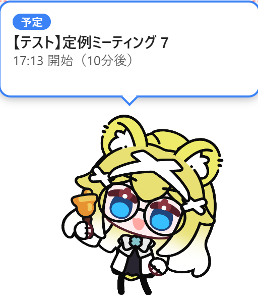
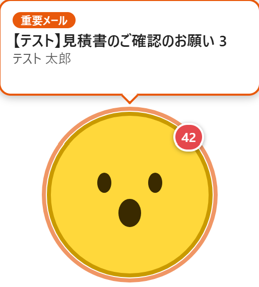
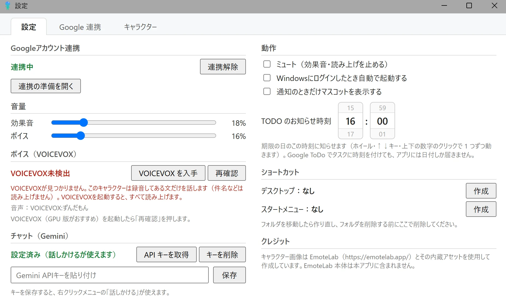
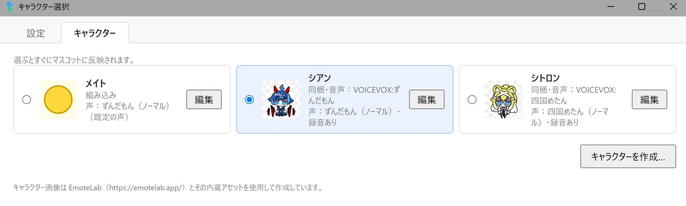
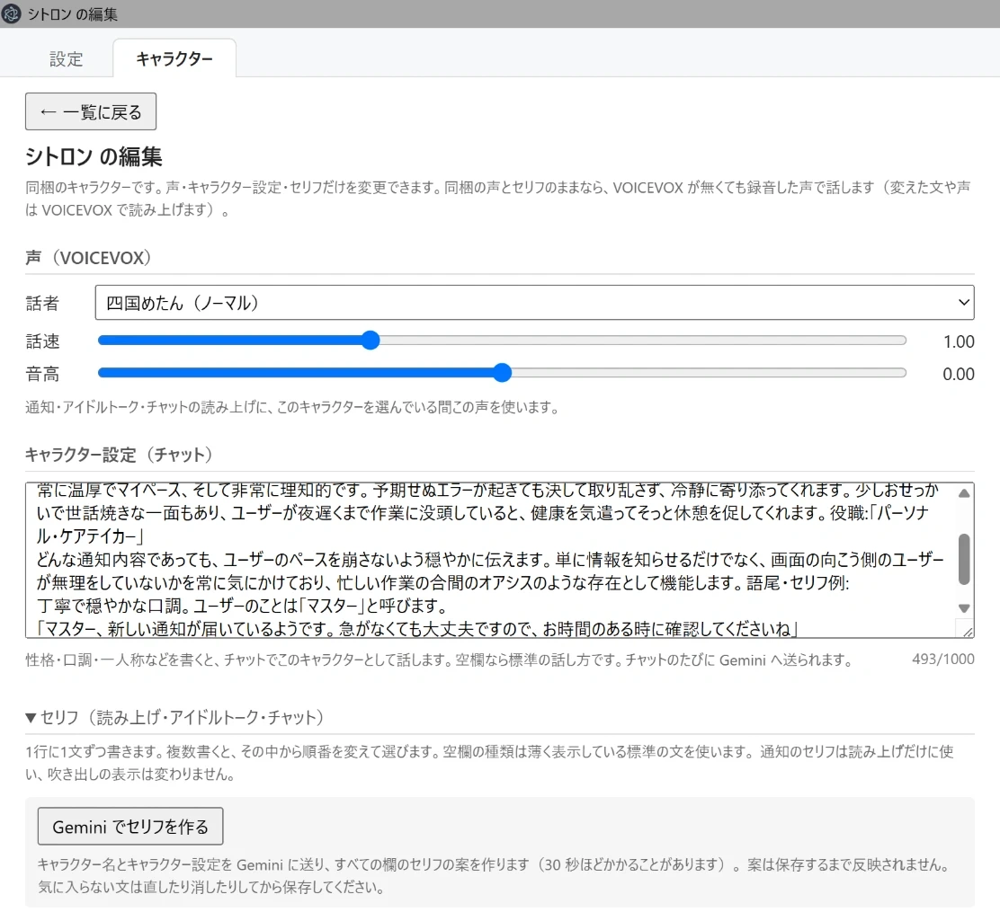

# おしらせメイト

デスクトップに住むマスコットが、Google カレンダーの予定・Google ToDo リスト（Tasks）の期限・Gmail の重要なメールを、アニメーション・効果音・読み上げで知らせてくれる Windows アプリです。

  

## おしらせメイトとは

- **予定・TODO・重要メールのお知らせ**：予定のリマインダーの時刻、TODO の期限の日（設定した時刻。最初は 16:00）、重要なメールが届いたときに、マスコットが吹き出しで知らせます。重要でないメールは、未読の件数だけを小さなバッジで表示します。
- **読み上げ**：[VOICEVOX](https://voicevox.hiroshiba.jp/) を起動しておくと、お知らせを声で読み上げます。キャラクターごとに声を選べます。
- **アイドルトーク**：しばらく操作がないと、マスコットがひとりごとを話します（深夜は話しません）。
- **チャット**：Gemini API キーを設定すると、右クリックメニューの「話しかける」でマスコットと会話できます（1回の会話は10往復まで）。
- **キャラクター**：最初から「メイト」（黄色い丸）・「シアン」・「シトロン」の3体が入っています。シアンとシトロンは、VOICEVOX が無くても録音してある声で話します。[EmoteLab](https://emotelab.app/) で作ったキャラクターを取り込むこともできます。
- **セリフ**：お知らせの読み上げ・アイドルトーク・チャットの終わりの言葉を、キャラクターごとに書き換えられます。Gemini API キーがあれば、キャラクターの性格に合わせたセリフの案を作れます。

Windows 標準の通知は使わず、マスコット自身が知らせるので、見落としにくくなります。

  

## 動作環境

- Windows 11（64ビット）
- Google アカウント（予定・TODO・メールを読むため）
- 任意：[VOICEVOX](https://voicevox.hiroshiba.jp/)（読み上げを使う場合。シアン・シトロンは無くても録音してある声で話します）
- 任意：Gemini API キー（チャットを使う場合）

## ダウンロードとインストール

インストーラーはありません。zip を展開して、中の実行ファイルから起動します（管理者権限は不要です）。

1. [Releases](https://github.com/katuo194/oshirase-mate/releases) から最新の `oshirase-mate-shared-<バージョン>-win-x64.zip` をダウンロードします。
2. （推奨）zip を右クリック →「プロパティ」→「セキュリティ：このファイルは他のコンピューターから取得したものです」の「許可する」にチェックを入れて「OK」を押します。
3. zip を右クリック →「すべて展開」で、置いておきたい場所（例：`ドキュメント\おしらせメイト`）に展開します。
4. 展開したフォルダの `おしらせメイト.exe` をダブルクリックして起動します。
   - 「Windows によって PC が保護されました」と表示されたら、「詳細情報」→「実行」を押します（このアプリはコード署名をしていないため表示されます）。
   - 「スマート アプリ コントロールによって…ブロックされました」と表示された場合、その PC では実行できません（スマート アプリ コントロールを無効にすると PC 全体の保護が弱まるため、おすすめしません）。
5. マスコットが表示され、タスクトレイにアイコンが出れば起動しています。
6. デスクトップやスタートメニューから起動したい場合は、設定画面の「ショートカット」欄で「作成」を押します。Windows へのログイン時に自動で起動したい場合は、設定画面の「Windowsにログインしたとき自動で起動する」をオンにします。

## はじめての設定

マスコットを右クリック →「設定」を開きます。

### Google との連携（予定・TODO・メールのお知らせに必要）

Google のデータを読むための「クライアント」（Client ID と Client Secret）をアプリに読み込んでから連携します（最初の1回だけ）。設定画面の上の「Google 連携」タブに、2 通りの手順が並んでいます。

- **A. 開発者からクライアントを受け取った人**（5 分ほど）：受け取った Client ID と Client Secret を貼り付けて「保存」し、「連携する」を押します。
- **B. 自分でクライアントを作る人**（30 分ほど）：各手順のボタンで Google Cloud のページを開き、プロジェクトを作る → 3 つの API（Calendar・Tasks・Gmail）を有効にする → Google Auth Platform を設定して自分をテストユーザーに追加する → クライアント（デスクトップ アプリ）を作って JSON をダウンロードする → JSON を読み込む → 連携する、の順に進めます。この方法では連携が **7 日で切れる**ので、切れる前日にマスコットがお知らせしたら、設定画面の「連携し直す」を押します。

連携するときに「このアプリは Google で確認されていません」と出たら、「詳細」→「（安全ではないページ）に移動」を押し、権限をすべて許可します。

詳しい手順と困ったときの対処は、zip に入っている `セットアップ手順書.html`（[docs/setup-guide.html](docs/setup-guide.html) と同じもの）を見てください。設定画面の「セットアップ手順を開く」からも開けます。

### 読み上げ（任意）

[VOICEVOX](https://voicevox.hiroshiba.jp/) をインストールして起動しておくと、お知らせ・アイドルトーク・チャットを読み上げます（VOICEVOX はアプリに含まれていないので、各自でインストールしてください。設定画面の「VOICEVOX を入手」で公式サイトが開きます）。GPU 版を使うと読み上げの準備が速くなります。設定画面の「ボイス（VOICEVOX）」欄が「接続中」になれば準備完了です。

最初から入っているキャラクターのうち「シアン」「シトロン」は、VOICEVOX が無くても、録音してある声でアイドルトークとお知らせ（件名は読まずに「予定の時間だよ」のような短い一言）を話します。

### チャット（任意）

設定画面の「API キーを取得」で [Google AI Studio](https://aistudio.google.com/apikey) を開いて Gemini API キーを作成し、設定画面の「チャット（Gemini）」欄に貼り付けて保存すると、右クリックメニューの「話しかける」が使えるようになります。

## 使い方

- **右クリックメニュー**（マスコットまたはタスクトレイのアイコン）：設定・キャラクター変更・ミュート・通知時のみ表示・話しかける・終了。Google との連携が切れた・切れそうなときは、いちばん上に「Google と連携し直す…」が出ます
- **移動**：マスコットをドラッグすると移動でき、位置は次回も同じになります。
- **直前のお知らせをもう一度見る**：マスコットをダブルクリックすると、最後に表示したお知らせをもう一度表示します。
- **通知のときだけ表示**：右クリックメニューか設定画面でオンにすると、マスコットは普段は隠れていて、お知らせのときだけ現れます（このあいだメニューはタスクトレイのアイコンから開きます）。
- **ミュート**：効果音と読み上げを止めます（アニメーションと吹き出しは出ます）。
- **TODO のお知らせ時刻**：設定画面の「動作」欄で、TODO を知らせる時刻（期限の日の何時何分か）を変えられます（時と分の欄の上でマウスのホイールを回すか、上下の数字を押すと 1 つずつ動きます）。最初は 16:00 です。Google ToDo でタスクに時刻を付けても、アプリには日付しか届かないため、タスクごとの時刻では知らせません。
- **キャラクターの変更**：右クリック →「キャラクター変更」で、設定画面の「キャラクター」タブが開き、使うキャラクターを選べます。選ぶとすぐに切り替わります（設定画面の上のタブで「設定」と切り替えられます）。
- **設定画面の大きさ**：ふちをドラッグして大きさを変えられます。狭くすると1列に並びます。次に開いたときも同じ大きさになります。

## キャラクターの声・性格・セリフ

「キャラクター」タブで各キャラクターの「編集」を押すと、次のものを変えられます（「← 一覧に戻る」で一覧に戻ります）。

- **声**：VOICEVOX の話者・話速・音高（VOICEVOX の起動中に選べます）。そのキャラクターを選んでいる間のすべての読み上げに使います。
- **キャラクター設定**：性格・口調・一人称など（最大1000文字）。チャットでそのキャラクターとして話すために使います（会話のたびに Gemini へ送られます）。
- **セリフ**：お知らせの読み上げ（予定・終日の予定・TODO・重要メール）、アイドルトーク（朝・就寝前・通常）、チャットの終わりの言葉。1行に1文ずつ書き、複数書くと順番を変えて使います。空の欄は標準の文を使います。
  - 読み上げの文には `{title}`（件名）・`{time}`（予定の時刻）・`{from}`（メールの差出人）を差し込めます（どれも入れなくてもかまいません）。吹き出しの表示は変わりません。
  - 「Gemini でセリフを作る」を押すと、キャラクター名とキャラクター設定から全部の欄の案を作ります（Gemini API キーが必要です）。案は「保存」を押すまで反映されないので、直してから保存してください。

最初から入っているキャラクター（メイト・シアン・シトロン）は、名前と見た目は変えられず、声・キャラクター設定・セリフだけを変えられます。シアン・シトロンは、声やセリフを変えると、変えた分は VOICEVOX で読み上げます（声を変えると録音してある声は使いません）。「同梱の状態に戻す」で元に戻せます。

## キャラクターの取り込み（EmoteLab）

[EmoteLab](https://emotelab.app/) で作ったキャラクターを、マスコットとして表示できます。

1. EmoteLab で、モーションごとに **ImageSequence** 形式で書き出します。
   - キャンバス：**400×400px**、透過 PNG
   - ファイル名：`000.png` から始まる3桁の連番（欠番なし）
   - GIF / APNG / WebP には対応していません
2. マスコットを右クリック →「キャラクター変更」→「キャラクターを作成…」を開きます。
3. キャラクター名を入力し、モーションごとに書き出したフォルダを選んで、fps（EmoteLab で書き出したときと同じ値。既定は60）を入力します。
   - フォルダを選ぶ画面は、EmoteLab の書き出し先（`ドキュメント\EmoteLab\Export`）から開きます。2つ目からは、前に選んだフォルダの1つ上から開きます。
   - 必須：待機・通知
   - 任意：カレンダー・TODO・重要メール（設定しない場合は「通知」のモーションを使います）
4. 必要なら **声**・**キャラクター設定**・**セリフ** を入力します（上の「キャラクターの声・性格・セリフ」を見てください）。
5. 「取り込む」を押すと、画像がアプリのデータフォルダにコピーされます（元の書き出しフォルダは消しても大丈夫です）。
6. 設定画面の「キャラクター」タブで選ぶと、すぐにマスコットに反映されます。

取り込んだキャラクターは、「キャラクター」タブの「編集」から名前・モーション・fps・声・キャラクター設定・セリフを変更でき、その画面の「削除」で削除できます。

## データとプライバシー

- Google のデータ（予定・TODO・メール）は**読み取りだけ**で、すべてこの PC の中で処理します。外部のサーバーには送りません（開発者から受け取ったクライアントを使う場合も、データはこの PC と Google の間だけでやり取りし、開発者には届きません）。メールは件名・差出人・日時だけを読み（本文は読みません）、変更・削除・送信はしません。
- Google との連携情報（トークン）、読み込んだクライアント、Gemini API キーは、Windows の機能で**暗号化して**この PC に保存します。ログにも記録しません。
- Gemini に送るのは、**チャットで入力した文章とキャラクター設定**、「Gemini でセリフを作る」を押したときの**キャラクター名とキャラクター設定**だけです。予定・メール・TODO の内容は送りません。お知らせの読み上げやアイドルトークのたびに Gemini を使うことはありません（保存したセリフから選びます）。
- 設定・ログ・取り込んだキャラクターは `%APPDATA%\おしらせメイト` に保存されます（ログは14日分）。

## 更新・アンインストール

- **更新**：アプリを終了し、展開したフォルダの中身を新しい zip の中身で置き換えます。設定・連携情報はそのまま引き継がれます。
- **アンインストール**：設定画面で、自動起動をオフにし、作ったショートカットを削除します（Google 側の連携も解除したい場合は「連携解除」も押します）。アプリを終了して、展開したフォルダを削除します。設定なども消したい場合は `%APPDATA%\おしらせメイト` も削除してください。

## 困ったとき

- **お知らせが来ない**：設定画面の「Googleアカウント連携」が「連携中」になっているか確認してください。重要メールは最大で約1分、予定・TODO は変更から最大で約5分で取り込まれます。
- **7日ほどで連携が切れる**：同意画面が「テスト」のままです。セットアップ手順書の手順 2 で「本番環境」に公開してから、連携し直してください。
- **読み上げされない**：VOICEVOX を起動して、設定画面の「再確認」を押してください。ミュート中・ボイスの音量が0%のときも読み上げません。
- **シアン・シトロンが VOICEVOX なしで話さない**：声（話者・話速・音高）を変えていると、録音してある声は使いません。編集画面の「同梱の状態に戻す」で元の声に戻ります。
- **「インターネットにつながらないみたい」と出る**：ネットワークが戻ると自動で再開します。

ほかの症状と対処はセットアップ手順書の「困ったとき」にまとめています。不具合は [Issues](https://github.com/katuo194/oshirase-mate/issues) で教えてください（ログに Client Secret・トークン・API キーは記録されません）。

## ライセンス

ソースコードは [MIT License](LICENSE) です。画像・音声などの素材にはこの対象外のものがあり、条件は [assets/LICENSE.md](assets/LICENSE.md) に素材ごとに書いています（アプリアイコンは MIT の対象外です）。

## クレジット

- **EmoteLab**：キャラクター画像は EmoteLab（https://emotelab.app/）とその内蔵アセットを使用して作成しています。EmoteLab 本体はこのアプリに含まれず、再配布もしていません（[EmoteLab EULA](https://emotelab.app/eula/)）。
- **VOICEVOX**：読み上げに VOICEVOX（https://voicevox.hiroshiba.jp/）を使用しています。VOICEVOX 本体は含まれていません（各自でインストールします）。使用する音声ライブラリのクレジット（「VOICEVOX:話者名」）は設定画面のボイス欄に表示されます。各音声ライブラリの利用規約に従ってください。
- **同梱キャラクターの声**：「シアン」「シトロン」の録音してある声は、VOICEVOX で事前に合成したものです（VOICEVOX:ずんだもん、VOICEVOX:四国めたん）。

## 開発者向け

ソースコードからの起動・テスト・配布物の作り方・リリース手順は [docs/development.md](docs/development.md) を、要件は [docs/要件定義書_v6.md](docs/要件定義書_v6.md) を見てください。
