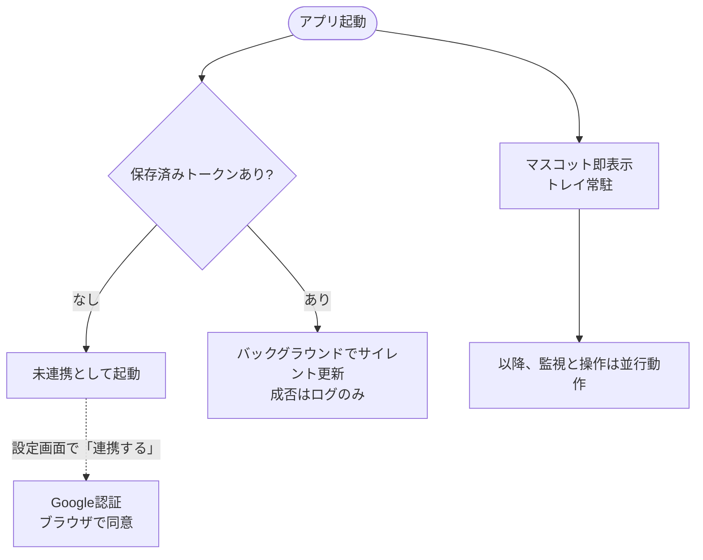
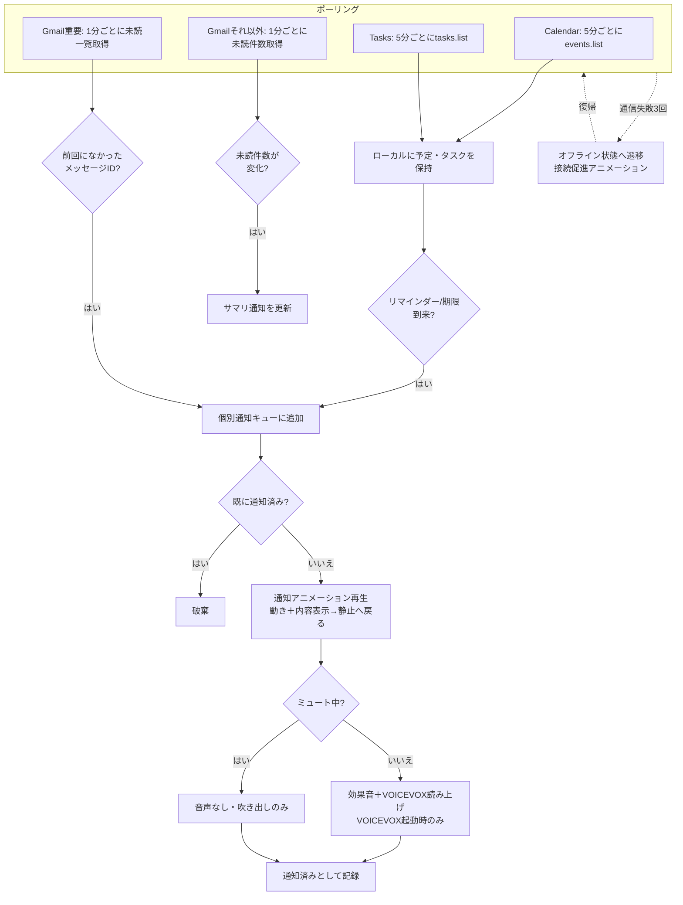
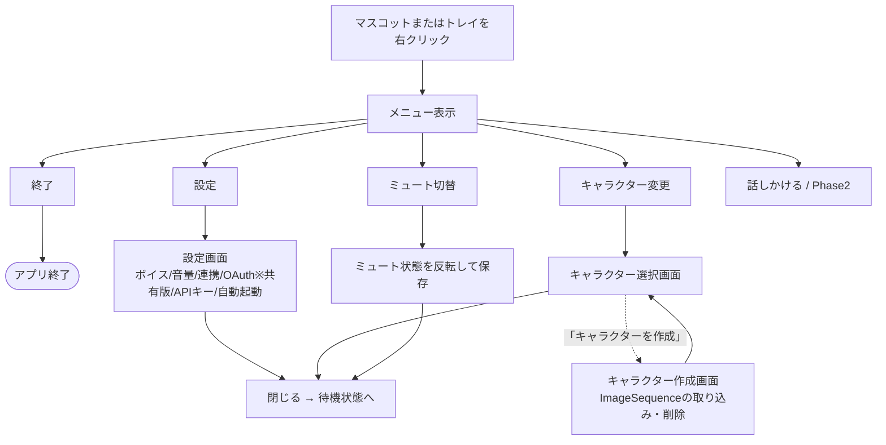
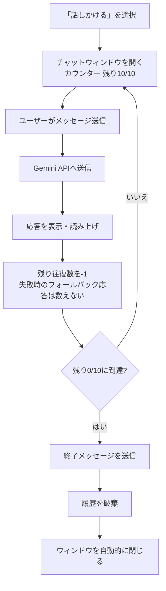
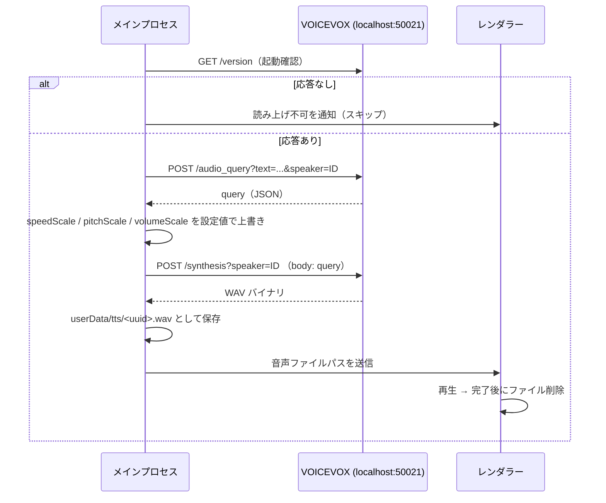

# おしらせメイト（デスクトップマスコット通知アプリ）要件定義書 v5.16

> **v5 改訂方針**
> v4で決定した項目（9章）を反映し、「残り回数の事前表示」を実装可能な粒度まで仕様化した。
> Mermaid図・コードブロックのフェンスを復元し、表記の乱れ（余分な空白等）を修正した。
> 主要な矛盾は本版で解消済み。残るのは実装をブロックしない将来フェーズの成果物のみ（9章参照）。

> **v5.1 改訂方針**（Phase 0実機テスト後）
> preloadスクリプトのディレクトリ構成（6章）と方針（2.8）を追加し、
> 6.1のウィンドウ位置永続化キーを`windowPosition`→`characterAnchor`に変更。

> **v5.2 改訂方針**（Phase 1実装時）
> settingsSchema.js・autostart.jsを6章に追加。8章Phase 1完了条件に自動起動を明記。
> 9章に個人版OAuth Client Secretの扱いを先送り事項として追加。

> **v5.3 改訂方針**（Phase 2実装時）
> 個人版のOAuth同意画面を「本番環境」に公開する方針に変更（2.3。テスト状態ではリフレッシュトークンが7日で失効するため）。
> 5.1の起動シーケンスを「マスコット即表示・認証はバックグラウンド／設定画面から」に修正。
> 認証周りのファイル分割（authCore.js・tokenStorage.js・loopback.js）とトークン保存形式を6章に追加。
> リフレッシュ失敗時の扱いを2.3に明記（invalid_grantのみトークン破棄）。

> **v5.4 改訂方針**（Phase 3実装時）
> F-08の受入基準を「キューへの整列」と「表示時の非重複」に分割し、後者をPhase 5に移動。
> Phase 3で追加したファイル（notifiedStore.js・reminderTimers.js・providers/dateOnly.js）を6章に追加し、
> 通知済みIDの永続化をstore.jsからnotifiedStore.jsへ分離した。
> Google TasksのdueとTODO通知時刻の関係（7.1）を明確化した。

> **v5.5 改訂方針**（Phase 4実装時）
> 8章Phase 4完了条件を、カレンダーのみからTODO・重要メールを含む3系統＋API制限の実測に拡張。
> Phase 4で追加したファイル（pipeline.js・googleApi.js・apiErrors.js・apiUsage.js・pollingConfig.js・notificationLogger.js・logger.js）と
> userData/logs/ を6章に追加した。実通信の配線（googleApi.js・index.js）と「どのイベントで何を呼ぶか」（pipeline.js）を分離し、後者を依存注入でユニットテスト可能にした。
> APIには `auth.getAccessToken()` の有効なアクセストークンのみをリクエストごとに渡し、googleapisのOAuth2Clientにrefresh_tokenを持たせない（更新経路をauth.jsに一本化）。
> googleapisの既定の自動リトライ（最大3回）は無効化した（Phase 6のバックオフ・呼び出し回数の実測と二重にならないため）。
> API失敗はkind（unauthorized / quota / forbidden / rate_limited / server / network / auth_unavailable / unknown）に分類してschedulerの'failed'イベントに載せる（Phase 6のオフライン判定・バックオフの入力）。
> mailSummaryに'updated'イベントを追加。通知のGUI表示（Phase 5）までは、notificationLogger.js（暫定）がキューを取り出してログに出す。
> ログの保持期間・クリーンアップは9章の先送り事項に追加した。
> 実機確認で、重要でないメールの未読件数が `resultSizeEstimate` の固定値（201）から動かない不具合が判明したため、件数をIDの数え上げ（ページング・上限2,500件）に変更した（2.1・7.1）。

> **v5.6 改訂方針**（Phase 5実装時）
> 2.3節のトークン運用の記述をPhase 4の実装（ヘッダー手渡し、setCredentials不使用）に合わせて訂正。
> 7.1にgoogleapisのretry無効化を追記。8章Phase 5完了条件にF-03/F-04/F-08(表示側)を追加。
> F-04の受入基準を修正：「各アニメーション1〜2秒」を出現・退場の遷移に限定し、待機（通知内容の表示保持）は
> 遷移とは別に種別ごとの保持時間を持つものとした。7.1にサマリバッジの表示丸め（99+）を追記。
> Phase 5で追加したファイル（notificationPresenter.js・notificationView.js・windowLayout.js・sounds.js・devNotifications.js・renderer/mascot/character.js・
> scripts/generate-placeholder-sfx.mjs）を6章に追加し、notificationLogger.jsをログ専用に変更した。
> マスコットは常時表示のまま、当初は「出現／待機／退場」を通知演出の入口／本体／出口としたが、実機確認で常時表示のキャラクターに出現・退場は意味を持たないと判明したため、
> 「通知なし（静止）→通知アニメーション→通知なし（静止）」の2状態に変更した（F-03・F-04・F-11・8章Phase 5・6章assets/animations・効果音名を修正）。
> 通知アニメーションは「冒頭の動き（約1秒・注意を引く）→内容表示中のループ」で、表示時間の終わりに動きと吹き出しを約0.5秒で絞って静止へ戻る。
> 効果音のファイル名は appear_* から notify_* に改めた。
> 保持時間は種別ごと（カレンダー8秒／TODO6秒／重要メール5秒。後続が溜まっていれば×0.6・下限3秒）。
> ウィンドウの拡大・縮小は瞬時のsetBounds（characterAnchor基準）とし、遷移の見た目は吹き出しのフェード＋スケールで表現する。
> 実機確認で、拡大・縮小の瞬間にキャラクターがちらつくことが判明した（ウィンドウ左上の移動と描画位置の再配置が別プロセスで、同一フレームに載らないため）。
> 切り替えの間だけキャラクターを約0.1秒隠す手順（隠す→再配置→ACK→setBounds→リサイズ反映後に再表示）に変更し、
> 連続する通知で配置が同じ場合は切り替え自体を省く（縮小は150ms遅延し、直後に次の通知が来れば拡大したまま続ける）。

> **v5.7 改訂方針**（Phase 6実装時）
> 3.6節にVOICEVOX接続状態表示を追記。8章Phase 6完了条件を具体化。
> **バックオフ**（scheduler.js・系統ごと）：失敗がn回続いたら次の再試行は min(1分×2^(n-1), 15分) 後（1→2→4→8→15→15分…）。基準は通常間隔によらず全系統1分で、
> 429のRetry-Afterが長ければそちらを採る。成功で通常間隔に戻る。apiErrors.jsの`retryable`フラグはバックオフ判定には使わず（失敗はすべてバックオフする）、ログ・将来のUI表示用の情報として残す。
> **オフライン判定の粒度**：系統ごとに`offlineCandidate`の失敗の連続回数を数え、いずれか1系統が3回に達したらオフライン、全系統が3未満に戻ったら解除（全体で1状態）。
> offlineCandidateでない失敗（401・クォータ・429・403等）はサーバーに届いている証拠として連続回数を0に戻す。invalid_grantは未連携化（スキップ）でありオフラインに数えない。
> 基準1分の共通バックオフにより、どの系統でも1回目から3回目の失敗までが3分で揃う（ネット断から最大約4分でオフライン表示）。
> 復帰の検知を15分待たせないため、オフライン中に失敗していた系統が成功したとき・OSがネットワーク復帰を報告したとき（`net.isOnline()`を30秒ごとに確認）・スリープ復帰時に、バックオフ待ちの系統を即時再試行する。
> Windowsでは仮想アダプタ（Hyper-V・WSL等）があると`net.isOnline()`がネット断中もtrueのままで復帰を検知できないため、オフライン表示中に限り30秒ごとに`https://www.google.com/generate_204`へHEADで疎通確認し、つながったら即時再試行する（networkWatch.js）。疎通があるのにAPIが失敗し続ける場合に叩き続けないよう、再試行は「つながらない→つながった」の変化（オフライン後の最初の成功を含む）でのみ行う。
> Google（OAuth・Calendar/Tasks/Gmail・Gemini）への通信と疎通確認は、Electronの`net.fetch`（Chromiumのネットワークスタック）で行う。OSのプロキシ設定（WPAD自動検出・PACを含む）に従わせるため。Nodeの`fetch`はプロキシを使わず、プロキシ必須のネットワーク（学内LAN等）では常に接続失敗→オフライン表示のままになる。`net.fetch`の接続失敗（`net::ERR_*`）はnetworkに分類する。VOICEVOX（localhost）はNodeの`fetch`のまま。
> **オフライン表現**：rest/notifyに並ぶ第3の状態にはせず、両者に重ねる修飾とした（状態機械は2状態のまま）。restの困り顔（八の字眉＋波口）＋キャラクター左下のバッジ（CSSのゆっくり点滅。rAFは回さない）（v5.9：EmoteLabキャラは困り顔を持たないため、バッジのみで表す）。
> 遷移時に1回だけ「インターネットにつながらないみたい／接続を確認してね」の吹き出し（効果音・読み上げなし）を、presenterのシステム通知枠（キューの次より優先・表示中は割り込まない）で出す。復帰時は表示を消すだけ。
> オフライン中も通知は表示する（カレンダー/TODOは取得済みの予定からアプリ内タイマーで発火する）。通知中はバッジを出したまま通知の顔で演出する。
> **読み上げと保持時間・応答性**：表示は音声を待たずに始め、合成は並行して行う（4章の応答性に影響しない）。音声は表示中のidに一致し絞りの前に届いた場合のみ再生し、遅れたものは捨てる。
> 絞りの開始 = max(保持時間, 読み上げの終わり＋0.6秒)、上限は表示開始から20秒。バックログで保持時間が圧縮（×0.6・下限3秒）されていても音声の長さを優先する。
> 読み上げ文は種別ごとの短い文（最大50文字）。読み上げの開始は効果音の終わり＋0.2秒以降（効果音と重ねない。合図が無くても1.5秒で解禁）。
> ミュート中に発生した読み上げは合成せず、合成中・再生中にミュートされた場合も破棄する（読み上げの待ち行列を持たないため、解除後に再生される経路は無い）。
> VOICEVOXの接続状態（接続中／未検出／失敗）は起動時・設定画面を開いたとき・再確認・読み上げのたびに確認し（定期ポーリングはしない）、設定画面のボイス欄に警告とクレジット表記を出す。話者・速度・高さはconfig.jsonの`voicevox`を読み取り専用で使う（話者選択UIは持たない）（v5.9：キャラクターごとの声を作成／編集画面で選べるようにした。config.jsonの`voicevox`は声が未設定のキャラクターの既定値）。
> **ログ保持期間（9章#4）**：14日。notifiedStore.jsと同じく起動時と書き込み時（日付が変わった最初の書き込み）にパージし、判定はファイル名の日付で行う（パターン外のファイルは消さない）。
> Phase 6で追加したファイル（voiceReader.js・mocks/voicevox/）と各ファイルの役割を6章に反映した。

> **v5.8 改訂方針**（Phase 7実装時）
> 9章#1の文面数の誤り（25種→20種）を修正。
> **アイドルトークと通知の優先度**：通知が常に優先する。アイドルトークはpresenterが「何も表示中でなく、システム通知待ち・キューが空」のときだけ受理し（それ以外は1分後に再試行）、表示中に通知（またはシステム通知）が来たら約0.5秒の絞りで中断して通知を始める。アイドルトークは通知済みIDにもnotifyQueueにも載せない。
> **アイドルトークの表示機構**：`notify`の動き・リング・効果音・種別ラベルは使わず、吹き出し（ラベル・副題なし、保持7秒）と読み上げのみの軽い表現にする（通知と紛らわしくならないため）。ミュート中は合成せず吹き出しのみ（3.7）。（v5.9：EmoteLabキャラは`notify`スロットを使わず、`rest`を再生し続ける）
> **トリガー判定**：setTimeoutを1本だけ張る（最終操作＋間隔。常時ポーリングしない）。「操作」はOS全体の入力ではなく**アプリ内の操作**（マスコットのドラッグ・右クリックメニュー・ダブルクリック〔F-21・v5.13〕・設定／チャットを開く・チャット送信・通知の表示終了・直前のアイドルトーク発話）。発話後・スリープ復帰後はその時刻から再武装する。
> カテゴリは 静粛時間帯（発話しない）→ 就寝前（`quietHours[0]`の直前1時間のその日最初）→ 朝（その日最初の発話が5:00〜10:00）→ 通常 の優先順。**静粛時間帯（0:00〜6:00）が優先するため、朝の挨拶が実際に出るのは6:00〜10:00**（3.4の「朝5:00〜10:00」との整合）。「その日」はローカル日付、状態はメモリのみ。
> **文面のランダム選択**：通常20種を1つの「シャッフル袋」（1周するまで同じ文面を出さず、周の境界でも直前の文面が先頭に来ない）から選ぶ。カテゴリ均等巡回は、独り言5種が過剰に繰り返されるため採らない。朝・就寝前は各5種の別々の袋。
> **チャット読み上げ**：voiceReader.jsは単一スロットのため、同じ実装（`createVoiceReader`）のチャット専用インスタンスを別に持ち、通知の読み上げと互いを中断しない。再生はチャットウィンドウ側。待ち行列は持たず（次の送信・終了・ミュートで破棄）、通知の読み上げが始まったらチャットの音声は譲る。10往復目は「応答＋終了メッセージ」を1回で合成し、再生後にウィンドウを閉じる。共有版はテキストのみ。
> **チャット中の通知**：通知経路（pipeline→キュー→presenter→マスコット）はメインプロセス内で完結し、チャットウィンドウとは別ウィンドウ・別IPCのため両立する。共有するのはVOICEVOXのみ。
> **カウンター表記**：内部は経過往復数`turn`、表示は「残り {max−turn}/{max} 往復」（開始時10/10→終了時0/10）に統一する（3.5・5.4の「0/10にリセット」は「残り10/10に戻る」の意）。失敗（フォールバック応答）は往復を消費せず履歴にも積まない。終了メッセージは生成せず定型。
> **Gemini呼び出し**：`@google/generative-ai`（1.6）は使わず、`fetch`によるREST呼び出し（geminiClient.js、キーは`x-goog-api-key`ヘッダ）に変更する。依存を増やさず、googleApi.js／voicevox.jsと同じfetch注入でモックテストできるため。送るのはユーザーが入力した文章のみ（v5.9：キャラクター設定〔persona〕もユーザーが入力した文章として、システムプロンプトに含めて毎回送る）。
> **Gemini APIキー**：設定画面から入力し`safeStorage`で暗号化保存する（apiKeyStorage.js。tokenStorage.jsと同形）。既存の「Client ID/Secret入力欄」は存在しない（個人版は`.env`、共有版の入力UIはPhase 9）ため、これが設定画面で入力する最初の秘密情報になる。レンダラーへはキーを返さず状態のみ渡す。
> チャットウィンドウのセキュリティ設定は設定ウィンドウと同水準（webviewTag無効・CSP・window.open拒否・遷移拒否・送信元検証）とし、加えて権限要求を全拒否する。
> Geminiのモデルは`geminiClient.js`の`GEMINI_MODELS`（候補を先頭から試す：`gemini-3.5-flash-lite`→`gemini-2.5-flash-lite`→`gemini-3.6-flash`→`gemini-2.5-flash`）。提供状況はキー（プロジェクト）ごとに違うため、404（モデルが無い・使えない）のときは次の候補へ切り替え、使えたモデルを覚える。全候補が404なら「使えるモデルが見つからない」旨、402（プリペイドのクレジット切れ。`quota`）なら「利用枠が足りない」旨のフォールバック応答（402も次の候補を試す）。1回30秒でタイムアウト、出力は1024トークンまで。ログにはHTTPステータス・Googleのエラー区分・短いメッセージ・モデル名を出す（キー・発言本文は出さない）。
> Phase 7の実機確認で、`gemini-2.5-flash`固定だと404になる環境があった（原因の詳細は未確認）ため、上記の候補切り替えに変更した。
> `--dev`起動の開発メニューに「アイドルトーク（通常／朝／就寝前）」を追加した（間隔・静粛時間帯を無視して今すぐ表示）。
> 定型文30種（朝5・就寝前5・独り言5・話しかけてくる系10・疑問形5）の文面はidleTalkPhrases.jsで確定した。口調は「親しみやすい友だち口調、一人称・名前・呼びかけなし、絵文字なし」（別キャラへの差し替えに備える）。

> **v5.9 改訂方針**（Phase 8実装時）
> **EmoteLab実機検証の反映（2.6）**：EmoteLabはGIF/APNG/WebP/ImageSequenceの書き出しに対応し、モーションごとに個別のImageSequenceフォルダ（`000.png`〜`0NN.png`の3桁連番、他のメタデータファイルなし）として書き出せることを確認した。
> 取り込み形式は**ImageSequence（透過PNG連番）のみ**とし、GIF/APNG/WebPは本Phaseのスコープ外として9章#5へ先送りした（旧2.6の「GIFを簡易フォールバックとして許容」は撤回）。
> 想定キャンバスは**400×400px・RGBA透過PNG**。サイズの異なるフォルダは取り込み時にエラーとし、自動リサイズは行わない。
> fpsはEmoteLab側の書き出し設定に依存するため、アプリ側は固定値を持たず、キャラクター作成画面でモーションごとに入力してmanifest.jsonに保持する（既定30、実機負荷を見て60まで）。
> characterAnchorは**取り込んだキャンバスの中心**を基準とする（フレームごとの実描画範囲＝bboxは使わない。実測でフレームごとに輪郭位置が微妙に動くため、bbox基準だとアンカーが揺れる）。
> **キャラクター枠は全キャラクター共通の200 DIP**：400×400のPNGはデコード時にcanvasの実ピクセル（200×表示倍率）へ高品質縮小して描く（表示倍率200%で等倍）。当初は枠を400 DIPに拡大したが、実機確認で拡大表示では画像の粗が目立ったため200 DIPに戻した。枠の大きさが変わらないので、キャラクターの切り替えでウィンドウは拡縮しない。
> **EmoteLabキャラの演出**：動きはPNG連番に焼き込み済みとみなし、既定キャラの手続き的な演出（ホップ・揺れ等の移動／拡縮、種別色のリング）は重ねない。種別の違いは`notify.calendar`/`notify.tasks`/`notify.gmail`スロット（未設定は`notify`）と吹き出しの色で表す。
> **オフライン表現**：EmoteLabキャラは困り顔（八の字眉＋波口）を持たないため、オフラインはキャラクター左下のバッジのみで表す（顔はrestのまま）。**アイドルトーク**：EmoteLabキャラは`notify`を使わず`rest`を再生し続ける（v5.8の「動きなし」に相当）。
> **スロットの先読み**：キャラクター選択時（起動時を含む）に設定済みの全スロットのPNGを**圧縮データのまま**先読みする。デコード済みで保持するのは `rest`（常時表示）と、表示中の通知のスロットだけで、通知の開始時に000から順にデコードし（未デコードのフレームは直前のフレームで代用。1枚目は数msで出る）、表示が終わったら解放する。これで種別スロットも初回の通知からF-11どおりに出る。
> 当初は全スロットをデコード済みで保持したが、5スロット×70枚で全プロセスのプライベートメモリが既定キャラ比で約290MB増え、4章の目標（300MB未満）を大きく超えたため、この方式に変更した。なお既定キャラだけでも約300MB（プライベート）あり、目標付近にある。
> **メモリ目標の見直し（4章）**：Phase 8の実機確認（EmoteLabキャラ、タスクマネージャー）で**待機時約430MB・通知表示中約480MB**だった。既定キャラの時点でElectron本体・googleapis等で約300MBあり、300MB未満は現構成では達成できないため、目標を「**待機時・通知表示中とも500MB未満**」に改めた。既定キャラ時点のメモリの内訳調査と削減は9章#7へ先送りする。
> **画像の受け渡し**：レンダラーは取り込んだPNGを独自プロトコル`mascot-character://<id>/<folder>/<NNN>.png`で読む（file://の画像をcanvasに描くと、ヒットテストで使うα値の読み出しがオリジン制約で失敗し得るため）。メインは`userData/characters/`配下の検証済みパスだけを返す。
> **設定の分離（6.1）**：config.jsonの`"character"`は選択中のキャラクターID文字列のみ。スロット情報は`userData/characters/<id>/manifest.json`に持つ。`"default"`は組み込みの既定キャラ。
> **画面（3.6）**：キャラクター選択画面（既定＋取り込み済みの一覧・選択で即反映・編集）とキャラクター作成／編集画面（ImageSequenceフォルダの取り込み・差し替え・削除、声、キャラクター設定）を別ウィンドウとして実装する。トレイの「キャラクター変更」を有効化した。
> **編集**：取り込み済みキャラクターは名前・スロットのフォルダ（差し替え・任意スロットの解除）・fps・声・キャラクター設定を編集できる。フォルダを変えない編集はmanifest.jsonの置き換え（一時ファイル→rename）のみ、フォルダを変える編集は別フォルダで組み直してから入れ替える（途中で失敗しても元のキャラクターは残る）。組み込みの既定キャラクターは声とキャラクター設定だけを編集でき、`userData/characters/default-profile.json`に保存する。
> **キャラクターごとの声（F-13）**：各キャラクターは`voice`（話者・スタイルのID、話速0.5〜2.0、音高-0.15〜0.15）を持てる。未設定ならconfig.jsonの`voicevox`を使う。選択中のキャラクターの声を**通知・アイドルトーク・チャットのすべての読み上げ**と設定画面のクレジット表記（VOICEVOX:話者名）に使う。v5.7の「話者選択UIは持たない・config.jsonの`voicevox`を読み取り専用で使う」はこれで改め、config.jsonの`voicevox`は「声が未設定のキャラクターの既定値」とする（引き続き直接編集）。話者の一覧はVOICEVOXの`GET /speakers`から取り、未起動時は選べない（保存済みの値は残す）。共有版は声の欄を表示しない。
> **キャラクター設定（チャットの人格。3.5）**：各キャラクターは`persona`（自由記述・最大1000文字）を持てる。チャットのシステムプロンプトは「キャラクター名＋キャラクター設定＋共通ルール」で組み立てる（chatPersona.jsの`buildSystemPrompt`）。口調・一人称はキャラクター設定に従い、共通ルール（短く1〜3文・絵文字／Markdownなし・予定の中身は知らない・安全上の注意）はキャラクター設定より優先する。設定が空なら従来の人格（黄色い丸・友だち口調）。プロンプトは会話の開始時（チャットウィンドウを開いたとき）に確定し、会話の途中でキャラクターを変えても混ざらない。キャラクター設定もユーザーが入力した文章としてGeminiへ毎回送られる（v5.8の「送るのはユーザーが入力した文章のみ」に含まれる）。
> チャットの終了メッセージ・フォールバック応答・アイドルトークの定型文は固定文のまま（キャラクターの口調と揃わないことがある。9章#6）。
> **ライセンス（7.4）**：EmoteLab公式EULAに基づくクレジット表記を設定画面・キャラクター選択画面・README.md（本Phaseで新規作成）に置く。
> F-17の受入基準（3.2）、画面一覧（3.6）、ディレクトリ構成（6章）、Phase 8完了条件（8章）を上記に合わせて具体化した。

> **v5.10 改訂方針**（9章#7 メモリの調査・削減）
> 既定キャラクター・未連携・待機時に、スクラッチの`--user-data-dir`で起動して各プロセスのプライベートメモリ（Private Bytes）を計測した。全プロセス合計は約270MB（メイン約137MB・GPU約94MB・マスコットのレンダラー約27MB・ネットワークサービス約12MB）。効果音を鳴らすと音声サービス（約10MB）が加わる。
> メインのうち約100MBは`googleapis`の読み込みによるもの（入口が全API〔300超〕の定義を読み込むため。クライアントを生成しなくても同じ）。使うCalendar・Tasks・Gmailだけを個別パッケージ（`@googleapis/calendar`・`@googleapis/tasks`・`@googleapis/gmail`。中身は`googleapis`内の同じコードで、`googleapis-common`も同じ版）で読むように改め、**合計約210MB（メイン約76MB）、読み込みは約1.1秒→約0.2秒**になった。クライアントの呼び方（`retry: false`・Authorizationヘッダ・エラーの形）は変わらない。
> fetchによるREST直接呼び出しへの置き換えは、個別パッケージからの上積みが数MB程度の見込みのため見送った。レンダラー・GPU側は、透過をやめる・`backgroundThrottling`を有効にする・canvasの`willReadFrequently`を外す・V8の`--lite-mode`のいずれも差が出なかった（±3MB以内）。ハードウェアアクセラレーションを無効にするとGPUプロセスが約94MB→約16MB（合計約−77MB）になるが、合成がCPUになるため、EmoteLabキャラでのCPU使用率・描画の実機確認が要る（9章#7に残す）。
> 置き換え後の実機確認（EmoteLabキャラ・連携済み・タスクマネージャー）で**待機時約300MB・通知表示中約345MB**だったため、4章のメモリ目標を「**待機時・通知表示中とも400MB未満**」に改めた（v5.9の500MB未満から引き下げ）。
> **読み上げのタイムアウト（F-13・7.2）**：実機で「キャラクターの声を保存して起動し直すと、その声だけ読み上げられない」事象があった。原因は保存・再起動ではなく、CPUモードのVOICEVOXで1件の合成に10〜13秒かかり（話者によって2〜3割差がある）、合成の待ち時間の上限（8秒）を超えていたこと。打ち切った合成もVOICEVOX側では最後まで続くため、後続の要求や起動確認（1.5秒）も遅れて「未検出」と誤判定していた。配布先のPCでも起こり得るため、次のとおり改めた。
> ①合成の待ち時間の上限を20秒（表示の上限`MAX_VOICE_HOLD_MS`と同じ）にした。②読み上げる通知は、音声が届くまで吹き出しを保持する（表示開始から20秒が上限。合成できなかったときはすぐ保持を解く）。v5.7の「音声は絞りの前に届いた場合のみ再生」は維持し、保持時間（8秒等）で絞りに入る前に音声を待つ形にした。
> ③合成と話者の先読みは1件ずつ送る（通知とチャットの読み上げで共有の待ち行列）。送信済みの要求は中断しても完了まで待ち、まだ送っていない要求は中断で取り消す。自分の合成中の起動確認のタイムアウトは「未検出」にしない。④起動時と声を変えたときに`POST /initialize_speaker`（`skip_reinit=true`）で話者を先に読み込ませる。
> あわせて、VOICEVOXのGPUモードで合成が大幅に速くなる（実機で1件1秒未満）ことをREADME等の案内に含める候補とする（Phase 9）。

> **v5.11 改訂方針**（Phase 9実装時）
> **方針変更：共有版でもVOICEVOXを有効にする。** 利用者が自分のPCにVOICEVOXを別途インストール・起動すれば、共有版でも読み上げ（通知・アイドルトーク・チャット）とキャラクターごとの声が使える。VOICEVOXはアプリに同梱しない（再配布は発生しない）。
> これにより2.5の「VOICEVOX読み上げ：共有版は無効」、F-13の「個人版のみ」、3.5の「共有版はテキスト表示のみ」、v5.8の「（チャット読み上げは）共有版はテキストのみ」、v5.9・3.6の「ボイス設定（個人版のみ表示）」「共有版は声の欄を表示しない」をいずれも撤回した（v5.8・v5.9の改訂方針の記述は履歴として残す）。
> **コードの変更方針**：edition（`getEdition()`）によるVOICEVOX機能の出し分けをやめ、**VOICEVOXへの疎通確認の結果（接続中／未検出／失敗）だけ**で判定する。出し分けがあったのは `index.js`（`voiceEnabled`・起動時／声の変更時の先読みの条件）、`ipc.js`（`registerVoiceIpc` の `isEnabled`・`registerCharacterIpc` の `isVoiceEnabled`）、`voiceReader.js`（読み上げない理由 `'shared'`）と、それらのフラグで欄を隠していた設定画面・キャラクター作成／編集画面のレンダラーである（`voicevox.js`・`chatController.js` はもともと edition を見ていない）。v5.10のタイムアウト対策（上限20秒・音声が届くまで吹き出しを保持・1件ずつの待ち行列・話者の先読み）は両版にそのまま適用される。
> 結果として、**個人版・共有版の違いは「OAuth資格情報の提供元」と「配布形態」の2点だけ**になった（2.5）。
> **共有版のOAuth資格情報（2.4・3.6・F-18）**：利用者が設定画面で入力したClient ID/Secretは、Gemini APIキーと同じく`safeStorage`で暗号化して`userData/oauth-client.enc`に保存する（6.1の`oauth`フィールドは廃止）。Secretはレンダラーへ返さない。入力値の検証と受入基準は3.6に明記した。同意画面は「テストユーザー登録」ではなく**本番環境に公開**する案内に改めた（テスト状態ではリフレッシュトークンが7日で失効するため。個人版のv5.3と同じ）。
> **editionの決め方（6.1）**：config.jsonに実際に保存された`edition`（`"personal"`/`"shared"`）→ ビルド時の既定値（配布パッケージの`package.json`の`mascotEdition`）→ `"personal"` の順。スキーマ・electron-storeの既定値で`edition`を埋めることはしない（埋めるとビルド時の値が常に上書きされるため）。アプリから`edition`を書き込む経路は持たない。
> **配布形態（9章#2）**：electron-builderで作る**実行ファイル一式のzip＋セットアップ手順書**に決定した（コード署名なし）。当初はNSISインストーラーとしたが、実装時に、スマート アプリ コントロールが有効なWindowsでは未署名のインストーラーがアプリケーション制御ポリシーで止められる（SmartScreenと違い「実行」を選べない。electron-builderはアンインストーラーを作るためにビルド中にもインストーラーを実行するため、開発PCではビルド自体ができない）ことが分かったため変更した。未署名のアプリ本体（zipの中の実行ファイル）は開発PCで起動できることを確認した（ただしスマート アプリ コントロールの判定は評判ベースのため、他のPCでも必ず通るとは限らない）。共有版と個人版を別の設定でビルドし、共有版には`.env`を含めない（ファイルはホワイトリストで指定し、ビルド後にも確認する）。個人版は`.env`を`resources/`に同梱する（9章#3）。
> セットアップ手順書（`docs/shared-edition-setup.html`。読みやすさのためMarkdownではなく単体のHTMLとする。設定画面からはアプリ内の専用ウィンドウで開き、本文の https のリンクだけ既定のブラウザで開く。`shell.openPath` は .html の既定アプリ〔VS Code 等のエディターのこともある〕で開くため使わない）はOAuthクライアントの作成に加え、VOICEVOXのインストール・起動（GPU版の推奨・ポート50021固定）とGemini APIキーの取得を含む。共有版のzipの中（実行ファイルと同じフォルダ。`セットアップ手順書.html`）に同梱し、設定画面の「セットアップ手順を開く」からアプリ内のウィンドウで開ける。

> **v5.12 改訂方針**（Phase 10計画時）
> **アプリ名の変更**：製品名を「通知マスコット」から**「おしらせメイト」**に変更した（実行ファイル `おしらせメイト.exe`、zip は `oshirase-mate-{shared,personal}-<version>-win-x64.zip`、`package.json` の `name` は `oshirase-mate`）。本書のファイル名とプロジェクト名（通知編集システム）はそのまま。
> **userData の保存先は旧名のまま固定する。** Electron の userData は `package.json` の `productName`（無ければ `name`）から決まる。electron-builder の `productName` は同梱の `package.json` に入らないため、これまでは開発時・配布版とも `name`（`my-mascot-app`）のフォルダ `%APPDATA%\my-mascot-app` を使っていた。`name` を変えると設定・トークン・取り込んだキャラクターが引き継がれないため、起動の最初（`store.js` が import 時に userData を読むこと、単一インスタンスのロックも userData に置かれることから、`index.js` の最初の import）に `app.setPath('userData', …)` で個人版（と開発時）は `%APPDATA%\my-mascot-app` に固定する。**共有版は専用の `%APPDATA%\おしらせメイト` にする**（同じPCで個人版と共有版を動かしたときに、開発者のトークン・取り込んだキャラクター等が共有版に見えないようにするため。版の判定はビルド時の `mascotEdition` だけで行う。config.json の `edition` は保存先が決まるまで読めないため）。これにより両版は別々の単一インスタンスのロックを持ち、同時に起動できる。`appId`（`local.mascot-notifier`）も内部の識別子として変えない（F-19 の AppUserModelID に使う）。
> **ショートカットからの起動（F-19）**：インストーラーを使わない（9章#2）ため、アプリ自身が設定画面のボタンでデスクトップ・スタートメニューに `おしらせメイト.lnk` を作成・作り直し・削除する（Electron の `shell.writeShortcutLink`。配布版のみ）。リンク先が現在の実行ファイルと違う（フォルダを移動した）場合は「作り直す」を促す。起動中にもう一度起動したら（二重起動）設定画面を開く。アプリアイコンはユーザーが用意した画像（`build/resources/icon.png`）を実行ファイルに埋め込み、トレイにも使う（9章#8のアイコン部分を解決）。
> **「通知時のみ表示」モード（F-20）**：設定 `displayMode`（`"always"`／`"notifyOnly"`。6.1）を追加した。`notifyOnly` ではマスコットは普段は非表示で、通知（オフラインのお知らせを含む）のときだけフェードイン（約0.2秒）して提示し、吹き出しが閉じたらフェードアウトして非表示に戻る。連続する通知の間・ドラッグ中・右クリックメニュー表示中は消さない。アイドルトークは出さない。これに伴い F-03・F-04 の「マスコットは常時表示」は `always`（既定）のときの記述とする。
> **読めない暗号化ファイルは削除せず退避する**：実機で、ログに記録のないまま `tokens.enc` と `gemini-key.enc` が同時に消えた（原因は未特定。開発版と配布版の実行ファイルの違いでは復号に失敗しないことは確認済み）。アプリ内で記録なしにこれらを消し得るのは「復号できない・中身が不正なファイルを削除する」処理だけだったため、`tokens.enc`・`gemini-key.enc`・`oauth-client.enc` とも、削除せずに `<ファイル名>.broken-<日時>` へ名前を変えて残し、ファイル名と理由（decrypt／parse／invalid。復号した中身は出さない）をログに警告として出すよう改めた（unreadableFile.js）。退避後は未設定として扱う。

> **v5.13 改訂方針**（直前のお知らせの再表示）
> **直前のお知らせの再表示（F-21）**：マスコット（キャラクターの描画部分）をダブルクリックすると、最後に表示した通知（予定・TODO・重要メール）をもう一度表示する。オフラインのお知らせ・アイドルトークは対象外。表示の内容（予定の「n分後」など）はダブルクリックした時刻で作り直し、効果音・読み上げも最初の表示と同じに行う（ミュート中は鳴らさない：3.7）。notifyQueue・通知済みID（notified.json）は通さない（presenter の優先枠に入れる）。覚えるのはメモリ上だけで、再起動すると忘れる。
> 受け付けるのは、何も表示していないか、アイドルトークの表示中（通知と同じく絞って中断してから出す）で、通知・システム通知の表示待ちが無いときだけ。通知・お知らせ・再表示の表示中にダブルクリックしても何もしない（連打で積み重ならない）。まだ通知を1件も表示していなければ「まだお知らせはないよ」をお知らせとして出す。押している間に数px以上動かした（ドラッグした）場合はダブルクリックとして扱わない。ダブルクリックはアイドルトークの「アプリ内の操作」に含める。見た目は元の通知と同じ（「もう一度」の印は付けない）。
> 「通知時のみ表示」（F-20）ではマスコットが普段は非表示のため、ダブルクリックできるのは通知の表示中だけで、その間は受け付けない。つまりこのモードでは使えない（トレイメニューからの再表示は将来の検討事項）。

> **v5.14 改訂方針**（GitHub での公開：Phase 11計画時）
> **GitHub で一般に配布する。** 配布するのは共有版のみで、GitHub Releases に zip（`oshirase-mate-shared-<version>-win-x64.zip`）とセットアップ手順書（HTML）を置く（9章#2）。ビルドは開発PCで行う（GitHub Actions は使わない）。個人版は `.env` を含むためリリースに載せない。
> **公開用リポジトリは新設する**（`katuo194/oshirase-mate`）。既存のリポジトリ（`katuo194/Notification-Editing-System`）の履歴にはコミット作成者の個人のメールアドレスが含まれるため公開せず、アーカイブとして残す。新リポジトリは作業ツリーを書き出した1コミットから始め、コミット作成者は GitHub の noreply アドレスにする。Phase 12〜15 は新リポジトリ（非公開）で開発し、最初のリリースを作る Phase 16 で公開に切り替える（作りかけの状態を公開しない）。古いブランチの誤 push で旧履歴が出ないよう、新リポジトリは別の作業フォルダで扱う。
> **ライセンス**：ソースコードは MIT（`LICENSE`。著作権者表記は `katuo194`）。素材は `assets/LICENSE.md` に素材ごとの条件を書く。アプリアイコン（Canva の AI 機能で生成し背景を透過したもの）は MIT の対象外とし、Canva の利用規約に従う。今後同梱するキャラクター画像（EmoteLab。7.4）と固定ボイス（VOICEVOX で生成した音声ファイル。各音声ライブラリの規約）も MIT の対象外とする。共有版の zip には `LICENSE.txt` を実行ファイルと同じフォルダに置き、`scripts/check-dist.mjs` で有無を確かめる。`package.json` は version 0.1.0、`license: "MIT"`・`repository` を加え、`private: true`（npm に公開しない）は維持する。
> **以降の計画（Phase 12〜16）**：OAuth セットアップの簡略化（Console からダウンロードした `client_secret_*.json` の読み込み・3 API を一度に有効にするリンク・設定画面のセットアップウィザード）、キャラクターごとのセリフ（通知の読み上げテンプレート・アイドルトーク。9章#6）、Gemini によるセリフの自動生成、同梱キャラクター（初期キャラ〔話者なし〕・男キャラ〔ずんだもん〕・女キャラ〔四国めたん〕。EmoteLab 製）と固定ボイス（VOICEVOX で事前生成した音声ファイルを同梱し、VOICEVOX が無くても鳴る）、README のセットアップ手順と最初のリリース。各 Phase の詳細は着手時に計画して本書に反映する。

> **v5.15 改訂方針**（Phase 12：OAuth セットアップの簡略化・利用者向け文書の整理）
> **設定画面の「Google 連携の準備」（3.6）**：共有版の OAuth 入力欄（旧見出し「OAuth クライアント（共有版）」）を、番号付きの手順 1〜5 を並べたウィザードに改めた。①プロジェクトを作り 3 つの API を一度に有効にする（`https://console.cloud.google.com/flows/enableapi?apiid=calendar-json.googleapis.com,tasks.googleapis.com,gmail.googleapis.com`。Google の公式文書に定まった仕様は無いが、Google の Apigee のガイドで使われている形）②同意画面（Google Auth Platform のブランディング `/auth/branding`）を設定し、対象（`/auth/audience`）で本番環境に公開する ③クライアント（デスクトップ アプリ。`/auth/clients/create`）を作り、**作成直後の画面で JSON をダウンロードする**（Google は新しいクライアントのシークレットを作成時にしか表示・ダウンロードさせない。あとから詳細画面でダウンロードした JSON にはシークレットが入らない）④ダウンロードした JSON を読み込む（ボタンでファイルを選ぶか、欄にドラッグ＆ドロップ。保存済みなら ✓）⑤連携する（連携中なら ✓）。手順 1〜3 のボタンは Console の該当ページを既定のブラウザで開く。Client ID/Secret の手入力は「手動で入力する」を開いたときだけ出す。個人版では従来どおりこの欄を出さない。
> **画面から任意の URL を開かせない**：画面はリンクの名前（`apis` / `branding` / `audience` / `client` / `voicevox` / `geminiKey`）だけをメインへ送り（`links:open`）、URL はメインの表（externalLinks.js）で決める。開く直前にも、表にある URL そのものかを確かめる。
> **設定画面のレイアウト（3.6）**：縦長（幅 420）で 8 つの欄を縦に並べていたのを、横長のウィンドウ（内容 1000×660 DIP。作業領域より大きくしない）の 2 列に改めた（左：Google 連携の準備・Googleアカウント連携、右：音量・ボイス・チャット・動作・ショートカット・クレジット）。スクロールせずに 1 画面ですべて見えるよう説明文を短くした。作業領域が低い画面では列の中だけスクロールする。
> **Client ID も画面に表示しない（2.4）**：v5.11 では Client ID を非秘匿として確認用に表示していたが、表示しないことにした。oauthClient の状態（`oauth:get-state` 等）からも Client ID を除き、レンダラーには「保存済みか」だけを渡す。手動入力の Client ID 欄も、保存・削除のあとは空に戻す。
> **VOICEVOX・Gemini API キーの入手ボタン**：設定画面のボイス欄に「VOICEVOX を入手」（`https://voicevox.hiroshiba.jp/`）、チャット欄に「API キーを取得」（`https://aistudio.google.com/apikey`）のボタンを置き、既定のブラウザで開く（両版で表示。仕組みは上の Console のボタンと同じ）。
> **ショートカットをソースからの起動でも作れるようにした（F-19 の変更）**：v5.12 では配布版（パッケージ）だけで作れ、`npm start`・`npx electron .` では「配布版でのみ使えます」と表示していた（共有版の動作確認で、利用者に見せない「配布版」という言葉が出ていた）。ソースからの起動では実行ファイルが Electron 本体（node_modules の中）なので、引数にアプリのフォルダと、起動時に明示された `--user-data-dir`（共有版の動作確認で同じ保存先で起動し直すため）を付けた `おしらせメイト（開発）.lnk` を作る（配布版の `おしらせメイト.lnk` とは別の名前で、互いに触らない）。引数が違う .lnk は「作り直す」を促す。Electron の `shell.readShortcutLink` は引数を 259 文字（MAX_PATH − 1）までしか読み戻さない（.lnk には全文が保存されている）ため、それより長い引数は先頭が一致すれば同じとみなす。作れないのは Windows 以外だけになり、その表示は「この環境では使えません」。アイコンはソースからの起動では Electron のもの。
> **JSON の読み込み（oauthClientFile.js）**：`{"installed": {client_id, client_secret, …}}` から値を取り出し、`validateOAuthClient` に通す。先頭の BOM・前後の空白は許す。失敗の理由は、JSON ではない（拡張子が .json でないものを含む）／種類がウェブ アプリケーション（`web`。デスクトップ アプリで作り直してもらう）／OAuth クライアントのファイルではない／値の欠け（シークレットの入っていない JSON）／値の形式が不正／64KB を超える（中身を読まない）／読み込めない、に分けて画面に出す。ファイルの読み込みはメインで行い（ファイル選択ダイアログもメインが開く。ドロップされたファイルは preload が `webUtils.getPathForFile` で取った場所だけを送る）、中身・Secret は画面へ一度も渡さず、ログには理由だけを出す（ファイルの場所も出さない）。保存は手入力と同じ `oauthClient.set()` の経路（暗号化・auth.configure への反映・連携中の拒否）。
> **同意画面へのスコープ登録（旧手順書 2-3 の「データアクセス」）は省く**（確定）。登録していないスコープを要求すると「未確認のアプリ」の警告が出るが、この警告は従来から出ていたため手間は増えない。Phase 12 の実機確認で、未使用の Google プロジェクトをウィザードの手順だけで（スコープを登録せずに）「連携中」にできることを確かめた。
> **利用者向けの文書の整理**：README.md は利用者向けだけにした（「個人版」「共有版」「ビルド」「npm」を出さない。ユニットテストで固定）。開発者向けの内容（起動とテスト、個人版と共有版、`.env`、共有版の動作確認、配布用のビルド、リリース手順）は `docs/development.md` に移した。セットアップ手順書は `docs/shared-edition-setup.html` → **`docs/setup-guide.html`** に改名し、本文から「共有版」という表記を消して、Google との連携の章をウィザードの手順 1〜5 に合わせて書き直した（zip の中の名前 `セットアップ手順書.html` は変えない）。設定画面の見出しは「Google 連携の準備」で、利用者に「共有版」という言葉を見せない（コードの内部・本書・開発者向け文書では引き続き個人版／共有版と呼ぶ）。
> **userData の固定の例外（v5.12 の修正）**：起動引数に `--user-data-dir` が明示されているときは、v5.12 の保存先の固定（`app.setPath('userData', …)`）をしない。v5.12 で固定を入れて以来、開発中の共有版の動作確認（専用の userData に `{"edition":"shared"}` の config.json を置き、`--user-data-dir` を付けて起動する。docs/development.md）でも保存先が `%APPDATA%\my-mascot-app` に上書きされ、指定したフォルダの config.json が読まれず個人版で起動していた（Phase 12 の実機確認で判明）。明示が無い普段の起動・配布版の保存先は変わらない。判定は userDataDir.js の `userDataDirToPin`（純粋関数）。

> **v5.16 改訂方針**（Phase 13：キャラクターごとのセリフ）
> **キャラクターごとのセリフ（F-22）**：キャラクターの作成・編集画面で、通知の読み上げ文（セリフ）とアイドルトークの文を設定できるようにした。設定しなかった種類は今の固定文をそのまま使う。黄色い丸（既定キャラクター）もセリフを編集できる。9章#6のうちアイドルトークの定型文を解決した（チャットの終了メッセージとエラー時の返事〔フォールバック応答〕は固定文のまま。Phase 14 で扱うかを改めて決める）。
> **セリフの種類と差し込み**：通知は「予定・時刻あり」（`notify.calendar`。差し込み `{title}` 必須・`{time}`＝「10時30分」）、「予定・終日」（`notify.calendarAllDay`。`{title}`）、「TODO」（`notify.tasks`。`{title}`）、「重要メール」（`notify.gmail`。`{title}`・`{from}`＝差出人）の4種。予定は時刻ありと終日で分ける。アイドルトークは朝・就寝前・通常の3種で、差し込みはない。既定は、通知が今の固定文をひな形にしたもの（例「予定のお知らせです。{time}から、{title}」）、アイドルトークが idleTalkPhrases.js の30種。
> **セリフは読み上げにだけ使う**：吹き出し（種別・件名・時刻）は今のまま。1種類に複数の文を入れられ、シャッフル袋（v5.8と同じ。1周するまで重複せず、続けて同じ文にならない）で選ぶ。差し込みの値が空になる文（差出人が無いのに `{from}` を含む、時刻の無い予定で `{time}` を含む）は避けて使える別の文を選び、どれも使えなければ既定の文（「重要なメールです。{title}」「予定のお知らせです。{title}」など、今の固定文の差し込みが無いときの形）を使う。`{title}` は件名が空でも使える。袋はキャラクターを切り替えるたびに作り直す。
> **読み上げの長さ（変更）**：これまでは長い読み上げを文全体で50字（SPEECH_MAX）に切っていたが、**件名の側を切り詰めて**全体を50字以内にし、セリフの部分は残すようにした（件名が文の途中にあるセリフでも後ろが切れない）。件名を空にしても収まらなければ差出人を切り詰め、それでも長ければ文全体を切る。「TODO」の読み替え（トゥードゥー）は従来どおり展開した後の文全体に行い、読み替えた後の長さで収める。アイドルトークの読み上げにも同じ読み替えをする（キャラクターの文に「TODO」と書かれても読めるように）。何も設定していないときの読み上げは今と同じ（既定の文は件名が末尾にあるため、長い件名の結果も同じ）。
> **入力の決まり**：1行1文。通知のセリフは差し込みを除いた部分が30字以内・1種類10文まで。アイドルトークは1文30字以内（`PHRASE_MAX_LENGTH`）で、朝・就寝前が各10文、通常が30文まで。知らない差し込み・`{title}` の無い通知のセリフ・字数や文数の超過は保存させず、種類と何行目かを入れたエラーを画面に出す（該当の欄を開いて示す）。改行・タブ以外の制御文字は取り除き、前後の空白を落とし、空行は無視する。
> **保存先**：manifest.json に省略できる `lines` を追加した（6.2。manifest の `version` は1のまま）。黄色い丸は default-profile.json に `lines` を追加した。保存済みの `lines` に壊れた行があればその行だけを捨て、キャラクター自体は一覧から外さない。`lines` の無い古いファイルもそのまま読める。
> **画面（3.6）**：作成・編集画面に「セリフ（読み上げ・アイドルトーク）」欄を `<details>`（初めは閉じた状態）で追加した。「通知の読み上げ」4欄と「アイドルトーク」3欄の textarea に1行1文で書く。欄が空のときは既定の文を placeholder で薄く表示し、何も書かなければそれを使うことが分かるようにした。各欄に文の数（上限を超えたら赤く表示し、保存できない）と使える差し込みの説明を添える。「試しに読み上げる」ボタンは付けない。
> **構成**：検証・既定のセリフ・差し込みの展開と件名の切り詰め・キャラクターのセリフと既定の合成を characterLines.js（純粋関数）に置いた。notificationView.js の `toSpeechText` / `toPresentation` はセリフと文の選び方を受け取れ（渡さなければ今と同じ）、phrasePicker.js は通知の種類ごとの文も選べ（`pickNotify`。乱数は注入）、notificationPresenter.js は通常の表示と F-21 の再表示の両方で選択中のキャラクターのセリフを使う（`getSpeechOptions` を注入）。
> **テストの対象（開発）**：`vitest.config.js` を追加し、テストの対象から `.claude/**` を外した（Claude Code の作業用の複製 `.claude/worktrees/` の下のテストが二重に拾われるのを防ぐため。`node_modules` などの既定の除外は残す）。
---

## 0. 用語定義

| 用語 | 定義 |
|---|---|
| 通知 | 本アプリがマスコットを介してユーザーに提示する情報の単位。Googleからの生イベントではなく、アプリ内で正規化した後のもの |
| 個別通知 | 内容を提示する通常の通知（カレンダー・TODO・重要メール） |
| サマリ通知 | 件数のみを知らせる軽量な通知（重要でないメールの未読件数） |
| カレンダー通知 | Google Calendar の予定の**開始前リマインダー時刻**に発火する通知 |
| TODO通知 | Google Tasks のタスクの**期限**に関する通知 |
| マスコット | デスクトップ上に常時表示される透過ウィンドウ内のキャラクター |
| アイドルトーク | 通知がない状態で一定時間経過、または特定の時間帯に入ったときにマスコットが自発的に話す機能 |
| VOICEVOX | ローカルで動作する音声合成ソフト。HTTP API (`localhost:50021`) を提供する |
| 個人版 / 共有版 | 2.5参照。開発者本人が使う版と、知人グループへ配布する版 |

---

## 1. 概要

### 1.1 解決したい課題
Googleカレンダーに予定が入っているのに、通知に気が付かず予定を逃すことがある。

### 1.2 原因
- Googleの通知がPC上に表示されない（ブラウザを閉じている／通知が抑制されている）
- 表示されても味気なく、視界に入っても意識に残らない

### 1.3 解決アプローチ
デスクトップに常駐するマスコットが、Googleカレンダー・TODO・メールの通知を
**アニメーション＋効果音＋音声読み上げ**という「無視しにくい形」で提示する。

**設計判断（確定）**：本アプリは**OS標準通知（Toast/Notification）を使用しない**。
「標準通知は味気ない」ことが課題（1.2）であるため、独自の透過ウィンドウでの表示に一本化する。

### 1.4 スコープ外（非対応と明記するもの）
- **アプリ未起動時の通知検知**：通知の提示先がアプリ自身であるため、未起動時は原理的に提示できない。
  代替として「OSログイン時の自動起動」で常駐性を担保する。
- **外部サーバーの構築**：Webhook受信用のクラウドサーバーは構築しない（2.2参照）。
- **スマートフォンへの通知**
- **通知内容のリアルタイム自動生成**：通知そのものの文面・演出をAIでその場生成する機能は行わない（開発時の素材調達に生成AIツールを使うこととは別。2.7参照）

### 1.5 対応OS（確定）
**Windows 11 のみ**を対象とする。macOS対応は行わない。

### 1.6 技術スタック

| 区分 | 採用技術 |
|---|---|
| ランタイム | Node.js 20 LTS |
| デスクトップ | Electron 30以降 |
| Google API | `@googleapis/calendar`・`@googleapis/tasks`・`@googleapis/gmail`（Node公式クライアントの個別パッケージ。`googleapis`全体は読み込みでメモリが約100MB増えるため使わない：v5.10） |
| 設定永続化 | `electron-store` |
| 音声合成 | VOICEVOX（ローカルHTTP API。個人版・共有版とも、利用者が起動していれば有効：v5.11） |
| チャット | Gemini API（`fetch` による REST 呼び出し。`@google/generative-ai` は使わない：v5.8） |
| テスト | Vitest または Jest |

実装はすべてNode.jsで統一する。

---

## 2. アーキテクチャ決定事項

### 2.1 通知の検知方式：ポーリングに統一
Google Cloud Pub/Sub によるプッシュ通知は**採用しない**。理由：

1. プッシュのWebhook受け口には**インターネットからアクセス可能なHTTPSエンドポイント**が必要で、ローカル完結の構成と両立しない。
2. **Google Tasks にはプッシュ通知APIが存在しない**ため、どう設計してもポーリングが必要になる。
3. Google Calendar のプッシュは Pub/Sub ではなく `events.watch`（ドメイン検証済みWebhook）で、Gmailとは方式が異なる。3サービスで実装が三重化する。
4. 本アプリの目的は「予定の開始に気付くこと」であり、必要な即時性は**分単位**。ポーリングで十分。

**結論：アプリ内のスケジューラが定期的にGoogle APIをポーリングする。**

| 対象 | 取得API | ポーリング間隔 | 通知発火条件 | 通知種別 |
|---|---|---|---|---|
| カレンダー | `events.list`（今後24時間分） | 5分 | リマインダー時刻に達した瞬間にアプリ内タイマーで発火 | 個別通知 |
| TODO | `tasks.list` | 5分 | 期限が到来したタスクで未通知のもの（通知時刻は当日**16:00**固定） | 個別通知 |
| メール（重要） | `users.messages.list`（`q=is:important is:unread`） | 1分 | 前回取得時に存在しなかったメッセージID | 個別通知 |
| メール（それ以外） | `users.messages.list`（`q=is:unread -is:important`、`maxResults=500`。`nextPageToken`を辿って**IDの数を数える**。最大5ページ＝2,500件） | 1分 | 未読件数の増減 | サマリ通知 |

### 2.2 サーバー構成：ローカル完結
外部サーバー・Webhook受信処理はすべて不要。Electronのメインプロセス内で完結する。

### 2.3 認証方式（個人版）
- **OAuth 2.0 Loopback フロー ＋ PKCE** を使用する。
- 取得スコープ（いずれも読み取り専用）
  - `https://www.googleapis.com/auth/calendar.readonly`
  - `https://www.googleapis.com/auth/tasks.readonly`
  - `https://www.googleapis.com/auth/gmail.readonly`
- リフレッシュトークンは Electron の `safeStorage` で暗号化して userData 領域に保存する。
- 開発者本人のGoogle Cloud ProjectのOAuth同意画面は**「本番環境」に公開する**（「テスト」状態ではリフレッシュトークンが7日で失効し、週次で再連携が必要になるため）。個人利用のため検証（審査）は受けず、同意時の「未確認のアプリ」警告は許容する。
- ループバックのポートは動的（OSが割り当てる空きポート、`127.0.0.1`のみ）。認可URLには `access_type=offline` と `prompt=consent` を付ける。
- 同意画面で一部のスコープが外された場合は、必要な3スコープが揃うまで連携を成立させない。
- **リフレッシュ失敗時の扱い**：Googleが `invalid_grant` を返した場合のみ、保存トークンを破棄して未連携に戻す。ネットワークエラー・5xx・その他のエラーではトークンを保持し、連携済みのまま扱う（オフライン起動で再認証を強いない。再試行・バックオフはPhase 6）。
- **連携解除**：Google側でトークンをrevokeし（失敗しても続行）、`tokens.enc` を必ず削除する。
- 保存するトークンは `refresh_token` / `scope` / `token_type`。**googleapisの`OAuth2Client`には渡さない**（自動リフレッシュ機構を使うと、auth.js/authCore.jsが行うリフレッシュ・invalid_grant判定と経路が二重化するため）。APIリクエストは`auth.getAccessToken()`が返す有効なアクセストークンを、呼び出しのたびに`Authorization`ヘッダーで渡す。401が返った場合は`auth.invalidateAccessToken()`でキャッシュを破棄し、次回呼び出しで再取得させる。アクセストークンは保存しない。
- 開発者のOAuth Client ID/Secretは `.env`（dotenv）経由で読み込む（9章#3参照。gitには含めない）。開発時はプロジェクト直下、配布パッケージ（個人版）では `resources/.env` から読む（v5.11）。

### 2.4 認証方式（共有版）
知人グループへの配布を想定し（2.5）、開発者のOAuth資格情報を配布物に同梱しない。

- 設定画面に「Google 連携の準備」欄を置く（3.6。共有版のみ表示。v5.15 で手順 1〜5 のウィザードにした）
- 利用者はGoogle Cloud Consoleで自分のプロジェクト・OAuthクライアント（種別：デスクトップアプリ）を作成し、作成直後の画面でダウンロードした JSON（`client_secret_〜.json`）を読み込む（v5.15）。Client ID/Secret の手入力も「手動で入力する」から行える
- 利用者は自分のプロジェクトのOAuth同意画面を**「本番環境」に公開する**（「テスト」状態ではリフレッシュトークンが7日で失効し、毎週再連携が必要になるため。検証〔審査〕は受けず、「未確認のアプリ」警告は許容する。個人版の2.3と同じ。v5.11でテストユーザー登録の案内から変更）。同意画面へのスコープの登録は案内しない（v5.15。登録しなくても連携できることを実機で確認済み）
- 読み込んだ・入力したClient ID/Secretは `safeStorage` で暗号化して `userData/oauth-client.enc` に保存する（平文フォールバックなし）。JSON の読み込みはメインプロセスで行い、Secretはレンダラーへ渡さない。Client ID も画面に表示せず、レンダラーへ渡さない（v5.15。それまでは非秘匿のため確認用に表示していた）。値はログに出さない
- 認証の流れ（Loopback＋PKCE・トークンの保存・リフレッシュ失敗時の扱い・連携解除）は2.3と同じ
- セットアップ手順書（`docs/setup-guide.html`。単体のHTML。v5.15 で `docs/shared-edition-setup.html` から改名）を共有版のzipに `セットアップ手順書.html` として同梱し、設定画面から開けるようにする（アプリ内のウィンドウ。外部リンクは既定のブラウザ）（8章 Phase 9 の成果物。Phase 12 でウィザードの手順に合わせて書き直した）。利用者向けの文書・画面では「共有版」という言葉を使わない（v5.15）

### 2.5 個人版／共有版の機能差分
| 項目 | 個人版 | 共有版 |
|---|---|---|
| OAuth資格情報 | アプリに同梱（開発者のもの） | 利用者が自分で作成・入力（2.4） |
| VOICEVOX読み上げ | 有効（利用者が自分のPCにVOICEVOXを別途インストール・起動する。個人版・共有版で差はない：v5.11） | 同左 |
| Gemini APIキー | 利用者が入力（両版共通、そもそも同梱していない） | 同左 |
| 配布形態 | 開発者本人のみ（`npm start`、または `.env` を同梱したzip） | 実行ファイル一式のzip（署名なし）＋セットアップ手順書（9章#2で決定：v5.11） |

> 個人版・共有版の機能差分は **「OAuth資格情報の提供元」と「配布形態」のみ**（v5.11）。VOICEVOXの有効・無効は版ではなく、VOICEVOXへの疎通確認の結果（接続中／未検出）で決まる。

### 2.6 キャラクター描画方式
| フェーズ | 方式 |
|---|---|
| MVP | 初期キャラクター「黄色い丸に目と口」（キャラクターID `default`）。Canvasの手続き描画（`renderer/mascot/character.js`）。キャラクター枠200×200 DIP |
| Phase 8 | EmoteLab で作成したキャラクターの読み込み（**ImageSequence＝透過PNG連番のみ**。v5.9） |

**EmoteLabの書き出し形式（実機検証済み）**
- EmoteLabはGIF/APNG/WebP/ImageSequenceの書き出しに対応する。モーションごとに個別のImageSequenceフォルダとして書き出せる（`000.png`〜`0NN.png`の**3桁連番**。他のメタデータファイルは無い）
- 取り込むのは**ImageSequenceのみ**。GIF/APNG/WebPへの対応は本Phaseのスコープ外（9章#5）

**取り込みの条件**
- キャンバスは **400×400px・RGBA透過PNG**（現行マスコットの表示サイズに合わせて実機で調整済み）。フレームのサイズが異なる・RGBAでないフォルダは取り込み時にエラーとし、**自動リサイズは行わない**（Phase 8スコープ外）
- 連番は `000` から始まり欠番がないこと（1〜999枚）。連番名でないファイル（`Thumbs.db` 等）は無視する
- **fps**はEmoteLab側の書き出し設定に依存するため、アプリ側は固定値を持たない。キャラクター作成画面でモーションごとに数値入力し、manifest.jsonに保持する（既定30。実機負荷を見て個別に60まで引き上げ可）

**表示**
- キャラクター枠は全キャラクター共通の **200 DIP**。400×400のPNGはデコード時に canvas の実ピクセル（200×表示倍率）へ高品質縮小する（表示倍率200%で等倍。400 DIPへの拡大表示は画像の粗が目立つため採らない：v5.9）
- **characterAnchor（6.1）は取り込んだキャンバスの中心**を基準とする。フレームごとの実描画範囲（bbox）の中心は使わない（実測でフレームごとにキャラクターの輪郭位置が微妙に動くため、bbox基準だとアンカーが揺れる）
- 動きはPNG連番に焼き込み済みとみなし、既定キャラの手続き的な演出（移動・拡縮・種別色のリング）は重ねない。種別の違いは `notify.*` スロット（3.2 F-17）と吹き出しの色で表す
- 通知中は該当スロットをループし、表示の終わりの絞りの途中で `rest` へ戻る。`rest` は常時ループ再生する（待機時CPUを抑えるため、rAFを回し続けずフレームが変わるときだけ描画する）
- 設定済みの全スロットはキャラクター選択時（起動時を含む）に圧縮データ（PNG）のまま先読みする。デコード済みで持つのは `rest` と表示中の通知のスロットだけで、通知の開始時に000から順にデコードし、表示が終わったら解放する（メモリ：4章。その種別の初回通知からF-11どおりの表示になる）
- 既定キャラにはある困り顔（オフライン）を、EmoteLabキャラは持たない。オフラインはバッジのみで表す（F-14）

### 2.7 素材の調達方法
効果音・アニメーション素材は「フリー素材」と「生成AIツールでの制作」を併用する。

> **1.4節との違いに注意**：ここでいう「生成」は**開発時に**素材を作る手段を指し、アプリが**実行時に**通知のたびに内容を自動生成する機能（1.4でスコープ外とした機能）とは別物である。運用中に生成AIのAPIを呼ぶことはない。

### 2.8 preloadスクリプトの方針
contextIsolation: true／sandbox: trueを全ウィンドウで使用するため、レンダラーごとに専用のsrc/preload/<window>.cjsを用意し、contextBridge経由で必要最小限のAPIのみ公開する。サンドボックス化されたpreloadは拡張子.cjs（CommonJS）で統一する。
---

## 3. 機能要件

### 3.1 MVP（これが動けば課題1.1は解決する）

| ID | 要件 | 受入基準 |
|---|---|---|
| F-01 | Googleアカウントと連携できる | ブラウザで同意後、トークンが暗号化保存され、再起動時に再認証を求められない |
| F-02 | カレンダー・TODO・重要メールの個別通知を検知する | モックAPIレスポンスに対し、2.1の発火条件どおりに通知オブジェクトが生成されるユニットテストが通る |
| F-02b | 重要でないメールは未読件数のサマリ通知にする | 未読が3件→5件に増えたとき、サマリ表示が「5件」に更新されるユニットテストが通る（個別アニメーションは発生しない） |
| F-03 | 個別通知を透過ウィンドウ上のマスコットで提示する | 通知発生時、マスコットが通知アニメーション（動き＋吹き出しによる内容表示）で反応し、終了後に通知のない静止状態へ戻る（マスコット自体は常時表示のまま。「通知時のみ表示」モードでは通知の間だけ現れる：F-20） |
| F-04 | 通知アニメーションは「冒頭の動き＋内容表示中のループ」で構成する | 冒頭の注意を引く動き（約1秒・1回）のあと、内容表示中は動きをループする。吹き出しはフェード（出現約0.35秒・消去約0.5秒）で出入りし、表示時間の終わりに動きを絞って静止へ戻る。内容の表示保持は種別ごとの長さを持ち、ユーザーが内容を読み切れる長さとする（マスコットは常時表示のため、キャラクター自体の出現・退場のアニメーションは持たない。「通知時のみ表示」モードのフェードイン・アウトはウィンドウ全体の出入りで、キャラクターのアニメーションではない：F-20） |
| F-05 | 同一通知を重複して提示しない | 既通知IDが永続化され、再起動後も再提示されない |
| F-06 | タスクトレイ常駐と右クリックメニュー | 「終了／設定／キャラクター変更／ミュート」が表示・機能する |
| F-07 | 設定を永続化する | 音量・ミュート状態・選択キャラクターが再起動後も保持される |
| F-08 | 個別通知が短時間に集中した場合、順番にキューへ並べる | 重要メール5件が同時発生した場合、通知オブジェクトが到着順でキューに並び、先入れ先出しで一件ずつ取り出せる（取り出し＝表示ではない。表示時にアニメーションが重ならないことはPhase 5で実機確認する） |

### 3.2 Phase 2

| ID | 要件 | 備考 |
|---|---|---|
| F-11 | 通知の種類によってアニメーションを変える | 素材数は「（冒頭の動き＋ループ）× 3種別 = 3クリップ＋静止1」。MVPは共通1セット |
| F-12 | アニメーションに沿った効果音 | |
| F-13 | VOICEVOXによる通知の読み上げ | 個人版・共有版とも（v5.11。2.5）。VOICEVOX未起動時はサイレントにスキップし、設定画面に警告を出す。声は選択中のキャラクターの`voice`（未設定ならconfig.jsonの`voicevox`）。v5.9 |
| F-14 | オフライン時に接続を促すアニメーション | Google APIへの接続失敗を3回連続で検知したらオフライン状態に遷移。既定キャラはrestの困り顔＋左下のバッジ、EmoteLabキャラは困り顔を持たないため**バッジのみ**（v5.9） |
| F-15 | アイドルトーク | 3.4参照 |
| F-16 | チャットボット（Gemini API） | 3.5参照 |
| F-17 | EmoteLabキャラクターの読み込み | 2.6参照。受入基準：<br>① キャラクター作成画面から、EmoteLabで書き出したImageSequenceフォルダをモーション（`rest`/`notify`/`notify.calendar`/`notify.tasks`/`notify.gmail`）ごとに取り込める<br>② `rest`・`notify`は必須、`notify.calendar`/`notify.tasks`/`notify.gmail`は任意で、未設定時は`notify`にフォールバックする<br>③ 取り込んだキャラクターはキャラクター選択画面（3.6）から選べ、選択すると各状態の表示に反映される<br>④ EmoteLabのクレジット表記が設定画面とREADMEに表示される（7.4） |
| F-18 | 共有版のOAuth資格情報入力・案内 | 2.4・3.6参照。受入基準：設定画面でClient ID/Secretを入力・検証・暗号化保存でき、再起動なしで連携できる。設定画面からセットアップ手順書を開ける。v5.15：「Google 連携の準備」の手順 1〜5 に沿って、Console からダウンロードした JSON を読み込んで連携できる |
| F-19 | ショートカットからの起動・アプリアイコン | v5.12。受入基準：配布版の設定画面からデスクトップ・スタートメニューに `おしらせメイト.lnk` を作成・作り直し・削除でき、クリックで起動できる（v5.15：ソースからの起動でも、アプリのフォルダと明示された `--user-data-dir` を引数に付けた `おしらせメイト（開発）.lnk` を作れる。作れないのは Windows 以外だけ）。リンク先が現在の実行ファイルと違えば「作り直す」を表示する。起動中にもう一度起動すると設定画面が前面に出る。実行ファイル・ショートカット・トレイに用意したアイコンが表示される |
| F-20 | 「通知時のみ表示」モード | v5.12。受入基準：設定画面とトレイ／右クリックメニューで `displayMode` を切り替えられ、再起動後も保持される。`notifyOnly` では普段は非表示で、通知・オフラインのお知らせのときだけフェードインし、吹き出しが閉じたらフェードアウトして非表示になる。連続する通知の間・ドラッグ中・右クリックメニュー表示中は消えない。アイドルトークは出ない。`always` に戻すとすぐ表示される |
| F-21 | 直前のお知らせの再表示 | v5.13。受入基準：マスコットをダブルクリックすると、最後に表示した通知（予定・TODO・重要メール）が、その時刻で作り直した内容・効果音・読み上げつきでもう一度表示される。オフラインのお知らせ・アイドルトークは対象にならない。通知の表示中・表示待ちがあるときは何も起きず、アイドルトークの表示中は中断して再表示する。まだ通知が無ければ「まだお知らせはないよ」と表示する。ドラッグしたときは再表示しない。notified.json は変わらない |
| F-22 | キャラクターごとのセリフ | v5.16。受入基準：<br>① キャラクターの作成・編集画面（黄色い丸の編集を含む）の「セリフ」欄で、通知の読み上げ文（予定・時刻あり／予定・終日／TODO／重要メール）とアイドルトークの文（朝／就寝前／通常）を1行1文で設定でき、manifest.json（黄色い丸は default-profile.json）の `lines` に保存される<br>② 設定したキャラクターを選ぶと、通知の読み上げ（F-21 の再表示を含む）とアイドルトークがそのセリフになる。吹き出しの表示は変わらない<br>③ 設定しなかった種類は今の固定文を使い、何も設定していないキャラクターの読み上げは従来と同じ<br>④ 1種類に複数の文があればシャッフル袋で選ぶ。差し込みの値が空になる文（差出人の無いメールで `{from}` を含むなど）は選ばず、使える文が無ければ既定の文を使う<br>⑤ 読み上げは50字以内で、長いときは件名の側を切り詰める（セリフの部分は残す）<br>⑥ 知らない差し込み・`{title}` の無い通知のセリフ・字数（差し込みを除いて30字。アイドルトークは30字）や文数（通知は各10、朝・就寝前は各10、通常は30）の超過は保存できず、種類と何行目かが画面に出る<br>⑦ `lines` の無い古い manifest.json・default-profile.json も読め、保存済みの壊れた行はその行だけが捨てられる |

### 3.3 アイデアリスト（要件化は未了）
- 実行時のアニメーション・音声自動生成（1.4でスコープ外と明記済み）

### 3.4 アイドルトークの仕様

| 種別 | トリガー条件 | 発話内容 |
|---|---|---|
| 通常アイドルトーク | 最後の通知またはユーザー操作から15分（設定変更可）経過。ユーザー操作＝アプリ内の操作（マスコットのドラッグ・右クリックメニュー・ダブルクリック〔F-21〕・設定／チャットを開く・チャット送信。OS全体の入力ではない：v5.8） | 定型文からランダム選択（20種を1周するまで重複しない） |
| 朝の挨拶 | その日最初のアイドルトーク発火時、かつ現在時刻が5:00〜10:00（静粛時間帯が優先するため、実際に出るのは6:00〜10:00：v5.8） | 朝の挨拶セット（5種） |
| 就寝前の挨拶 | 静粛時間帯（下記）開始の直前1時間（23:00〜0:00）の間の最初のアイドルトーク | 就寝前セット（5種） |

- 発話は**あらかじめ用意した定型文**からランダム選択する（オフラインで動作、APIコスト0）。将来的にGemini APIによる生成に切り替え可能な構造にしておく。
- 静粛時間帯：**0:00〜6:00** はアイドルトークを行わない
- ミュート中は音声を出さず、テキスト吹き出しのみ表示する
- 表示は通知より軽い表現（動き・効果音・種別ラベルなし。吹き出しと読み上げのみ）。通知が発生したら中断して通知を優先する（v5.8）
  - EmoteLabキャラは`notify`スロットを使わず、`rest`を再生し続ける（v5.9）
- 定型文の内訳（合計30種。v1の「返答を30種類」に対応）
  - 朝の挨拶：5種
  - 就寝前挨拶：5種
  - 独り言：5種
  - 話しかけてくる系：10種
  - 疑問形：5種
  - 文面は `src/main/idleTalkPhrases.js` で確定した（Phase 7。口調は友だち口調・一人称なし。v5.8参照）
- **キャラクターごとの文（v5.16・F-22）**：キャラクターの作成・編集画面で、朝・就寝前・通常の文をキャラクターごとに設定できる（1文30字以内。朝・就寝前は各10文、通常は30文まで）。設定した種類はその文から、設定しなかった種類は上の定型文から、それぞれシャッフル袋で選ぶ。選択中のキャラクターを切り替えると袋を作り直す。読み上げでは「TODO」を通知と同じく読みに置き換える

### 3.5 チャットボットの仕様
- Gemini API を使用する
- **APIキーはユーザーが設定画面から入力し、`safeStorage` で暗号化保存する**（アプリに同梱しない。個人版・共有版共通）
- 会話履歴は直近**10往復**をメモリ保持し、永続化しない
  - チャットウィンドウ下部に「残り n/10 往復」のカウンターを常時表示する（1往復ごとに更新。開始時は「残り 10/10 往復」、10往復目の応答で「残り 0/10 往復」。Geminiの失敗によるフォールバック応答は往復に数えない：v5.8）
  - 10往復に達したら、Botが会話を終える旨のメッセージ（定型：「今日はこのくらいにしようか。またお話ししようね。」）を送信したうえでチャットウィンドウを自動的に閉じる
  - 履歴はウィンドウを閉じた時点で破棄する。次回「話しかける」を選ぶと新規の会話として最初から始まる（カウンターも「残り 10/10 往復」に戻る）
- 応答はVOICEVOXで読み上げる（個人版・共有版とも、VOICEVOX起動時のみ。未起動時はテキスト表示のみ：v5.11）。声は選択中のキャラクターの声（v5.9）
- **キャラクターごとの人格（v5.9）**：システムプロンプトは選択中のキャラクターの名前とキャラクター設定（`persona`、最大1000文字）から組み立てる。口調・一人称はキャラクター設定に従い、共通ルール（返答は1〜3文・100文字程度、絵文字・Markdownなし、予定・メール・TODOの中身は知らない、個人情報・医療／法律／お金・危険な話題の注意）はキャラクター設定より優先する。設定が空のときは従来の人格（黄色い丸・友だち口調・一人称なし）。プロンプトは会話の開始時に確定する
- チャット入力UIは、マスコット右クリックメニューに「話しかける」を追加し、入力欄付きウィンドウを開く方式とする

### 3.6 画面一覧

| 画面 | 内容 |
|---|---|
| マスコットウィンドウ | 透過・枠なし・常に最前面。キャラクター表示と吹き出し。`displayMode` が `notifyOnly` のときは通知の間だけ表示（F-20） |
| 設定画面 | ボイス設定（両版で表示：v5.11。VOICEVOX接続状態と未検出時の案内表示、「VOICEVOX を入手」ボタン〔v5.15〕を含む）、音量調整、Googleアカウント連携状態、「Google 連携の準備」（共有版のみ表示。手順 1〜5 のウィザード・JSON の読み込み・手動入力。下記。v5.15）、Gemini APIキー入力（「API キーを取得」ボタン〔v5.15〕を含む）、自動起動ON/OFF、「通知時のみ表示」ON/OFF（F-20）、ショートカットの作成・削除（F-19。v5.15 でソースからの起動でも作れるようにした）、クレジット表記（EmoteLab。7.4） |
| キャラクター選択画面 | 既定キャラクター（黄色い丸）と取り込み済みキャラクターの一覧から選択（選択で即マスコットに反映）。各キャラクターの「編集」、キャラクター作成画面を開くボタン。EmoteLabのクレジット表記 |
| キャラクター作成／編集画面 | ImageSequenceフォルダの選択（OSのフォルダ選択ダイアログ）、モーションスロット（`rest`/`notify`/`notify.calendar`/`notify.tasks`/`notify.gmail`）への割り当てと検証結果（枚数・エラー理由）の表示、スロットごとのfps入力、キャラクター名入力、取り込み（userDataへのコピー）、取り込み済みキャラクターの編集（名前・フォルダの差し替え・任意スロットの解除・fps）と削除。声（VOICEVOXの話者・スタイル、話速、音高。両版で表示：v5.11。VOICEVOX未起動時は話者を選べず、保存済みの値は残す）とキャラクター設定（チャットの人格・最大1000文字）の入力。セリフ（F-22・v5.16）：初めは閉じた「セリフ（読み上げ・アイドルトーク）」欄に、通知の読み上げ4欄（予定・時刻あり／予定・終日／TODO／重要メール）とアイドルトーク3欄（朝／就寝前／通常）の textarea（1行1文。空欄のときは既定の文を placeholder で薄く表示。文の数と使える差し込みの説明つき。入力のエラーは種類と何行目かを表示し、該当の欄を開いて示す）。既定キャラクターは声・キャラクター設定・セリフのみ編集できる（v5.9・v5.16） |
| チャットウィンドウ | 入力欄、応答表示欄、残り往復数カウンター（Phase 2） |

> 「キャラクター**作成／編集**画面」と「キャラクター**選択**画面」は別ウィンドウとして実装する（Phase 8）。選択中のキャラクターを削除した場合は既定キャラクターに戻る。

**設定画面の「Google 連携の準備」（共有版のみ。F-18・v5.11・v5.15）の受入基準**
- 共有版でだけ表示する（個人版は `.env` を使うため表示しない。個人版から保存・削除・読み込みの要求が来ても拒否する）。見出しは「Google 連携の準備」で、画面に「共有版」という言葉を出さない
- 番号付きの手順 1〜5 を並べる（v5.15）。手順 1〜3 のボタンは Console の該当ページ（API の一括有効化・同意画面のブランディング／対象・クライアントの作成）を既定のブラウザで開く。画面は手順の名前だけを送り、URL はメインが決める（知らない名前は拒否）。手順 3 には「シークレットは作成直後の画面でしかダウンロードできない」ことを明記する
- 手順 4：「ファイルを選ぶ」（メインがファイル選択ダイアログを開く）か、欄へのドラッグ＆ドロップで JSON を読み込める。読み込みはメインで行い、中身はレンダラーを通らない。保存済みなら ✓ と「読み込み済みです」を表示する（Client ID は表示しない）。失敗したら理由（JSON でない・ウェブ アプリケーションの種類・OAuth クライアントのファイルでない・シークレットが無い・値の形式が不正・大きすぎる・読み込めない）に応じた対処を表示する
- 手順 5：「連携する」（下の「Googleアカウント連携」と同じ動作）。連携中なら ✓
- Client ID/Secret の手入力欄は「手動で入力する」を開いたときだけ表示する。以下の手入力の検証は従来どおり
- 入力値は前後の空白を取り除いてから検証する。検証はメインプロセス（`authCore.validateOAuthClient`）で行い、レンダラーは理由（enum）だけを受け取る
  - Client ID：必須。`〜.apps.googleusercontent.com` の形式
  - Client Secret：必須。空白・改行・全角文字を含まないASCII、8〜256文字
  - ID欄とSecret欄の取り違え（Secret欄にClient IDの形式の値）を検出して知らせる
- 両方の欄が空でないときだけ「保存」を押せる。Client ID/Secretが未設定・不正な間は「連携する」を押せない（空文字での連携試行を防ぐ）
- 保存は暗号化（2.4）。保存に成功すると再起動なしで「未連携」になり、そのまま「連携する」で連携できる。Secret欄・Client ID欄は保存後に空に戻し、保存した値を二度と表示しない（v5.15で Client ID も表示しないことにした）
- 連携中・同意フロー中・連携状態の確認中は、変更・削除できない（「連携を解除してから変更してください」と表示する。トークンは作成したクライアントに結び付くため）
- 「削除」で保存した値を消すと「設定が必要です」に戻る
- 連携時に `invalid_client` が返ったら、共有版は「クライアントを削除していないか確認し、手順 3・4 をやり直してください」と案内する（個人版は `.env` の確認を案内）
- 「セットアップ手順を開く」ボタンで手順書を開ける

### 3.7 操作仕様
- **「終了」**：アプリを完全にシャットダウンする
- **「ミュート」**：効果音と読み上げ音声を停止する。**アニメーションと吹き出しは継続する**
  - ミュート中に発生した読み上げは**破棄する**（解除後にまとめて再生しない）
- ウィンドウはドラッグで移動でき、位置を記憶する
- マスコットの非表示部分はマウスイベントを透過させる（クリックがデスクトップに届く）
- **ダブルクリック**（キャラクターの上）：直前のお知らせ（予定・TODO・重要メール）をもう一度表示する（F-21）。表示中は何もしない
- **「通知時のみ表示」**（トレイ／右クリックメニューのチェック項目と設定画面。F-20）：ONの間、マスコットは通知のときだけ現れる。ONにした時点で通知の表示中ならその通知が終わってから消え、OFFにするとすぐ現れる。非表示の間はマスコットを右クリックできないため、操作はトレイから行う
- **二重起動**（ショートカット等からもう一度起動）：新しいプロセスはすぐ終了し、起動中のアプリが設定画面を開く（F-19）

---

## 4. 非機能要件

| 区分 | 要件 |
|---|---|
| 応答性 | **カレンダー／TODO**：リマインダー時刻から10秒以内に提示開始<br>**重要メール**：到着から最大約1分（ポーリング間隔）＋5秒以内 |
| 対応OS | Windows 11 のみ（1.5参照） |
| リソース | 待機時のCPU使用率は平均1%未満、メモリは待機時・通知表示中とも 400MB 未満を目標（全プロセス合計。v5.9で300MB→500MB、v5.10で400MBに改定。v5.10実測：EmoteLabキャラで待機時約300MB・通知表示中約345MB、既定キャラの待機時約210MB（プライベート）） |
| マルチモニタ | 複数モニタ環境で表示位置が破綻しないこと |
| 起動 | OSログイン時の自動起動を設定でON/OFFできる |
| オフライン耐性 | API接続失敗時はアプリを落とさず、指数バックオフ（1分→2分→4分、最大15分）で再試行する |
| セキュリティ | **ユーザーのアクセス/リフレッシュトークン**とGemini APIキーは平文で保存しない（暗号化必須）。<br>**共有版で利用者が入力したOAuth Client ID/Secret**も暗号化して保存する（2.4。v5.11）。<br>**OAuthクライアントのClient ID/Secret**（開発者の個人版用）は、Googleの分類上デスクトップアプリでは秘匿対象ではないため、`.env`での平文管理を許容する（9章#3参照）。リポジトリに秘密情報を含めない。 |
| ログ | userData領域に日次ローテーションのログを出力（APIエラー・通知履歴） |
| API制限 | Gmail/Calendar/Tasks の無料枠内に収まる間隔設定とする（現行設定で問題ないことを実測で確認） |

---

## 5. UI操作フロー

### 5.1 起動シーケンス



> **起動をブロックしない**：マスコットは認証状態に関わらず常に即座に表示する。
> 認証（初回連携・再連携）は、ユーザーが設定画面で「連携する」を押したときのみ行う。
> サイレント更新で `invalid_grant` が返った場合のみ未連携に戻る（2.3参照）。

### 5.2 通知監視ループ（バックグラウンド）



> 「通信失敗3回」はいずれか1系統の接続失敗（offlineCandidate）の3連続、「復帰」は全系統の回復（v5.7参照）。オフライン状態の表示は、既定キャラが困り顔＋バッジ、EmoteLabキャラがバッジのみ（v5.9）。失敗中の再試行は系統ごとのバックオフ（1→2→4→8→15分）。
> 読み上げは表示と並行して準備し、表示を待たせない（効果音の後に再生）。

### 5.3 右クリックメニュー（ユーザー操作）



### 5.4 チャットウィンドウ（Phase 2）



---

## 6. ディレクトリ構成

```
my-mascot-app/
├── package.json               ... 依存定義（electron, @googleapis/calendar・tasks・gmail, electron-store 等）
├── README.md                  ... 利用者向けの説明（ダウンロードとインストール・はじめての設定・使い方・キャラクターの取り込み・データとプライバシー・クレジット表記〔EmoteLab 7.4・VOICEVOX 7.2〕）。Phase 8で新規作成。v5.15 で利用者向けだけにした（「個人版」「共有版」「ビルド」「npm」を出さない。test/userDocs.test.js で固定）
├── .env.example                ... 環境変数のひな形（実値は含めない）
├── vitest.config.js            ... 【Phase 13】テストの設定（.claude/** を対象から外す。既定の除外は残す）
├── LICENSE                     ... 【Phase 11】ソースコードのライセンス（MIT）。共有版の zip に LICENSE.txt として同梱する
├── build/                      ... 【Phase 9】electron-builder の設定（base／shared／personal）。共有版は mascotEdition=shared を埋め込み、.env を含めない。【Phase 10】resources/icon.png（実行ファイルのアイコン。ユーザーが用意）
├── .gitignore
│
├── assets/
│   ├── animations/             ... （未使用）初期キャラクター（黄色い丸）はCanvasの手続き描画（renderer/mascot/character.js）で素材ファイルを持たない。EmoteLabキャラは取り込み時に userData/characters/ へコピーする（v5.9）
│   ├── sounds/                 ... 効果音（MP3/WAV/OGG。フリー素材＋生成AIで制作したものを含む）。notify_{calendar,tasks,gmail}.*、共通フォールバックnotify.*。現在は scripts/generate-placeholder-sfx.mjs で生成した仮素材（WAV）。mp3を置けばそちらが優先される
│   ├── icons/                  ... 【Phase 10】icon.png（トレイアイコン。無ければコードで描いた黄色い丸）
│   └── LICENSE.md              ... 【Phase 11】素材ごとのライセンス（効果音は MIT、アイコン・キャラクター画像・固定ボイスは MIT の対象外）
│
├── src/
│   ├── main/                   ... メインプロセス
│   │   ├── index.js            ... エントリーポイント、ライフサイクル管理
│   │   ├── window.js           ... 透過ウィンドウ／設定ウィンドウの生成・制御。マスコット側は演出・バッジ・効果音設定をレンダラーへ橋渡しし、吹き出し表示時にcharacterAnchor基準でウィンドウを瞬時に拡大・縮小する。切り替えの間はキャラクターを隠して再配置する（Phase 5。手順はwindow.js冒頭のコメント参照）。Phase 7でチャットウィンドウ（openChatWindow。設定画面と同水準のセキュリティ＋権限要求の全拒否）とアイドルトーク中断（mascot.abort）を追加。Phase 8でキャラクターの切り替え（mascot.setCharacter。レンダラーが先読みを終え、通知の表示中でなければ差し替える。枠は200 DIPのままでウィンドウは拡縮しない）、キャラクター選択ウィンドウ（openCharacterWindow）・作成／編集ウィンドウ（openCharacterCreateWindow）を追加
│   │   ├── tray.js             ... トレイアイコンと右クリックメニュー（Phase 8で「キャラクター変更」を有効化）
│   │   ├── characterImport.js  ... 【Phase 8】ImageSequenceフォルダの検証（PNGヘッダーからキャンバスサイズ・RGBA、フレーム数・3桁連番の欠番チェック）とuserData/characters/へのコピー（一時フォルダ→rename）、編集（manifestの置き換え／フォルダを差し替える場合は組み直して入れ替え）、manifest.json・default-profile.jsonの読み書き・検証、mascot-character:// のURL⇔パス変換。fs注入・electron非依存の純粋ロジック部分とI/O部分（createCharacterRepository）を分離
│   │   ├── characterProfile.js ... 【Phase 8】キャラクターの声（voice：話者ID・話速・音高）とキャラクター設定（persona）の検証、実際に使う声の解決（キャラクターの voice → config.json の voicevox）。純粋関数。Phase 13で default-profile.json の lines（セリフ）の読み込みを追加
│   │   ├── characterLines.js   ... 【Phase 13】キャラクターごとのセリフ（F-22）。lines（notify：予定・時刻あり／予定・終日／TODO／重要メール、idle：朝／就寝前／通常）の入力の検証（validateLines：字数・文数・差し込み・{title} 必須・制御文字・空行。エラーに種類と行番号）と保存済みの値の読み込み（parseLines：壊れた行だけを捨てる）、今の固定文を同じ形にした既定のセリフ（DEFAULT_NOTIFY_LINES・差し込みが無いときの FALLBACK_NOTIFY_LINES。アイドルトークは idleTalkPhrases.js）、キャラクターのセリフと既定を種類ごとに合わせる処理（effectiveLines。空の種類は既定）、差し込みの展開と件名の切り詰め・TODO の読み替え（renderSpeech。SPEECH_MAX・SPOKEN_TODO もここ）、作成画面の欄の案内（linesGuide）。純粋関数
│   │   ├── characterMotions.js ... 【Phase 8】選択中のキャラクターのmanifestから、状態（rest / notify.*）→ 再生するフォルダ・フレーム数・fpsを解決する（notify.* 未設定なら notify へフォールバック。アイドルトークは rest）。レンダラーへ送る描画情報の組み立て。純粋関数
│   │   ├── store.js            ... 設定の永続化（electron-store）。Phase 8で setCharacter（character キーだけを書く）を追加
│   │   ├── settingsSchema.js   ... 設定の既定値・正規化・更新パッチ検証（electron非依存の純粋ロジック）
│   │   ├── autostart.js        ... OSログイン時の自動起動の適用（setLoginItemSettings）
│   │   ├── userDataDir.js      ... 【Phase 10】userData の保存先フォルダ名（個人版・開発時は旧名 my-mascot-app に固定、共有版は おしらせメイト：v5.12）。固定そのものは pinUserDataDir.js（index.js の最初の import）。v5.15：起動引数に --user-data-dir が明示されていれば固定しない（userDataDirToPin）
│   │   ├── shortcuts.js        ... 【Phase 10】デスクトップ・スタートメニューのショートカットの状態確認・作成・削除（F-19。shell等は注入）。Phase 12でソースからの起動用（おしらせメイト（開発）.lnk。Electron 本体＋アプリのフォルダ・--user-data-dir の引数）を追加
│   │   ├── mascotVisibility.js ... 【Phase 10】「通知時のみ表示」の表示・非表示の状態機械（F-20。タイマー等は注入）
│   │   ├── auth.js             ... 連携の状態機械（連携・解除・サイレント更新・getCredentials）。fetch等は注入。Phase 9でClient ID/Secretの差し替え（configure。未連携時のみ）を追加
│   │   ├── authCore.js         ... PKCE生成、認可URL・トークン要求の組み立て、応答解釈、.env検証。Phase 9でClient ID/Secretの検証（validateOAuthClient）を追加（electron非依存の純粋ロジック）
│   │   ├── edition.js          ... 【Phase 9】個人版／共有版の解決（config.jsonに保存された値→ビルド時の既定値→personal）と、OAuth資格情報の提供元（env／user）。純粋関数
│   │   ├── oauthClientStorage.js ... 【Phase 9】共有版のClient ID/Secretの暗号化保存（oauth-client.enc。apiKeyStorage.jsと同形・平文フォールバックなし）
│   │   ├── oauthClient.js      ... 【Phase 9】共有版のClient ID/Secretの状態管理（保存・削除・検証、auth.configureへの反映、連携中の変更拒否）。Secretはmainの外へ出さない。Phase 12でJSONの読み込み（importFile。保存は set と同じ経路）を追加
│   │   ├── oauthClientFile.js  ... 【Phase 12】Consoleからダウンロードした OAuth クライアントの JSON（client_secret_〜.json）の解析・検証（installed の取り出し・BOM・web 種別・値の欠け・64KB 上限。解析は純粋関数、読み込みは fs 注入）
│   │   ├── externalLinks.js    ... 【Phase 12】設定画面のボタンで開く外部のページの表（リンクの名前 → URL。「Google 連携の準備」の Console・VOICEVOX・Gemini API キー。画面から任意の URL を開かせない）。純粋関数
│   │   ├── tokenStorage.js     ... tokens.enc の暗号化読み書き（safeStorage注入。平文フォールバックしない）
│   │   ├── loopback.js         ... OAuthリダイレクト受け口（127.0.0.1・動的ポート・state検証・タイムアウト）
│   │   ├── scheduler.js        ... ポーリング統括、バックオフ（系統ごと。1→2→4→8→15分）、オフライン判定（いずれか1系統が接続失敗3連続でオフライン・全系統回復で解除。Phase 6）
│   │   ├── notifyQueue.js      ... 個別通知の正規化・重複排除・キュー管理（取り出しの一時停止／再開を含む）
│   │   ├── notifiedStore.js    ... notified.json の読み書きと7日パージ（store.jsから通知済みID管理を分離。fsパス注入・electron非依存）
│   │   ├── reminderTimers.js   ... 予約通知（カレンダー・TODO）の setTimeout 登録・差分再構築・破棄（タイマー注入・electron非依存）
│   │   ├── mailSummary.js      ... 重要でないメールの未読件数管理（サマリ通知）。'updated'／'reset'イベントでマスコット右上のバッジを更新・消去する
│   │   ├── pipeline.js         ... 通知パイプラインの配線（orchestration）。どのイベントで何を呼ぶか（poll→reminderTimers／notifyQueue／mailSummary、未連携時のスキップ、連携解除時のリセット）。providers・auth・タイマー・ログはすべて注入（electron・googleapis非依存）
│   │   ├── googleApi.js        ... 実Google API呼び出し。auth.getAccessToken()のトークンをリクエストごとにAuthorizationヘッダで渡し、失敗をGoogleApiErrorに分類。googleapisのクライアントは注入（自動リトライは無効化）
│   │   ├── apiErrors.js        ... API失敗の分類（unauthorized / quota / forbidden / rate_limited / server / network / auth_unavailable / unknown）。純粋関数。トークンを含む生のエラーは保持しない
│   │   ├── apiUsage.js         ... API呼び出し回数・クォータ消費の実測カウンタ（4章API制限の確認用。1時間ごと・終了時にログ出力）
│   │   ├── pollingConfig.js    ... config.jsonのpolling.*・taskNotifyHourの読み出し用正規化（読み取り専用の純粋ロジック）
│   │   ├── notificationLogger.js ... 通知・サマリのログ出力（デバッグ・遅延実測用）。Phase 5でキューの取り出しはnotificationPresenter.jsへ移り、ここはログ専用（take()しない）
│   │   ├── notificationPresenter.js ... 【Phase 5】通知の表示シーケンサ。notifyQueue.take()を表示完了ごとに1回だけ呼び、アニメーションを重ねずキュー順に1件ずつ表示。ドラッグ中はpause()／終了でresume()、レンダラー未準備中は保留、完了応答が来ない場合のウォッチドッグ。描画の実体は注入（electron非依存）。Phase 7でアイドルトーク（showIdle）を追加：何も表示しておらずキューも空のときだけ受理し、表示中に通知が来たら abort で絞って通知を優先する。v5.13で直前の通知の再表示（replayLast。F-21）を追加。v5.16で読み上げのセリフ（getSpeechOptions。通常の表示と再表示の両方で選択中のキャラクターのセリフを使う）を注入できるようにした
│   │   ├── notificationView.js ... 【Phase 5】通知→吹き出しの内容（ラベル・主題・副題）・種別ごとのアニメーションパラメータ（色・動き。F-11）・タイミング（冒頭の動き／表示保持／終わりの絞り。F-04）・サマリバッジの表示文字列（99+）。純粋関数。v5.16で読み上げ文をキャラクターのセリフから作るようにした（toSpeechText・toPresentation がセリフと文の選び方を受け取る。渡さなければ今の固定文）
│   │   ├── windowLayout.js     ... 【Phase 5】characterAnchor＋吹き出しサイズ→ウィンドウのレイアウト・bounds逆算（キャラクターの見た目位置を保ったままの拡大。上下反転・左右クランプ）。純粋関数
│   │   ├── sounds.js           ... 【Phase 5】効果音の解決（ミュート・音量・ファイル有無の判定。無ければ無音で続行し種別ごとに1回だけ警告）。ファイル有無・ログは注入
│   │   ├── devNotifications.js ... 【Phase 5】--dev起動時のテスト通知（トレイ／右クリックメニューの「[開発] テスト通知」）の生成。本番動作には関与しない
│   │   ├── logger.js           ... コンソールとuserData/logs/への日次ファイル出力。14日を過ぎたファイルを起動時と日付変更時に削除（Phase 6）
│   │   ├── providers/          ... 生レスポンスの正規化（純粋関数）と取得関数の注入。取得関数の実体はgoogleApi.js（Phase 4）
│   │   │   ├── calendar.js     ... events.list とリマインダー時刻の管理
│   │   │   ├── tasks.js        ... tasks.list と期限判定（16:00固定通知）
│   │   │   ├── gmail.js        ... 重要メールの差分検出／未読件数取得
│   │   │   └── dateOnly.js     ... 「日付だけ」の値（終日予定のstart.date・Tasksのdue）をローカル時刻へ変換する共通ルール
│   │   ├── voicevox.js         ... localhost:50021 への合成リクエストと接続状態（Phase 8で話者一覧 listSpeakers を追加）（unknown / available / unavailable / error）の管理（v5.11：版によらず、疎通確認の結果だけで有効・無効が決まる）。fetch注入
│   │   ├── voiceReader.js      ... 【Phase 6】通知1件の読み上げの段取り（ミュート・音量・版の判定→合成→tts/へ保存→表示終了で中断・削除）。待ち行列を持たない（ミュート中の読み上げは破棄）
│   │   ├── gemini.js           ... 【Phase 7】チャットのセッション（履歴・往復カウンター「残り n/10」・10往復目の終了メッセージ・失敗時のフォールバック応答。失敗は往復を数えない）。chat.* 設定の正規化。Geminiクライアントは注入
│   │   ├── geminiClient.js     ... 【Phase 7】Gemini API（generateContent）のREST呼び出しとエラー分類（auth / rate_limit / quota〔402：クレジット切れ〕/ model_unavailable〔404〕/ server / network / timeout / blocked / empty / aborted / unknown）。モデルは候補リスト（GEMINI_MODELS）を先頭から試し、404・402なら次の候補へ切り替えて使えたモデルを覚える。fetch注入。キーは x-goog-api-key ヘッダのみ・ログに出さない（失敗ログにはHTTPステータス・Googleのエラー区分・短いメッセージ・モデル名を出す）
│   │   ├── chatPersona.js      ... 【Phase 7】チャットのシステムプロンプト（友だち口調・短く・記号なし）。Phase 8で buildSystemPrompt（キャラクター名＋キャラクター設定＋共通ルール。設定が空なら従来の人格）を追加
│   │   ├── chatController.js   ... 【Phase 7】チャットの段取り（応答の読み上げ＝チャット専用のvoiceReaderインスタンス、10往復目の自動終了、通知の読み上げが優先、ウィンドウ終了で履歴・音声を破棄）。electron非依存
│   │   ├── apiKeyStorage.js    ... 【Phase 7】Gemini APIキーの暗号化保存（gemini-key.enc。tokenStorage.jsと同形・平文フォールバックなし）と入力検証
│   │   ├── geminiKey.js        ... 【Phase 7】APIキーの「設定済みか」の状態とchangeイベント（「話しかける」の有効・無効、設定画面の表示）。キー本体はmainの外へ出さない
│   │   ├── idleTalk.js         ... 【Phase 7】アイドルトークのトリガー判定（最終操作＋間隔のタイマー1本・静粛時間帯・朝／就寝前の判定・表示できないときの再試行）と idleTalk.* 設定の正規化。時刻・タイマー・表示は注入
│   │   ├── idleTalkPhrases.js  ... 【Phase 7】定型文30種（朝5・就寝前5・独り言5・話しかけてくる系10・疑問形5）。v5.16からはキャラクターのセリフ（F-22）が無い種類の既定
│   │   ├── phrasePicker.js     ... 【Phase 7】文面選択（シャッフル袋：1周するまで重複しない・周の境界でも連続しない）。乱数注入。v5.16で選択中のキャラクターのセリフから選ぶようにし、通知の読み上げのセリフ（pickNotify。使えない文を避ける accept つき）も選べるようにした。キャラクターを切り替えたら作り直す
│   │   └── ipc.js              ... メイン⇔レンダラー間通信の中継
│   │
│   ├── preload/
│   │   ├── mascot.cjs       ... マスコットウィンドウ用。contextBridgeで最小APIを公開（Phase 0）。Phase 5で演出・レイアウト・バッジ・設定のコールバック登録と、ready／showDoneを追加。Phase 7でアイドルトーク中断（onAbort）、Phase 8でキャラクターの描画情報の受信（onCharacter）と先読み完了（characterReady）を追加
│   │   ├── settings.cjs     ... 設定画面用（Phase 1で追加）。Phase 7でGeminiキー（geminiApi）、Phase 9で共有版のOAuthクライアント（oauthApi）を追加。Phase 12でJSONの読み込み（ドロップされたファイルは webUtils.getPathForFile で場所だけを送る）と Console のページを開く（手順の名前だけを送る）を追加
│   │   ├── character.cjs    ... キャラクター選択画面用（Phase 8で追加）
│   │   ├── characterCreate.cjs ... キャラクター作成／編集画面用（Phase 8で追加）。フォルダのフルパスはレンダラーへ渡さない
│   │   └── chat.cjs         ... チャットウィンドウ用（Phase 7で追加）
│   │
│   └── renderer/
│       ├── mascot/             ... index.html / style.css / app.js（演出の進行・吹き出し・バッジ・効果音再生）/ character.js（キャラクター描画。Phase 5。Phase 8で手続き描画〔既定キャラ〕とPNG連番再生〔EmoteLabキャラ。全スロットを圧縮のまま先読みし、rest と表示中のスロットだけデコード〕の切り替えを追加）
│       ├── settings/           ... index.html / style.css / app.js（Phase 7でGemini APIキー欄、Phase 8でクレジット欄、Phase 9で共有版のOAuth入力欄〔共有版のみ表示〕を追加。Phase 12でそれを「Google 連携の準備」のウィザード〔手順 1〜5・JSON の読み込み・手動入力の折りたたみ〕にした。ボイス欄は両版で表示）
│       ├── character/          ... キャラクター選択画面（Phase 8）
│       ├── characterCreate/    ... キャラクター作成／編集画面（index.html / style.css / app.js。Phase 8。Phase 13でセリフ欄〔<details>・7つの textarea〕を追加）
│       └── chat/                ... チャットウィンドウ（入力欄・応答表示・残り往復数カウンター・読み上げ再生。Phase 7）
│
├── scripts/
│   ├── generate-placeholder-sfx.mjs ... 仮の効果音（WAV）の生成（Nodeのみ。既存ファイルは--forceなしでは上書きしない）
│   └── check-dist.mjs      ... 【Phase 9】配布ビルドの前後確認（個人版：ビルド前に.envの有無・形式、共有版：ビルド後に.envが含まれていないこと）
│
├── mocks/                      ... 開発・テスト用のAPIモック
│   ├── google/                 ... Calendar/Tasks/Gmail のレスポンス固定データ、oauth.js（token/revokeエンドポイントのスタブ）、client_secret_*.json（Phase 12。Consoleからダウンロードする JSON の見本〔デスクトップ・ウェブ・シークレットなし〕。値はダミー）
│   ├── voicevox/               ... 音声合成のスタブ（/version・/speakers・/audio_query・/synthesis を返す偽fetch。未起動・HTTPエラー・合成の保留を注入できる）
│   └── gemini/                 ... 【Phase 7】Gemini generateContent のスタブ（偽fetch。応答の列・HTTPエラー・キー不正・接続断・ブロック・空応答・保留を注入できる）
│
├── docs/
│   ├── setup-guide.html    ... セットアップ手順書（単体のHTML。外部の読み込みなし。インストール、Google との連携〔設定画面の手順 1〜5 と同じ番号〕、VOICEVOX、Gemini APIキー、トラブル対応。Phase 9成果物。v5.15 で shared-edition-setup.html から改名し、本文から「共有版」を消した。共有版のzipに セットアップ手順書.html として同梱）
│   └── development.md      ... 【Phase 12】開発者向けの説明（起動とテスト、個人版と共有版、.env、共有版の動作確認、配布用のビルド、リリース手順）
│
├── test/                       ... ユニットテスト
│
└── (userData領域)              ... OS管理領域に自動生成
    ├── config.json             ... 設定値
    ├── tokens.enc              ... 暗号化トークン
    ├── gemini-key.enc          ... 暗号化したGemini APIキー（safeStorage。Phase 7）
    ├── oauth-client.enc        ... 共有版で入力したOAuth Client ID/Secret（safeStorage。Phase 9。個人版では作られない）
    ├── notified.json           ... 通知済みIDの履歴（7日でパージ）
    ├── characters/             ... 取り込んだキャラクター（Phase 8）。取り込み中は .importing-<id>/ に書き、完了時に rename（残骸は起動時に掃除）
    │   ├── default-profile.json ... 既定キャラクターの声・キャラクター設定・セリフ（{ "voice": …, "persona": …, "lines": … }。Phase 8。lines は Phase 13）
    │   └── <characterId>/
    │       ├── manifest.json   ... キャラクターのメタ情報とスロットマッピング（6.2）
    │       └── <slotFolderName>/000.png... ... 取り込んだPNG連番の実体（rest / notify / notify-calendar / notify-tasks / notify-gmail）
    ├── logs/                   ... app-YYYY-MM-DD.log（ローカル日付ごとのファイル。APIエラー・通知履歴。14日で削除：9章#4）
    └── tts/                    ... 生成音声。一意名で保存し、表示の終了時にメインプロセスが削除（サンドボックスのレンダラーは削除できないため）。残骸は起動時に掃除。チャットの読み上げは tts/chat/（通知側の掃除と干渉しないよう別ディレクトリ。Phase 7）
```

### 6.1 config.json スキーマ

```json
{
  "edition": "personal",
  "character": "default",
  "muted": false,
  "volume": { "sfx": 0.8, "voice": 1.0 },
  "voicevox": { "speakerId": 3, "speedScale": 1.0, "pitchScale": 0.0 },
  "polling": { "mailIntervalSec": 60, "calendarIntervalSec": 300, "taskIntervalSec": 300 },
  "taskNotifyHour": 16,
  "idleTalk": { "enabled": true, "intervalMin": 15, "quietHours": [0, 6] },
  "chat": { "maxTurns": 10, "showRemainingCount": true },
  "launchAtLogin": false,
  "displayMode": "always",
  "characterAnchor": { "x": 100, "y": 100 }
}
```

> `edition` は `"personal"` または `"shared"`。**アプリは書き込まない**（開発・検証時に直接編集する場合のみ存在する）。
> 実際の版は「config.jsonに実際に保存された `edition`（上記2値のいずれか）→ ビルド時の既定値（配布パッケージの `package.json` の `mascotEdition`）→ `"personal"`」の順で決める（v5.11）。
> スキーマ（settingsSchema.js）・electron-storeの既定値で `edition` を埋めることはしない（「値がある」は「スキーマの既定値で埋まっている」ではなく「本当に保存されている」で判定する。埋めるとビルド時の値が常に上書きされるため）。
> 旧版の `oauth` フィールドは廃止した（v5.11）。共有版のClient ID/Secretは `userData/oauth-client.enc` に暗号化して保存する（2.4）。

> `character` は**選択中のキャラクターIDの文字列のみ**を保持する（v5.9）。`"default"` は組み込みの既定キャラクター（黄色い丸）。
> スロット（モーション）の詳細は config.json に持たせず、`userData/characters/<id>/manifest.json`（6.2）に分離する。
> 保存されたIDのキャラクターが存在しない・manifestが壊れている場合は `"default"` として表示する。
> 書き込みは専用の経路（キャラクター選択画面→`setCharacter`）のみで、`character` キー以外は書き換えない。

> `voicevox` は**声が未設定のキャラクターの既定値**（v5.9）。キャラクターの声は manifest.json（既定キャラクターは default-profile.json）の `voice` に持ち、アプリからは config.json の `voicevox` を書き換えない。

> `displayMode` は `"always"`（常時表示・既定）または `"notifyOnly"`（通知時のみ表示。F-20・v5.12）。不正な値は `"always"` として扱う。設定画面・トレイから書き換える。

> `characterAnchor` は**ウィンドウ左上ではなくキャラクターの中心座標**。
> ウィンドウのbounds（x, y, width, height）はこのアンカーとキャラクターサイズから
> 毎回逆算する（Phase 5での吹き出し表示時にキャラクター位置がずれないようにするため）。

> **config.jsonへの書き込み方針**：設定の更新は対象キーのみを部分更新し、
> 他のキー（`characterAnchor`、他Phaseで追加されるキーを含む）を上書きしない。
> 各Phaseで新しい設定項目を追加する際もこの方針に従う。

### 6.2 manifest.json スキーマ（Phase 8）

```json
{
  "version": 1,
  "id": "emotelab-3f9a1c2e",
  "displayName": "星空寝夢",
  "canvasSize": 400,
  "source": "EmoteLab",
  "importedAt": "2026-09-21T07:30:00.000Z",
  "updatedAt": "2026-09-21T08:00:00.000Z",
  "voice": { "speakerId": 3, "speedScale": 1.0, "pitchScale": 0.0 },
  "persona": "夜空を眺めるのが好きな、おっとりした女の子。一人称は「わたし」。語尾は「〜だよ」「〜かな」。",
  "lines": {
    "notify": {
      "calendar": ["{time}から{title}だよ。忘れないでね"],
      "calendarAllDay": [],
      "tasks": ["{title}、そろそろやろうか"],
      "gmail": ["{from}さんからメールだよ。{title}", "大事なメールが来たよ。{title}"]
    },
    "idle": { "morning": ["おはよう。よく眠れたかな"], "bedtime": [], "normal": [] }
  },
  "slots": {
    "rest": { "folder": "rest", "frameCount": 59, "fps": 30 },
    "notify": { "folder": "notify", "frameCount": 69, "fps": 30 },
    "notify.calendar": null,
    "notify.tasks": null,
    "notify.gmail": null
  }
}
```

> `id` は取り込み時に自動生成する（`emotelab-` ＋ランダム8桁の16進）。英小文字・数字・ハイフンのみ（パスに使うため）。`default` は予約。表示名（`displayName`、1〜40文字）は自由。
> `slots` の `rest`・`notify` は必須、`notify.calendar`/`notify.tasks`/`notify.gmail` は任意（`null` なら `notify` にフォールバック）。
> `folder` はキャラクターフォルダ内の保存先の名前（スロット名の `.` を `-` にしたもの）で、取り込み元のフォルダ名は保存しない。`fps` は1〜60の整数。
> `voice` は任意（`null` なら config.json の `voicevox`）。`speakerId` は0以上の整数（VOICEVOXのスタイルID）、`speedScale` は0.5〜2.0、`pitchScale` は-0.15〜0.15。`persona` は任意（空文字なら従来の人格。最大1000文字）。`updatedAt` は編集のたびに更新する（レンダラーの画像の読み直しの判定に使う）。
> `lines`（v5.16・F-22）は任意（無い古い manifest も読める。`version` は1のまま）。`notify` は通知の読み上げのセリフ（`calendar`＝予定・時刻あり、`calendarAllDay`＝予定・終日、`tasks`、`gmail`）、`idle` はアイドルトークの文（`morning`・`bedtime`・`normal`）で、各値は文の配列。空の配列はその種類の既定（今の固定文）を使う。差し込みは通知だけで、`{title}`（必須）、`calendar` の `{time}`、`gmail` の `{from}`。通知のセリフは差し込みを除いて30字以内・各10文まで、アイドルトークは1文30字以内で朝・就寝前は各10文、通常は30文まで。保存済みの壊れた行（文字列でない・字数超え・知らない差し込み・`{title}` が無い）は読み込み時にその行だけを捨て、多すぎる分は先頭から上限まで残す。
> 既定キャラクターの `default-profile.json` は `{ "voice": …, "persona": …, "lines": … }` の3つだけを持つ（`lines` は v5.16。形は manifest と同じ）。

---

## 7. 技術検証

### 7.1 Google API ポーリング

**カレンダー**
- `events.list` に `timeMin=now`, `timeMax=now+24h`, `singleEvents=true`, `orderBy=startTime` を指定
- 各イベントの `reminders`（未指定なら `defaultReminders`）から発火時刻を算出し、アプリ内の `setTimeout` に登録する
- ポーリングごとに登録済みタイマーを再構築し、予定の変更・削除に追随する

**TODO（Google Tasks）**
- `tasklists.list` → 各リストの `tasks.list` を取得
- `due` が現在時刻を過ぎ、`status != completed`、かつ未通知のタスクを通知対象とする
- Google Tasks の `due` は日付単位（時刻を保持しない）ため、通知時刻は当日 **16:00** 固定とする
- `due` はUTC 0時のタイムスタンプ（例 `2026-09-21T00:00:00.000Z`）として返るため、**文字列の日付部分だけ**を取り出してローカルの16:00と組み合わせる。`new Date(due)` でローカル時刻に変換してから日付を取ると、UTCより西のタイムゾーンで1日ずれる
- 16:00の到来は5分間隔のポーリングでの判定ではなく、カレンダーと同じアプリ内タイマーで発火させる（4章の応答性要件「リマインダー時刻から10秒以内」を満たすため）。ポーリングは通知の発火ではなくタイマーの再構築を担う

**メール（重要／それ以外の振り分け）**
- 重要メール：`q=is:important is:unread` で取得した `id` の集合を前回と比較し、新規IDを個別通知にする
- それ以外：`q=is:unread -is:important` を `maxResults=500` で取得し、`nextPageToken` を辿って**返されたIDの数**を件数とし、前回件数との差分をサマリ通知として反映する（最大5ページ＝2,500件。上限に達したら「2500+件」と表示する）
  - `resultSizeEstimate` は使わない。結果が1ページに収まらないとき、実件数ではなく**201の固定値**を返すため、未読が多いと件数が更新されなくなる（Phase 4の実機確認で判明）。
  - 途中のページの取得に失敗したときは、中途半端な件数で差分を出さず、そのポーリングを失敗として扱う。
- 初回起動時は既存の未読を**すべて通知済み扱い**にする
- 「重要」判定はGmail標準の重要度マーカー（`IMPORTANT`ラベル）を使用する

googleapisクライアントは既定の自動リトライ（最大3回）を`retry: false`で無効化している（API呼び出し回数の実測精度、およびPhase 6で実装するバックオフとの二重化を避けるため）。

サマリ通知（重要でないメールの未読件数）はマスコットの右上に小さなバッジで表示する。バッジのUI表示は100件以上・上限到達時とも「99+」に丸め、正確な件数（「2500+件」を含む）はログ（`[summary]`）で確認する。

### 7.2 VOICEVOX 連携（Node.js。個人版・共有版とも：v5.11）

**前提**
- VOICEVOXアプリをローカルで起動しておく必要がある
- 未起動時（接続失敗時）は読み上げをスキップし、設定画面に「VOICEVOX未検出」を表示する
- 話者IDは `GET /speakers` で一覧取得できる
- 合成と話者の先読み（`POST /initialize_speaker`）は1件ずつ送り、合成の待ち時間の上限は20秒（v5.10。CPUモードでは1件に10秒以上かかることがある）
- 読み上げる通知は、音声が届くか合成できないと分かるまで吹き出しを保持する（表示開始から20秒が上限。v5.10）



**実装方針（Node.js / 疑似コード）**

```js
// src/main/voicevox.js
const BASE = 'http://localhost:50021';

export async function synthesize(text, { speakerId, speedScale, pitchScale, volumeScale }) {
  const q = await fetch(
    `${BASE}/audio_query?text=${encodeURIComponent(text)}&speaker=${speakerId}`,
    { method: 'POST' }
  );
  if (!q.ok) throw new Error('audio_query failed');
  const query = await q.json();

  Object.assign(query, { speedScale, pitchScale, volumeScale });

  const s = await fetch(`${BASE}/synthesis?speaker=${speakerId}`, {
    method: 'POST',
    headers: { 'Content-Type': 'application/json' },
    body: JSON.stringify(query),
  });
  if (!s.ok) throw new Error('synthesis failed');
  return Buffer.from(await s.arrayBuffer()); // WAV
}
```

> **ライセンス注意**：VOICEVOX および各音声ライブラリには**クレジット表記義務**がある。設定画面またはREADMEに表記欄を設けること。**個人版・共有版の両方に適用される**（v5.11）。共有版の配布物（README・セットアップ手順書）にも表記し、設定画面には接続中の話者名で「VOICEVOX:話者名」を表示する。VOICEVOX本体は同梱しない（利用者が各自インストールする）。

### 7.3 チャットボット（Phase 2）
- Gemini API にキャラクター人格を定義したシステムプロンプトを付与する
- APIキー未設定時はチャット機能を無効化（グレーアウト）する
- レート制限・エラー時は「今はちょっと考えられないみたい」等のフォールバック応答を返す
- 往復のたびに `chat.maxTurns`（既定10）に対する現在の往復数を送り、レンダラー側でカウンターを更新する
- 10往復目の応答時に終了メッセージを付加し、送信後にウィンドウを自動で閉じる（3.5参照）

### 7.4 EmoteLab のライセンス注意（Phase 8）
EmoteLab公式EULA（https://emotelab.app/eula/）に基づく。

- **書き出し画像（Output）の商用利用は許可**されている
- ただし、EmoteLabとその内蔵アセット（Built-in Assets）を使って作成した画像を公開表示・配布物等で使う場合は、**EmoteLabを使用した旨のクレジット表記が必須**。本アプリでは設定画面・キャラクター選択画面・README.mdに表記する
- **EmoteLab本体（ソフトウェア）の再配布は禁止**（貸与・販売・再販・ライセンス・サブライセンス・譲渡等を含む）。本アプリはユーザーがEmoteLabで書き出したPNG連番のみを取り込み、EmoteLab本体は同梱・配布しない

---

## 8. 開発フェーズと完了条件

| Phase | 内容 | 完了条件 |
|---|---|---|
| 0 | プロジェクト雛形、透過ウィンドウ、トレイメニュー | 黄色い丸が常時表示され、右クリックメニューから終了できる |
| 1 | 設定永続化、設定画面 | 音量・ミュート・自動起動設定が再起動後も保持され、自動起動のON/OFFが実際に機能する |
| 2 | OAuth認証（個人版） | 再認証なしで起動できる。トークンが暗号化されている |
| 3 | ポーリングと通知キュー（**モックで実装・テスト**） | F-02, F-02b, F-05, F-08 のユニットテストが通る |
| 4 | 実APIとの接続 | 実際のGoogleカレンダー・Tasks・重要メールそれぞれで、通知パイプラインが実機で動作する（表示自体はPhase 5のためログで確認する）。ポーリング頻度がGmail/Calendar/Tasksの無料枠内に収まることを実測で確認する |
| 5 | アニメーション種別分岐、効果音 | F-03, F-04, F-08（表示側）, F-11, F-12。notifyQueueの通知が実際にマスコットのアニメーション（通知なし→通知アニメーション〔内容表示〕→通知なし）として表示され、通知種別ごとに見た目を変えられ、重ならずキュー順に再生される |
| 6 | VOICEVOX読み上げ、オフライン表示 | F-13：VOICEVOXが起動していれば通知内容が音声で読み上げられ、未起動時はサイレントにスキップして設定画面に警告が表示される。F-14：Google APIへの接続失敗が続くとオフライン状態へ遷移し、接続を促す表示になる。復帰後は自動的に通常状態へ戻る。バックオフ（1分→2分→4分、最大15分）が実際に働くことをログで確認する |
| 7 | アイドルトーク、チャットボット | F-15, F-16。定型文30種が用意されている。チャットは残り回数カウンターと10往復自動終了が動作する |
| 8 | EmoteLab連携 | F-17の受入基準①〜④（3.2）を満たす：EmoteLabのImageSequence（400×400・RGBA透過PNGの3桁連番）をモーションごとに取り込め（サイズ違い・欠番はエラー）、`notify.*` 未設定時は `notify` にフォールバックし、キャラクター選択画面で選ぶと各状態の表示に反映される。クレジット表記が設定画面とREADME.mdにある。取り込み済みキャラクターを編集でき、キャラクターごとの声（全読み上げ）とキャラクター設定（チャットの人格）が反映される。characterImport.js・characterMotions.js・characterProfile.js のユニットテストが通る。全5スロットを埋めたキャラクターでメモリ使用量を実機で計測し、4章の目標（500MB未満）に収まることを確認する（実測：待機時約430MB・通知表示中約480MB）。GIF/APNG/WebPへの対応は含まない（9章#5） |
| 9 | 共有版対応 | F-18。OAuth入力UI（3.6の受入基準：共有版のみ表示・入力値の検証・暗号化保存・再起動なしで連携）、共有版でもVOICEVOXが利用できる（edition ではなく疎通確認による判定に変更されている：v5.11）、`docs/shared-edition-setup.html`（v5.15 で `docs/setup-guide.html` に改名）の作成（OAuthクライアント・VOICEVOX・Gemini APIキー）、配布形態の確定（実行ファイル一式のzip＋手順書。共有版に `.env` が含まれない） |
| 10 | アプリ名変更、ショートカット起動、通知時のみ表示 | v5.12。アプリ名が「おしらせメイト」になり、個人版の userData は旧フォルダ（`%APPDATA%\my-mascot-app`）を引き続き使い（既存の設定・連携・キャラクターが引き継がれる）、共有版は `%APPDATA%\おしらせメイト` を使う（個人版のデータが見えない）。F-19・F-20 の受入基準（3.2）を満たす。userDataDir.js・shortcuts.js・mascotVisibility.js・settingsSchema.js（displayMode）のユニットテストが通る |
| 11 | 公開の準備（リポジトリ・ライセンス・リリース手順） | v5.14。`LICENSE`（MIT）と `assets/LICENSE.md` があり、共有版の zip に `LICENSE.txt` が入る（`check-dist` が確かめる）。`package.json` が version 0.1.0・`license`・`repository` を持つ。README にリリース手順がある。公開用リポジトリ `katuo194/oshirase-mate` が非公開・1コミット・noreply の作成者で作られ、別の作業フォルダで `npm install`・`npm test` が通る |
| 12 | OAuth セットアップの簡略化・利用者向け文書の整理 | v5.15。設定画面の「Google 連携の準備」が手順 1〜5 のウィザードになり（3.6の受入基準）、Console からダウンロードした JSON をファイル選択・ドラッグ＆ドロップで読み込める（Secret は画面に渡らない）。手入力は「手動で入力する」の中。ボイス欄・チャット欄のボタンで VOICEVOX・Gemini API キーのページを開ける。ショートカットはソースからの起動でも作れる（F-19）。oauthClientFile.js・externalLinks.js・oauthClient.js（importFile）・shortcuts.js のユニットテストが通る（JSON は mocks/google/client_secret_*.json に対して）。README.md が利用者向けだけになり（「個人版」「共有版」「ビルド」「npm」を含まない）、開発者向けの内容が docs/development.md にある。手順書が docs/setup-guide.html に改名され、`npm run dist:shared` の後の check-dist が通る（zip に セットアップ手順書.html として入る）。実機で、未使用の Google プロジェクトをウィザードの手順だけで「連携中」にでき、スコープ登録を省いても連携でき、各ボタンで正しい Console のページが開くことを確かめる（確認済み。あわせて、設定画面が 1 画面に収まること・Client ID を表示しないこと・ショートカットと入手ボタンも確認済み） |
| 13 | キャラクターごとのセリフ（通知の読み上げ・アイドルトーク） | v5.16。F-22 の受入基準①〜⑦（3.2）を満たす：作成・編集画面（黄色い丸を含む）の「セリフ」欄で通知4種・アイドルトーク3種の文を設定でき、manifest.json・default-profile.json の `lines` に保存される。通知の読み上げ（F-21 の再表示を含む）とアイドルトークが選択中のキャラクターのセリフになり、設定の無い種類・キャラクターは今と同じ文になる。characterLines.js のユニットテスト（検証・差し込みの展開・件名の切り詰め・TODO の読み替え・壊れた保存データ）と、notificationView・phrasePicker・notificationPresenter（再表示）・characterImport（lines の保存・編集・黄色い丸・古い manifest）のテストが通る。実機で、自分で書いたセリフで通知（予定・終日の予定・TODO・メール）とアイドルトークが読み上げられ、セリフ欄が空のキャラクターでは今と同じ文になり、ダブルクリックの再表示でもセリフが使われることを確かめる |
| 14 | Gemini によるセリフの自動生成 | v5.14 で計画。詳細は着手時に決める |
| 15 | 同梱キャラクターと固定ボイス | v5.14 で計画。詳細は着手時に決める |
| 16 | README の仕上げ・最初のリリース・公開 | v5.14 で計画（v5.15 で範囲を見直し：README の利用者向けの構成とセットアップ手順は Phase 12 で済んだため、Phase 13〜15 の機能〔セリフ・同梱キャラクター・固定ボイス〕の反映とスクリーンショット等の仕上げ、最初のリリース、公開への切り替え〔Secret scanning・Push protection の有効化〕を行う）。詳細は着手時に決める |

---

## 9. 先送り事項（実装をブロックしない）

これらはアーキテクチャや矛盾に関わる決定ではなく、担当フェーズで作成すればよい成果物・選択肢。

| # | 項目 | 内容 | 対応フェーズ |
|---|---|---|---|
| 1 | 通常アイドルトーク20種（独り言5・話しかけてくる系10・疑問形5。朝・就寝前挨拶は別枠） の文面 | キャラクター性が固まってから作成 | Phase 7 |
| 2 | 共有版の配布形態の最終選択 | **決定：electron-builderで作る実行ファイル一式のzip＋セットアップ手順書**（v5.11）。展開したフォルダから起動し、削除はフォルダを消すだけ（userDataは残る）。NSISインストーラーは、未署名のためスマート アプリ コントロールが有効なPCで止められ、開発PCでもビルドできないため採らない（コード署名後に再検討：#8）。未署名のため、ダウンロードしたzipから展開した場合はSmartScreenの警告が出る（回避手順を手順書に記載）。**配布場所は GitHub Releases**（v5.14。zip とセットアップ手順書を添付する。手順は README） | Phase 9（解決済み）・Phase 11（配布場所） |
| 3 | 個人版OAuth Client Secretの扱い | **決定：`.env`（dotenv）で実行時に読み込む。** `GOOGLE_OAUTH_CLIENT_ID` / `GOOGLE_OAUTH_CLIENT_SECRET` を`.env`に置き、起動時に`dotenv`で`process.env`へロードする。`.env`はgitignore対象、`.env.example`にはキー名のみ記載し値は空とする。配布パッケージ時はelectron-builderの`extraResources`で`.env`を同梱する（Phase 9で対応済み：個人版の設定でのみ `resources/.env` に置き、実行時はそこから読む。共有版には含めない）。 | Phase 2（解決済み） |
| 4 | ログファイルの保持期間・クリーンアップ | **決定：14日。** 今日を含め14日分の `userData/logs/app-YYYY-MM-DD.log` を残し、それより古いものを起動時と日付が変わった最初の書き込み時に削除する（notifiedStore.jsと同じ構え）。判定はファイル名の日付で、パターン外のファイルは削除しない | Phase 6（解決済み） |
| 5 | GIF/APNG/WebP等、ImageSequence以外の書き出し形式への対応 | EmoteLabはこれらの形式でも書き出せるが、Phase 8ではImageSequence（透過PNG連番）のみを取り込む。GIFは二値透過で輪郭がギザつきやすい点にも注意。あわせて、キャンバスサイズ違いの自動リサイズも将来対応とする | 未定（将来フェーズ） |
| 6 | 固定文面のキャラクター対応 | **一部解決（v5.16・Phase 13）：** アイドルトークの文と通知の読み上げ文は、キャラクターごとのセリフ（F-22）で設定できるようにした（設定しない種類は従来の固定文）。残り：チャットの終了メッセージ（「今日はこのくらいにしようか。またお話ししようね。」）とエラー時の返事（フォールバック応答）は固定文（友だち口調・一人称なし）のままで、キャラクター設定の口調と揃わないことがある。Phase 14（Gemini によるセリフの自動生成）で扱うかを改めて決める | アイドルトーク・通知の読み上げ：Phase 13（解決済み）／チャットの固定文：未定（Phase 14 で検討） |
| 7 | 既定キャラクター時点のメモリの調査・削減 | **一部解決（v5.10）：** `googleapis`を個別パッケージに置き換え、既定キャラの待機時は約270MB→約210MB（プライベート）。既定キャラでは当初目標の300MB未満を満たす。EmoteLabキャラは待機時約300MB・通知表示中約345MBで、4章の目標を400MB未満に改めた。残り：ハードウェアアクセラレーション無効化（GPUプロセス約−77MB）の実機評価（CPU使用率・透過描画の見た目） | 未定（別タスク） |
| 8 | コード署名・アプリアイコン | **アイコンは解決（v5.12・Phase 10）：** ユーザーが用意した画像を `build/resources/icon.png`（実行ファイル用）と `assets/icons/icon.png`（トレイ用）に置く。以下は署名について（残り）。配布物は未署名（SmartScreenの警告が出る。スマート アプリ コントロールが有効なPCでは実行を止められる可能性がある）。署名（Azure Artifact Signing等）を導入すればNSISインストーラー化も再検討できる。証明書の費用が用意できてから対応する | アイコン：Phase 10（解決済み）／署名：未定（将来フェーズ） |
