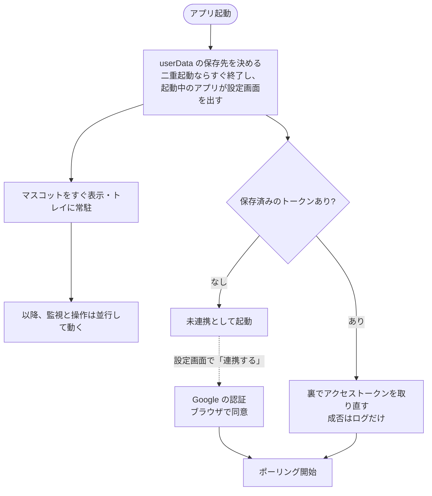
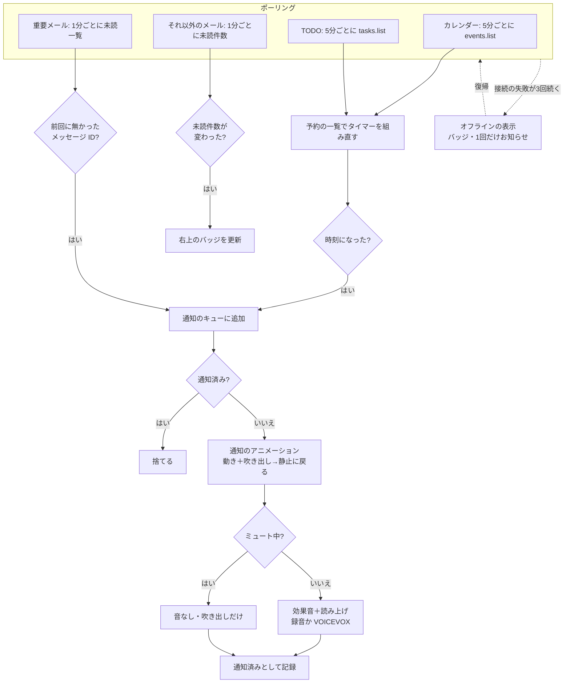
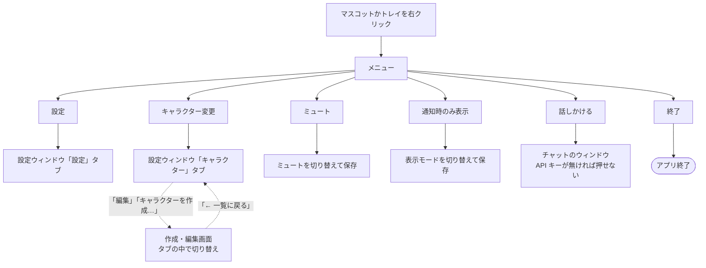
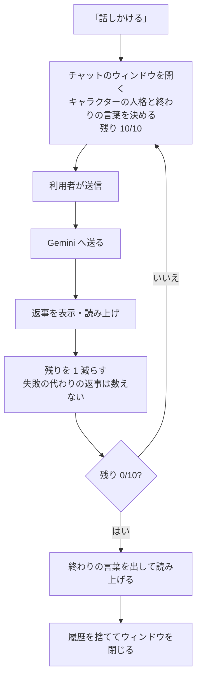
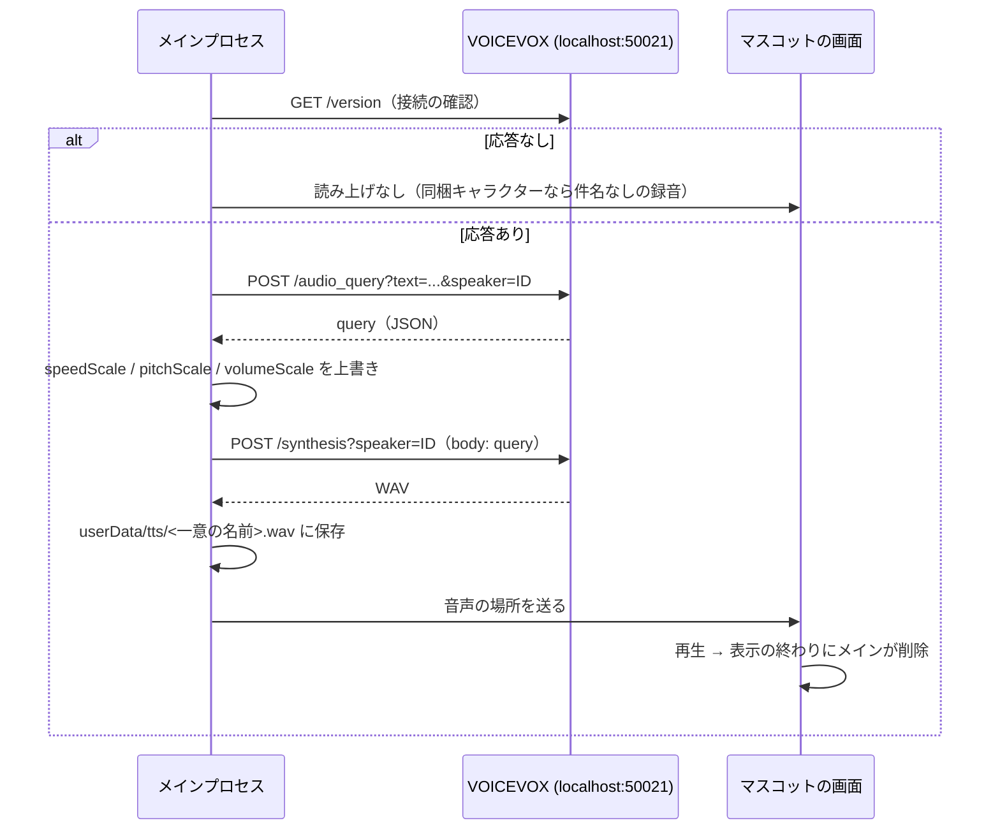

# おしらせメイト（デスクトップマスコット通知アプリ）要件定義書 v6

| 項目 | 内容 |
|---|---|
| 版 | v6.0（2026-10-27） |
| 対象 | アプリの版 0.1.0（最初のリリース。Phase 16） |
| 前の版 | v5.20（`docs/要件定義書_v5.md`。git の履歴に残る） |

## 0. この文書について

### 0.1 v6 の方針
v5 では、Phase ごとの変更を「v5.x 改訂方針」として冒頭に積み重ねてきた（v5〜v5.20 の 21 回分で、文書の約 4 割）。本文には「（v5.9）」「v5.11 で撤回」のような注記が増え、今の仕様がどれかを読み取りにくくなっていた。

v6 では次のように整理した。**仕様そのものは v5.20 から変えていない。**
- 各改訂方針の中身を、該当する章（機能・画面・アーキテクチャ・配布など）に溶け込ませ、**今の仕様**として書き直した。撤回・変更された古い記述は本文から消した。
- 「なぜそうしたか」（ユーザーの判断・採らなかった案・実機確認で分かったこと）は **付録 A　決定の経緯** にまとめた。
- 各版で何を変えたかは **付録 B　改訂履歴** に 1 行ずつ残し、内容が v6 のどの節に入ったかを書いた。コードのコメントにある「v5.19」などの参照は、付録 B でたどれる。

### 0.2 読み方
- 「個人版」「共有版」は開発者向けの言葉で、利用者向けの画面・文書（README・セットアップ手順書）では使わない（2.5）。
- 「同梱キャラクター」はアプリに入っているシアン・シトロン、「既定キャラクター」は黄色い丸のメイト、「取り込んだキャラクター」は利用者が EmoteLab で作って取り込んだもの（3.7）。
- 「F-nn」は機能の番号（3.1）、「Phase n」は開発の段階（9 章）。

### 0.3 用語

| 用語 | 定義 |
|---|---|
| 通知 | 本アプリがマスコットを介して利用者に提示する情報の単位。Google からの生のイベントではなく、アプリ内で正規化した後のもの |
| 個別通知 | 内容を提示する通常の通知（カレンダー・TODO・重要メール） |
| サマリ通知 | 件数だけを知らせる軽い通知（重要でないメールの未読件数。マスコット右上のバッジ） |
| システム通知 | アプリ自身のお知らせ（オフラインになった・まだお知らせがない、など）。キューの次より優先して出す |
| カレンダー通知 | Google カレンダーの予定の**開始前のリマインダー時刻**に出す通知 |
| TODO 通知 | Google ToDo リスト（Tasks）のタスクの**期限の日**に出す通知 |
| マスコット | デスクトップに表示される透過ウィンドウの中のキャラクター |
| アイドルトーク | 通知が無いまましばらく経ったときに、マスコットが自分から話す機能 |
| セリフ | キャラクターごとの読み上げの文（通知の読み上げ・アイドルトーク・チャットの終わり。F-22） |
| 固定ボイス | 同梱キャラクター用に VOICEVOX で事前に合成して同梱した音声（録音。F-23） |
| VOICEVOX | ローカルで動く音声合成ソフト。HTTP API（`localhost:50021`）を持つ |
| 個人版／共有版 | 開発者本人が使う版と、利用者に配る版（2.5） |
| userData | アプリのデータフォルダ（設定・トークン・取り込んだキャラクター・ログ。2.5・6 章） |

---

## 1. 概要

### 1.1 解決したい課題
Google カレンダーに予定が入っているのに、通知に気が付かず予定を逃すことがある。

### 1.2 原因
- Google の通知が PC 上に表示されない（ブラウザを閉じている／通知が抑制されている）
- 表示されても味気なく、視界に入っても意識に残らない

### 1.3 解決のしかた
デスクトップに常駐するマスコットが、Google カレンダー・TODO・メールの通知を **アニメーション＋効果音＋読み上げ** という「無視しにくい形」で知らせる。

**OS 標準の通知（Toast／Notification）は使わない。** 「標準の通知は味気ない」こと自体が課題（1.2）なので、独自の透過ウィンドウでの表示に一本化する。

### 1.4 スコープ外
- **アプリが起動していないときの通知**：知らせる先がアプリ自身なので、原理的にできない。代わりに「Windows へのログイン時に自動で起動」で常駐させる。
- **外部サーバーの構築**：Webhook を受けるクラウドサーバーは作らない（2.1・2.2）。
- **スマートフォンへの通知**
- **通知の内容のリアルタイム生成**：通知のたびに文面や演出を AI でその場で作ることはしない。Gemini を呼ぶのは、利用者がチャットで話しかけたときと、キャラクターの編集画面で「Gemini でセリフを作る」を押したとき（セリフの**案**を作り、保存した文を以後の読み上げに使う）だけ（2.7）。
- **macOS など Windows 11 以外**（1.5）
- **GIF／APNG／WebP の取り込み**、キャンバスの大きさが違う画像の自動リサイズ（10 章 #5）

### 1.5 対応 OS
**Windows 11（64 ビット）のみ。**

### 1.6 技術スタック

| 区分 | 採用技術 |
|---|---|
| ランタイム | Node.js 20 以降（開発・テストは Node.js で統一。Python は使わない） |
| デスクトップ | Electron 30 以降 |
| Google API | `@googleapis/calendar`・`@googleapis/tasks`・`@googleapis/gmail`（公式クライアントの個別パッケージ。`googleapis` 全体は読み込むだけでメモリが約 100MB 増えるため使わない：付録 A-7） |
| 認証 | OAuth 2.0 Loopback ＋ PKCE（2.3） |
| 設定の保存 | `electron-store`（`config.json`） |
| 秘密情報の保存 | Electron の `safeStorage`（Windows の DPAPI による暗号化） |
| 音声合成 | VOICEVOX（ローカルの HTTP API。利用者が起動していれば両版で使う） |
| チャット・セリフの生成 | Gemini API（`fetch` による REST 呼び出し。SDK は使わない：付録 A-9） |
| テスト | Vitest（Google・VOICEVOX・Gemini は `mocks/` のスタブに対してテストする） |
| 配布物の作成 | electron-builder（zip。インストーラーは使わない：8 章） |

### 1.7 配布の概要
- 利用者に配るのは**共有版だけ**で、GitHub Releases に zip とセットアップ手順書（HTML）を置く（8 章）。
- 利用者は自分の Google アカウントで OAuth クライアントを作り、設定画面で読み込んで連携する（2.4・3.8）。
- ソースコードは MIT ライセンスで、公開リポジトリ `katuo194/oshirase-mate` に置く。素材（アイコン・キャラクター画像・固定ボイス）は MIT の対象外（7.5）。

---

## 2. アーキテクチャ

### 2.1 通知の検知：ポーリングに統一
Google Cloud Pub/Sub などのプッシュ通知は**使わない**（付録 A-1）。アプリ内のスケジューラが Google API を定期的に取得（ポーリング）する。

| 対象 | 取得する API | 間隔 | 通知を出す条件 | 種別 |
|---|---|---|---|---|
| カレンダー | `events.list`（今から 24 時間分） | 5 分 | リマインダー時刻にアプリ内のタイマーで出す | 個別通知 |
| TODO | `tasklists.list` → 各リストの `tasks.list` | 5 分 | 期限の日の 16:00 にアプリ内のタイマーで出す（7.1） | 個別通知 |
| メール（重要） | `users.messages.list`（`q=is:important is:unread`） | 1 分 | 前回の取得に無かったメッセージ ID | 個別通知 |
| メール（それ以外） | `users.messages.list`（`q=is:unread -is:important`、`maxResults=500`。`nextPageToken` をたどって **ID の数を数える**。最大 5 ページ＝2,500 件） | 1 分 | 未読件数の増減 | サマリ通知 |

- カレンダー・TODO は、ポーリングで「予約しておくべき通知の一覧」を作り、アプリ内のタイマー（`reminderTimers`）を組み直す。通知を出すのはタイマー（4 章の応答性「時刻から 10 秒以内」のため）。予定の変更・削除にはポーリングのたびに追随する。
- 間隔は `config.json` の `polling.*` で変えられる（設定画面には出さない。10 秒未満は既定値に戻す）。
- 同じ通知は二度出さない。通知済みの ID は `notified.json` に保存し、7 日で消す（F-05）。ID には期限・開始日時を含めるので、期限を変えたタスクは改めて通知される。
- 初めて起動したときは、今ある未読の重要メールを**すべて通知済み**として扱う（起動直後に大量に出さない）。

**失敗とバックオフ（scheduler.js）**
- 失敗は系統ごと（カレンダー・TODO・重要メール・未読件数）に数え、n 回続いたら次の再試行は min(1 分 × 2^(n−1), 15 分) 後（1→2→4→8→15→15 分…）。基準は通常の間隔によらず全系統 1 分。429 の `Retry-After` が長ければそちらを使う。成功すれば通常の間隔に戻る。
- API の失敗は種類（`unauthorized`・`quota`・`forbidden`・`rate_limited`・`server`・`network`・`auth_unavailable`・`unknown`）に分類する（apiErrors.js）。トークンを含む生のエラーは持たない。
- googleapis の自動リトライ（最大 3 回）は `retry: false` で切る（呼び出し回数の実測と、上のバックオフとの二重化を避けるため）。

**オフライン（F-14）**
- 接続そのものの失敗（`offlineCandidate`）が、いずれか 1 系統で **3 回続いたらオフライン**、全系統が 3 回未満に戻ったら解除する（全体で 1 つの状態）。401・クォータ・429・403 などの失敗はサーバーに届いている証拠として連続回数を 0 に戻す。`invalid_grant` は未連携になるだけで、オフラインには数えない。ネットが切れてから最大約 4 分でオフラインの表示になる。
- 復帰を 15 分待たせないため、次のときはバックオフ待ちの系統をすぐ再試行する：オフライン中に失敗していた系統が成功したとき、OS がネットワークの復帰を報告したとき（`net.isOnline()` を 30 秒ごとに確認）、スリープから戻ったとき、オフライン表示中に 30 秒ごとの疎通確認（`https://www.google.com/generate_204` へ HEAD）がつながったとき（networkWatch.js）。仮想アダプタ（Hyper-V・WSL 等）があると `net.isOnline()` がネット断中も true のままになるため、疎通確認を併用する。疎通確認での再試行は「つながらない → つながった」の変化のときだけ（API だけが失敗し続ける場合に叩き続けない）。
- オフライン中も、取得済みの予定・TODO の通知はタイマーで出る。表示は 3.2。

### 2.2 ローカル完結とネットワーク
- 外部サーバー・Webhook の受信は不要で、Electron のメインプロセスの中で完結する。
- Google（OAuth・Calendar・Tasks・Gmail・Gemini）への通信と疎通確認は、Electron の `net.fetch`（Chromium のネットワーク）で行う。OS のプロキシ設定（WPAD・PAC を含む）に従うため。Node の `fetch` はプロキシを使わず、プロキシ必須のネットワークでは常に失敗する。`net.fetch` の接続失敗（`net::ERR_*`）は `network` に分類する。
- VOICEVOX（localhost）は Node の `fetch` で呼ぶ。

### 2.3 認証（Google）
- **OAuth 2.0 Loopback フロー ＋ PKCE**。ループバックのポートは OS が割り当てる空きポート（`127.0.0.1` のみ）。`state` を検証し、一定時間で打ち切る。認可 URL には `access_type=offline` と `prompt=consent` を付ける。
- スコープは読み取り専用の 3 つ：`calendar.readonly`・`tasks.readonly`・`gmail.readonly`（`https://www.googleapis.com/auth/…`）。同意画面で 1 つでも外されたら、連携を成立させない（「必要な権限がすべて許可されませんでした」）。
- OAuth の同意画面は**「本番環境」に公開する**（「テスト」のままではリフレッシュトークンが 7 日で失効するため）。審査は受けず、「Google で確認されていません」の警告は許容する。同意画面へのスコープの登録は省く（付録 A-14）。
- 保存するのは `refresh_token`・`scope`・`token_type` だけで、`safeStorage` で暗号化して `userData/tokens.enc` に置く（平文に戻す経路は持たない）。アクセストークンは保存しない。
- API には、`auth.getAccessToken()` が返す有効なアクセストークンを、呼び出しのたびに `Authorization` ヘッダーで渡す。googleapis の `OAuth2Client` にはリフレッシュトークンを渡さない（自動更新と、auth.js の更新・`invalid_grant` の判定が二重になるため）。401 が返ったらアクセストークンのキャッシュを捨て、次の呼び出しで取り直す。
- **起動時**：保存済みのトークンがあれば、裏でアクセストークンを取り直す（成否はログだけ）。マスコットの表示は待たせない（5.1）。
- **更新に失敗したとき**：Google が `invalid_grant` を返したときだけトークンを捨てて未連携に戻す。ネットワークエラー・5xx などではトークンを残し、連携中のまま扱う（オフラインでの起動で連携し直しを強いない）。
- **連携解除**：Google 側でトークンを revoke し（失敗しても続ける）、`tokens.enc` を必ず消す。
- **読めない暗号化ファイル**：`tokens.enc`・`gemini-key.enc`・`oauth-client.enc` が復号できない・中身が壊れているときは、消さずに `<ファイル名>.broken-<日時>` へ名前を変えて残し、ファイル名と理由（decrypt／parse／invalid。中身は出さない）をログに出して、未設定として扱う（unreadableFile.js。付録 A-12）。

### 2.4 OAuth クライアントの提供元
OAuth クライアント（Client ID／Secret）をどこから得るかが、個人版と共有版の違いの 1 つ目（2.5）。

**個人版（開発者）**：開発者の Google Cloud プロジェクトのクライアントを `.env`（`GOOGLE_OAUTH_CLIENT_ID`・`GOOGLE_OAUTH_CLIENT_SECRET`）に置き、起動時に dotenv で読む。開発時はプロジェクト直下、個人版の配布物では `resources/.env`。`.env` は git に入れない（`.env.example` には値を書かない）。デスクトップアプリの Client Secret は Google の分類上は秘匿の対象ではないため、`.env` での平文の管理を許す。

**共有版（利用者）**：開発者のクライアントは配布物に入れない。利用者が自分の Google Cloud プロジェクトでクライアント（種類：デスクトップ アプリ）を作り、設定画面の「Google 連携の準備」（3.8）で読み込む。
- 作成直後の画面でダウンロードした JSON（`client_secret_〜.json`）を、ファイル選択かドラッグ＆ドロップで読み込む。手入力は「手動で入力する」を開いたときだけ。
- 読み込み・入力した値は `safeStorage` で暗号化して `userData/oauth-client.enc` に置く（平文に戻す経路なし）。JSON の読み込みはメインプロセスで行い、Secret も Client ID も画面（レンダラー）へ渡さない。画面が受け取るのは「保存済みか」と、失敗の理由だけ。値はログに出さない。
- 連携中は変えられない（トークンはクライアントに結び付くため。先に連携解除する）。
- 認証の流れ（2.3）は個人版と同じ。

### 2.5 個人版と共有版

| 項目 | 個人版（開発者用） | 共有版（配布するもの） |
|---|---|---|
| OAuth クライアント | `.env`（開発者のもの） | 利用者が作って読み込む（暗号化して保存） |
| 配布 | 開発者本人のみ（ソースから起動、または `.env` を同梱した zip。配布しない） | GitHub Releases の zip ＋セットアップ手順書 |
| ソースからの起動 | `.env` に Client ID と Secret が両方入っているとき | `.env` が無い・空のとき（GitHub から取得したソースをそのまま起動したとき） |
| userData | `%APPDATA%\my-mascot-app`（旧名のまま） | `%APPDATA%\おしらせメイト` |

違いは **「OAuth クライアントの提供元」と「配布形態」の 2 つだけ**。VOICEVOX・Gemini・キャラクターなどの機能は両版で同じで、VOICEVOX を使えるかは版ではなく、VOICEVOX への疎通確認の結果（接続中／未検出）で決まる（付録 A-10）。

**版の決め方（edition.js・buildInfo.js）**：次の順で最初に決まったもの。
1. `config.json` に実際に保存された `edition`（`"personal"`／`"shared"`）。アプリは書き込まない（開発・確認のときに直接書く）。スキーマや electron-store の既定値で埋めない（埋めると 2 以降が効かなくなる）。
2. ビルド時の既定値（配布物の `package.json` の `mascotEdition`。electron-builder の `extraMetadata` で書き込む）
3. ソースからの起動では、プロジェクト直下の `.env` に Client ID と Secret が**両方入っていれば** `"personal"`、無ければ `"shared"`。形式は見ない（値が入っていて形式が誤っている `.env` は個人版のまま起動し、設定画面にエラーを出す。気づかないうちに共有版に切り替わらないため）。`.env` を読むのは 2 が無いときだけで、値は返さずログにも出さない。

**userData の保存先（userDataDir.js・pinUserDataDir.js）**
- Electron の userData は `productName`（無ければ `name`）で決まる。アプリ名を「おしらせメイト」に変えた後も、個人版の設定・トークン・キャラクターを引き継ぐため、個人版は旧名の `%APPDATA%\my-mascot-app` に固定する。共有版は `%APPDATA%\おしらせメイト`（同じ PC で両版を動かしても、開発者のデータが共有版に見えない）。
- 固定は `index.js` の最初の import（pinUserDataDir.js）で `app.setPath('userData', …)` する（store.js が import 時に userData を読み、単一インスタンスのロックも userData に置かれるため）。版の判定は 2・3 だけで行う（1 の `config.json` は保存先が決まるまで読めない）。
- 両版は別々の単一インスタンスのロックを持ち、同時に起動できる。`.env` の無い作業用の複製（`.claude/worktrees/` など）からソースで起動すると共有版になり、配布版と同じ保存先を使うため、配布版と同時には起動できない。
- 起動引数に `--user-data-dir` が明示されていれば、その場所を使い、固定しない（開発中の共有版の動作確認用。docs/development.md）。

### 2.6 キャラクターの描画

**既定キャラクター（メイト）**：黄色い丸に目と口。Canvas の手続き描画（`renderer/mascot/character.js`）で、素材ファイルは持たない。名前は「メイト」で変えられない。

**EmoteLab のキャラクター（取り込み・同梱）**：EmoteLab で書き出した **ImageSequence（透過 PNG の連番）だけ**を使う（付録 A-15）。
- EmoteLab はモーションごとに別々のフォルダとして書き出せる（`000.png` からの**3 桁の連番**。ほかのメタデータファイルは無い）。
- キャンバスは **400×400px・RGBA の透過 PNG**。大きさの違う・RGBA でないフォルダは取り込みでエラーにし、自動リサイズはしない。
- 連番は `000` から欠番なし（1〜999 枚）。連番名でないファイル（`Thumbs.db` など）は無視する。
- fps は EmoteLab の書き出しの設定によるので、アプリでは決めず、モーションごとに入力して manifest に持つ（1〜60。作成画面の既定は 60）。

**表示**
- キャラクターの枠は全キャラクター共通の **200 DIP**。400×400 の PNG は、デコードのときに canvas の実ピクセル（200 × 表示倍率）へ高品質に縮小して描く（表示倍率 200% で等倍。400 DIP への拡大は画像の粗が目立つため採らない）。枠が変わらないので、キャラクターを切り替えてもウィンドウは拡縮しない。
- `characterAnchor`（6.1）は**キャンバスの中心**。フレームごとの実際の描画範囲（bbox）は使わない（輪郭の位置がフレームごとに少し動き、基準が揺れるため）。
- 動きは PNG の連番に焼き込み済みとみなし、既定キャラクターの手続き的な演出（ホップ・揺れなどの移動と拡縮、種別色のリング）は重ねない。通知の種類の違いは `notify.calendar`・`notify.tasks`・`notify.gmail` のモーション（未設定なら `notify`）と吹き出しの色で表す。
- 通知中はそのモーションをループし、表示の終わりの絞りの途中で `rest` に戻る。`rest` は常にループする（待機中の CPU を抑えるため、rAF を回し続けず、フレームが変わるときだけ描く）。
- **先読みとメモリ**：キャラクターを選んだとき（起動時を含む）、全モーションの PNG を**圧縮したまま**先読みする。デコード済みで持つのは `rest` と、表示中の通知のモーションだけ。通知の開始時に `000` から順にデコードし（まだのフレームは直前のフレームで代用。1 枚目は数 ms で出る）、表示が終わったら解放する（付録 A-16）。
- 画像は独自プロトコル `mascot-character://<id>/<フォルダ>/<NNN>.png` で読む（`file://` の画像を canvas に描くと、当たり判定に使う α 値の読み出しがオリジンの制約で失敗し得るため）。メインは検証済みのパス（取り込んだものは `userData/characters/`、同梱は app の中の `assets/characters/`）だけを返す。ID・フォルダ名・ファイル名は許可リストで確かめる。
- オフラインの困り顔（八の字眉＋波口）は既定キャラクターだけが持つ。EmoteLab のキャラクターはバッジだけで表す。アイドルトークでは `notify` を使わず `rest` を再生し続ける。

### 2.7 生成 AI の使いどころ
- **開発時**：効果音・素材・同梱キャラクターのセリフの下書きなどに生成 AI を使ってよい（素材の調達。フリー素材と併用）。
- **実行時**：Gemini を呼ぶのは、利用者の操作があったときだけ（チャットで話しかけた〔F-16〕、「Gemini でセリフを作る」を押した〔F-22〕）。通知・アイドルトークのたびに呼ぶことはなく、読み上げは保存した文から選ぶ。オフラインでも動き、API の料金もかからない。
- Gemini に送るのは、利用者が入力した文章（チャットの発言・キャラクター名・キャラクター設定）とセリフの決まりだけ。予定・メール・TODO の内容は送らない。

### 2.8 ウィンドウとセキュリティ
- 全ウィンドウで `contextIsolation: true`・`sandbox: true`。ウィンドウごとに専用の preload（`src/preload/<window>.cjs`。sandbox の preload は CommonJS なので拡張子 `.cjs`）を置き、`contextBridge` で最小限の API だけを公開する。
- 設定ウィンドウ・チャットウィンドウは、webviewTag 無効・CSP・`window.open` の拒否・ページ遷移の拒否・IPC の送信元の検証を行う。チャットウィンドウは加えて権限の要求をすべて拒否する。
- 画面から任意の URL を開かせない。画面はリンクの名前（`apis`・`branding`・`audience`・`client`・`voicevox`・`geminiKey`）だけをメインへ送り、URL はメインの表（externalLinks.js）で決める。開く直前にも表にある URL そのものかを確かめる。
- セットアップ手順書は、アプリの中の専用ウィンドウで開く（`shell.openPath` は `.html` の既定のアプリで開くため、エディターが開く PC がある）。手順書の中の見出しへの移動はそのまま、`https` のリンクだけ既定のブラウザで開く（manualLinks.js）。
- ファイルの場所（フルパス）は画面に渡さない（キャラクターのフォルダ選択・JSON の読み込み。ドロップされたファイルは preload が `webUtils.getPathForFile` で取った場所だけをメインへ送る）。
- 秘密情報（トークン・Client Secret・Gemini API キー）は暗号化して保存し、画面に返さず、ログにも出さない（4 章）。

---

## 3. 機能要件

### 3.1 機能一覧と受入基準

**基本（MVP。これが動けば 1.1 の課題は解決する）**

| ID | 機能 | 受入基準 |
|---|---|---|
| F-01 | Google アカウントと連携できる | ブラウザで同意すると、トークンが暗号化して保存され、再起動しても連携し直しを求められない |
| F-02 | カレンダー・TODO・重要メールの個別通知を検知する | モックの API の応答に対し、2.1 の条件どおりに通知が作られるユニットテストが通る |
| F-02b | 重要でないメールは未読件数のサマリ通知にする | 未読が 3 件から 5 件に増えると、バッジが「5」に変わるユニットテストが通る（個別のアニメーションは出ない） |
| F-03 | 個別通知をマスコットで知らせる | 通知が来ると、マスコットが通知のアニメーション（動き＋吹き出しによる内容）で反応し、終わったら通知の無い状態に戻る（3.2） |
| F-04 | 通知のアニメーションは「冒頭の動き＋内容表示中のループ」 | 注意を引く冒頭の動き（約 1 秒・1 回）のあと、内容の表示中は動きをループする。吹き出しはフェード（出るとき約 0.35 秒・消えるとき約 0.5 秒）で出入りし、表示時間の終わりに動きを絞って静止に戻る。表示の長さは種別ごと（3.2）。キャラクター自体の出現・退場のアニメーションは持たない |
| F-05 | 同じ通知を二度出さない | 通知済みの ID が保存され、再起動しても出し直さない |
| F-06 | タスクトレイに常駐し、右クリックメニューを持つ | 「設定・キャラクター変更・ミュート・通知時のみ表示・話しかける・終了」が出て、それぞれ動く（3.9） |
| F-07 | 設定を保存する | 音量・ミュート・選んだキャラクター・自動起動・表示モードが、再起動しても残る |
| F-08 | 個別通知が短い間に集中したら、順番に並べる | 重要メール 5 件が同時に来たら、届いた順にキューに並び、1 件ずつ取り出せる。表示ではアニメーションが重ならず、キューの順に 1 件ずつ出る |

**追加の機能**

| ID | 機能 | 受入基準 |
|---|---|---|
| F-11 | 通知の種類でアニメーションを変える | 予定・TODO・重要メールで見た目（既定キャラクターは動きと色、EmoteLab のキャラクターはモーション）と吹き出しの色が変わる |
| F-12 | アニメーションに合わせた効果音 | 種類ごとの効果音（`notify_{calendar,tasks,gmail}`。無ければ共通の `notify`、それも無ければ無音で続け、種類ごとに 1 回だけ警告をログに出す） |
| F-13 | VOICEVOX による読み上げ | VOICEVOX が起動していれば、通知・アイドルトーク・チャットを選んでいるキャラクターの声で読み上げる。起動していなければ黙って読み上げを省き、設定画面に案内を出す（3.3） |
| F-14 | オフラインのときに接続を促す | 接続の失敗が 3 回続くとオフラインの表示になり、復帰すると自動で戻る（2.1・3.2） |
| F-15 | アイドルトーク | 3.5 |
| F-16 | チャット（Gemini） | 3.6 |
| F-17 | EmoteLab のキャラクターの取り込み | ① キャラクター作成画面で、ImageSequence のフォルダをモーション（`rest`・`notify`・`notify.calendar`・`notify.tasks`・`notify.gmail`）ごとに取り込める ② `rest`・`notify` は必須、ほかは任意で、未設定なら `notify` を使う ③ 取り込んだキャラクターをキャラクタータブで選ぶと、各状態の表示に反映される ④ EmoteLab のクレジットが設定画面・キャラクタータブ・README に出る ⑤ 名前・モーション・fps・声・キャラクター設定・セリフを編集でき、削除できる |
| F-18 | 利用者の OAuth クライアントの読み込みと案内 | 設定画面の「Google 連携の準備」の手順 1〜5 に沿って、Console からダウンロードした JSON を読み込み（手入力も可）、暗号化して保存し、再起動せずに連携できる。設定画面からセットアップ手順書を開ける（3.8） |
| F-19 | ショートカットからの起動・アプリのアイコン | 設定画面からデスクトップとスタートメニューに `おしらせメイト.lnk` を作成・作り直し・削除でき、そこから起動できる（ソースからの起動では `おしらせメイト（開発）.lnk`）。リンク先が今の実行ファイルと違えば「作り直す」を出す。起動中にもう一度起動すると設定画面が前に出る。実行ファイル・ショートカット・トレイに用意したアイコンが出る（3.9） |
| F-20 | 「通知時のみ表示」モード | 設定画面とトレイ／右クリックメニューで切り替えられ、再起動しても残る。オンの間は普段は隠れ、通知（オフラインのお知らせを含む）のときだけフェードインし、吹き出しが閉じたらフェードアウトする。連続する通知の間・ドラッグ中・右クリックメニューの表示中は消えない。アイドルトークは出ない（3.2） |
| F-21 | 直前のお知らせの再表示 | マスコットをダブルクリックすると、最後に表示した通知（予定・TODO・重要メール）を、その時刻で作り直した内容・効果音・読み上げつきでもう一度出す（3.2） |
| F-22 | キャラクターごとのセリフ | 通知の読み上げ・アイドルトーク・チャットの終わりの文をキャラクターごとに設定でき、「Gemini でセリフを作る」で案を作れる（3.4） |
| F-23 | 同梱キャラクターと固定ボイス | シアン・シトロンがアプリに入っていて、VOICEVOX が無くても録音の声で話す（3.3・3.7） |

### 3.2 通知の表示

**状態**：マスコットは「通知なし（静止・待機）」と「通知中」の 2 つの状態を持つ。オフラインは第 3 の状態にはせず、どちらにも重ねる印（バッジ）とする。

**通知の流れ**：ポーリング → 通知のキュー（notifyQueue：重複の排除・先入れ先出し）→ 表示の係（notificationPresenter）→ マスコットのウィンドウ。
- 表示の係は、表示が終わるたびにキューから 1 件だけ取り出す（アニメーションを重ねない）。ドラッグ中は取り出しを止める。画面の準備ができていなければ待つ。終わりの応答が来ないときのための見張り（ウォッチドッグ）を持つ。
- 表示の長さは種別ごと：カレンダー 8 秒・TODO 6 秒・重要メール 5 秒。後ろに通知がたまっていれば ×0.6（下限 3 秒）。
- 吹き出しには種別のラベル・件名・副題（予定の時刻「17:13 開始（10分後）」、TODO の期限、メールの差出人）を出す。吹き出しの内容は読み上げのセリフ（3.4）を変えても変わらない。
- サマリ通知（重要でないメールの未読件数）はマスコットの右上の小さなバッジ。100 件以上・上限（2,500 件）に達したときは「99+」に丸める。正確な件数はログ（`[summary]`）に出す。

**ウィンドウの拡大・縮小**
- 吹き出しを出すときだけ、ウィンドウを `characterAnchor` を基準に瞬時に広げ（`setBounds`）、終わったら戻す。広げてもキャラクターの見た目の位置は動かさない（windowLayout.js。画面の端では吹き出しを上下反転・左右に寄せる）。見た目の変化は吹き出しのフェードとスケールで表す。
- 切り替えの瞬間のちらつきを防ぐため、切り替えの間だけキャラクターを約 0.1 秒隠す（隠す → 配置し直す → 応答 → `setBounds` → 反映後に出す）。続く通知で配置が同じなら切り替えを省き、縮小は 150ms 遅らせる（すぐ次の通知が来れば広げたまま続ける）。
- 広げる間に届いた読み上げの音声は id ごとに覚えておき、その表示が始まったら使う（別の表示が始まった・ミュートしたら捨てる。付録 A-22）。

**オフラインの表示（F-14）**
- 既定キャラクターは待機の顔を困り顔（八の字眉＋波口）にし、キャラクターの左下にバッジ（CSS のゆっくりした点滅。rAF は回さない）を出す。EmoteLab のキャラクターはバッジだけ。
- オフラインになったとき 1 回だけ、「インターネットにつながらないみたい／接続を確認してね」の吹き出しを、システム通知（効果音・読み上げなし。キューの次より優先し、表示中には割り込まない）で出す。戻ったら印を消すだけ。
- オフライン中も通知は出す。通知中はバッジを出したまま、通知の顔で演出する。

**直前のお知らせの再表示（F-21）**
- マスコット（キャラクターの描画部分）をダブルクリックすると、最後に表示した通知（予定・TODO・重要メール）をもう一度出す。オフラインのお知らせ・アイドルトークは対象外。
- 内容（予定の「n 分後」など）はダブルクリックした時刻で作り直し、効果音・読み上げも最初と同じに行う（ミュート中は鳴らさない）。読み上げのセリフも選んでいるキャラクターのもの。
- キューと `notified.json` は通さない（表示の係の優先枠に入れる）。覚えるのはメモリの中だけで、再起動すると忘れる。
- 受け付けるのは、何も表示していないとき、またはアイドルトークの表示中（絞って中断してから出す）で、通知・システム通知の表示待ちが無いときだけ。通知・お知らせ・再表示の表示中は何もしない（連打で積み重ならない）。まだ通知を 1 件も出していなければ「まだお知らせはないよ」をシステム通知で出す。押している間に数 px 以上動かした（ドラッグした）ときはダブルクリックとして扱わない。見た目は元の通知と同じ（「もう一度」の印は付けない）。
- 「通知時のみ表示」ではマスコットが普段は隠れていて、ダブルクリックできるのは通知の表示中だけ（その間は受け付けない）なので、このモードでは使えない（トレイメニューからの再表示は 10 章 #9）。

**「通知時のみ表示」（F-20）**
- `displayMode` が `notifyOnly` のとき、マスコットは普段は隠れていて、通知（オフラインのお知らせを含む）のときだけフェードイン（約 0.2 秒）し、吹き出しが閉じたらフェードアウトして隠れる（mascotVisibility.js）。連続する通知の間・ドラッグ中・右クリックメニューの表示中は消さない。アイドルトークは出さない。
- オンにした時点で通知の表示中なら、その通知が終わってから隠れる。オフにするとすぐ現れる。
- 隠れている間はマスコットを右クリックできないので、メニューはトレイから開く。

### 3.3 読み上げ（VOICEVOX・固定ボイス）

**接続**：VOICEVOX（`localhost:50021` 固定。ポートを変えている場合は使えない）の接続状態（接続中／未検出／失敗）を、起動時・設定画面を開いたとき・「再確認」・読み上げのたびに確かめる（定期的には確かめない）。版では分けない。

**声**：選んでいるキャラクターの声（話者・スタイルの ID、話速 0.5〜2.0、音高 −0.15〜0.15）を、通知・アイドルトーク・チャットのすべての読み上げに使う。声が未設定のキャラクターは `config.json` の `voicevox`（既定値。設定画面では変えない）を使う。話者の一覧は VOICEVOX の `GET /speakers` から取る。

**読み上げる文**：通知はキャラクターのセリフ（3.4）から作り、50 文字以内に収める（長いときは件名の側を切り詰める）。「TODO」は「トゥードゥー」と読ませる。

**表示との関係**
- 表示は音声を待たずに始め、合成は並行して行う（4 章の応答性に影響させない）。
- 読み上げの開始は効果音の終わり＋0.2 秒以降（効果音と重ねない。合図が無くても 1.5 秒で解禁）。
- 読み上げる通知は、音声が届くか、合成できないと分かるまで吹き出しを保持する（表示の開始から 20 秒が上限）。絞りの開始＝max（表示の長さ, 読み上げの終わり＋0.6 秒）。後ろに通知がたまって表示の長さが縮んでいても、音声の長さを優先する。
- 音声は、表示中の id に一致し、絞りの前に届いたときだけ鳴らす。遅れたものは捨てる。

**合成の段取り（voicevox.js・voiceReader.js）**
- 合成は `POST /audio_query` → 話速・音高・音量を上書き → `POST /synthesis`。WAV は `userData/tts/` に一意の名前で保存し、表示が終わったらメインプロセスが消す（sandbox の画面からは消せないため）。残骸は起動時に掃除する。チャットの音声は `tts/chat/`。
- 合成と話者の先読みは 1 件ずつ送る（通知とチャットで共通の待ち行列）。送った要求は中断しても終わるまで待ち、まだ送っていない要求は中断で取り消す。合成の待ち時間の上限は 20 秒（CPU 版の VOICEVOX では 1 件に 10 秒以上かかることがあるため：付録 A-11）。自分の合成中の接続確認のタイムアウトは「未検出」にしない。
- 起動時と声を変えたときに `POST /initialize_speaker`（`skip_reinit=true`）で話者を先に読み込ませる。
- 読み上げの待ち行列は持たない。ミュート中に起きた読み上げは合成せず、合成中・再生中にミュートされたら捨てる（解除しても後から鳴らない）。ボイスの音量が 0% のときも読み上げない。

**固定ボイス（同梱キャラクター。F-23）**
VOICEVOX で事前に合成した音声（WAV）を同梱し、VOICEVOX が無くても話せるようにする。通知の読み上げは件名や時刻で毎回文が変わり、事前には録音できないため、次のように使い分ける（付録 A-21）。
1. **読み上げる文と一字一句同じ録音があれば、VOICEVOX が起動していても録音を流す**（速く、CPU を使わない）。録音しておくのは、アイドルトークの文（空の種類は標準の文）、差し込みの無い通知のセリフ、下の件名なしの文。差し込みのある通知のセリフと、チャット（返事は毎回違い、終わりの文も返事とつなげて合成する）は録音しない。
2. **通知は、VOICEVOX が無い・合成に失敗したとき、種類ごとの件名なしの一言**（manifest の `fallbackLines`。例「アドミン、予定の時間だぜ！遅れるなよ！」。種類ごとに 1〜5 文、シャッフル袋で選ぶ）を流す。件名は吹き出しで見る。表示が先に終わった・ミュートされたときは流さない。アイドルトークで録音の無い文は読み上げない。
3. 利用者が同梱キャラクターの**声（話者・話速・音高）を変えたら録音は使わない**（VOICEVOX だけで読み上げる）。セリフを変えた場合は、変えた文の録音が無いだけ（その文は VOICEVOX で読み、無ければ読まない）。
- 照合は「読み上げる文（TODO の読み替え・切り詰めの後）」と「声」で行う。録音のファイル名は文と声のハッシュ（16 桁の 16 進）、対応表は `voice/voices.json`（6.3）。ミュート・ボイスの音量・吹き出しの保持は合成した音声と同じ。録音は同梱のファイルなので、表示の終わりに消さない。

**クレジット（7.2）**：設定画面のボイス欄に「音声：VOICEVOX:話者名」を出す。VOICEVOX が接続中なら使っている話者、同梱キャラクターを選んでいて録音を今の声で使えるなら、VOICEVOX が無くても manifest の `voiceCredit` を出す。

**設定画面の案内**：VOICEVOX が見つからないときは、起動と「再確認」を促す（GPU 版がおすすめ。同梱キャラクターで録音を使えるときは「録音してある文だけを話す」旨）。同梱キャラクターの声を変えていて VOICEVOX が止まっていると何も読み上げないため、「声を変えているため録音してある声も使えない。『同梱の状態に戻す』で録音の声に戻る」旨を出す。

### 3.4 セリフ（F-22）

**種類と差し込み**

| 区分 | キー | 種類 | 差し込み | 上限 |
|---|---|---|---|---|
| 通知の読み上げ | `notify.calendar` | 予定（時刻あり） | `{title}`（件名）・`{time}`（「10時30分」） | 差し込みを除いて 30 字・10 文 |
| | `notify.calendarAllDay` | 予定（終日） | `{title}` | 同上 |
| | `notify.tasks` | TODO | `{title}` | 同上 |
| | `notify.gmail` | 重要メール | `{title}`・`{from}`（差出人） | 同上 |
| アイドルトーク | `idle.morning`・`idle.bedtime`・`idle.normal` | 朝・就寝前・通常 | なし | 1 文 30 字。朝・就寝前は各 10 文、通常は 30 文 |
| チャット | `chat.closing` | チャットの終わり | なし | 1 文 30 字・5 文 |

- **差し込みはどれも任意。** `{title}` を入れない文は件名を読まない（吹き出しには件名が出る。耳だけではどの通知か分からなくなるのは、その文を選んだ利用者の判断とする：付録 A-19）。
- 設定しなかった種類（空の欄）は標準の文を使う。標準の文は、通知が「予定のお知らせです。{time}から、{title}」のようなひな形、アイドルトークが idleTalkPhrases.js の 30 種、チャットの終わりが「今日はこのくらいにしようか。またお話ししようね。」。何も設定していないキャラクターの読み上げは標準の文のまま。
- **セリフは読み上げにだけ使う。** 吹き出しの表示は変わらない。

**文の選び方**
- 1 種類に複数の文があれば、シャッフル袋（1 周するまで同じ文を出さず、周の境目でも直前の文が先頭に来ない）で選ぶ。袋はキャラクターを切り替えるたびに作り直す。
- 差し込みの値が空になる文（差出人の無いメールで `{from}` を含む、時刻の無い予定で `{time}` を含む）は避けて、使える別の文を選ぶ。どれも使えなければ、差し込みが無いときの標準の文（「重要なメールです。{title}」「予定のお知らせです。{title}」など）を使う。`{title}` は件名が空でも使える。
- チャットの終わりの文は、会話の開始時（チャットウィンドウを開いたとき）にシステムプロンプトと一緒に決める（途中でキャラクターを変えても混ざらない）。

**長さ**：通知の読み上げは 50 字（`SPEECH_MAX`）以内。**件名の側を切り詰め**、セリフの部分は残す（件名が文の途中にあっても後ろが切れない）。件名を空にしても収まらなければ差出人を切り詰め、それでも長ければ文全体を切る。「TODO」の読み替えは展開した後の文全体に行い、読み替えた後の長さで収める。アイドルトークの文にも同じ読み替えをする。

**入力の決まり**：1 行 1 文。改行・タブ以外の制御文字は取り除き、前後の空白を落とし、空行は無視する。知らない差し込み・字数や文数の超過は保存させず、種類と何行目かを入れたエラーを画面に出す（該当の欄を開いて示す）。保存済みのデータに壊れた行（文字列でない・字数超え・知らない差し込み）があれば、読み込むときにその行だけを捨て、多すぎる分は先頭から上限まで残す（キャラクター自体は一覧から外さない）。

**Gemini でセリフを作る**
- 編集画面のセリフ欄の「Gemini でセリフを作る」を押すと、キャラクター名とキャラクター設定（いま欄に書いてある、保存前の値）を Gemini に送り、全種類のセリフの**案**を欄に入れる。案は「保存／取り込む」を押すまで反映されない（保存の経路と検証は手で書いたときと同じ）。
- メイトの編集でも使える（名前は送らず、「黄色い丸い形のマスコット『メイト』」として紹介する）。同梱キャラクターはキャラクター名を送る。キャラクター設定が空なら標準の口調（チャットと同じ友だち口調）で作る。
- 欄に 1 つでも文が書いてあれば、生成の前に「書いてあるセリフを、Gemini で作った案に置き換えますか？」を確かめる（メインのダイアログ）。全部空なら確かめない。キャンセルなら何も送らない。
- API キーが未設定ならボタンを押せず、設定画面で入れるよう案内する。生成中はボタン・セリフの欄・保存を押せない・書けない。画面を閉じたら中止する。同時に走るのは 1 件だけ。
- 作る数は標準の文と同じ（通知は各 3 文、朝 5・就寝前 5・通常 20、チャットの終わり 3）。上限いっぱいにすると出力が長くなり失敗しやすいため。プロンプトでは、1 要素 1 文・**通知の文には必ず `{title}` を入れる**（`{time}` はなるべく）・使える差し込みだけ・字数・内容を決めつけない・絵文字や記号なし・同じ言い回しをくり返さない、を指示する（保存の決まりでは `{title}` は任意のまま）。
- 応答は JSON で受け取る（`responseMimeType: application/json` と `responseSchema`。コードブロックで囲まれた応答も読む）。1 行ずつ保存と同じ決まりで確かめ、字数超え・知らない差し込み・改行入り・重複の行と、`{title}` の無い通知の行は捨てる。多すぎる分は保存の上限まで。使える文が 1 つも残らなかった種類はその欄を変えず、「作れなかったため元のまま」と出す。全種類が空・JSON として読めない（出力の上限で途中まで、を含む）ときは「うまく作れませんでした」。失敗は種類ごと（キーが不正・レート制限・利用枠・モデルが無い・接続断・タイムアウト・ブロック）の文を出す。
- ログには作った文の数と作れなかった種類だけを出し、応答の本文・キャラクター設定は出さない。
- 呼び出しはチャットと同じ geminiClient.js（モデルの候補の切り替えも同じ。3.6）の別のインスタンス（ログの頭は `[lines]`）で、出力 8192 トークン・temperature 1.0・1 回 60 秒まで。

### 3.5 アイドルトーク（F-15）

| 種類 | 出す条件 | 文 |
|---|---|---|
| 通常 | 最後の操作から 15 分（`idleTalk.intervalMin`）経ったとき | 通常の文（標準は 20 種）からシャッフル袋で選ぶ |
| 朝 | その日最初のアイドルトークが 5:00〜10:00 のとき（静粛時間帯が優先するので、実際に出るのは 6:00〜10:00） | 朝の文（標準は 5 種） |
| 就寝前 | 静粛時間帯の始まりの直前 1 時間（23:00〜0:00）の、その日最初のアイドルトーク | 就寝前の文（標準は 5 種） |

- **静粛時間帯** 0:00〜6:00（`idleTalk.quietHours`）は話さない。種類は「静粛時間帯 → 就寝前 → 朝 → 通常」の順に判定する。「その日」はローカルの日付で、状態はメモリだけ。
- **操作**とは、OS 全体の入力ではなく**アプリの中の操作**：マスコットのドラッグ・右クリックメニュー・ダブルクリック（F-21）・設定やチャットを開く・チャットの送信・通知の表示の終わり・直前のアイドルトーク。タイマーは 1 本だけ（最終操作＋間隔。常にポーリングはしない）。話した後・スリープから戻った後は、その時刻から数え直す。
- **通知が常に優先する。** アイドルトークは、何も表示しておらず、システム通知の待ちもキューも空のときだけ受け付ける（ほかは 1 分後にやり直す）。表示中に通知が来たら約 0.5 秒で絞って中断し、通知を出す。通知済みの ID にもキューにも載せない。
- 表示は通知より軽くする：動き・リング・効果音・種別ラベルは使わず、吹き出し（ラベル・副題なし、7 秒）と読み上げだけ。EmoteLab のキャラクターは `rest` のまま。ミュート中は吹き出しだけ。「通知時のみ表示」では出さない。
- 文は保存した文から選ぶ（オフラインで動き、API の料金はかからない）。キャラクターごとの文（3.4）があればそれを、無い種類は標準の文（idleTalkPhrases.js の 30 種：朝 5・就寝前 5・独り言 5・話しかけてくる系 10・疑問形 5。友だち口調・一人称や名前や呼びかけなし・絵文字なし）を使う。通常の 20 種は 1 つの袋で選ぶ（種類ごとに均等に回すと独り言 5 種がくり返されすぎるため）。
- `--dev` で起動したときの開発用メニューに「アイドルトーク（通常／朝／就寝前）」がある（間隔・静粛時間帯を無視してすぐ出す）。

### 3.6 チャット（F-16）
- 右クリックメニューの「話しかける」で、入力欄つきのチャットウィンドウを開く。Gemini API キーが未設定なら「話しかける」は押せない。
- API キーは利用者が設定画面で入力し、`safeStorage` で暗号化して `userData/gemini-key.enc` に置く（アプリには入っていない。両版共通）。画面にはキーを返さず、「設定済みか」だけを渡す。
- 会話は最大 **10 往復**（`chat.maxTurns`）。履歴はメモリにだけ持ち、ウィンドウを閉じたら捨てる（次に開くと新しい会話）。
- ウィンドウの下に「残り n/10 往復」を出す（開始時 10/10、10 往復目の返事で 0/10）。Gemini の失敗による代わりの返事（フォールバック応答）は往復に数えず、履歴にも積まない。
- 10 往復目は「返事＋終わりの言葉」を出し、読み上げた後にウィンドウを自動で閉じる。終わりの言葉は、会話の開始時に選んでいるキャラクターのセリフ（「チャットの終わり」。3.4）から選ぶ（無ければ標準の文）。その場では作らない。
- **人格**：システムプロンプトは「キャラクター名＋キャラクター設定（`persona`。最大 1000 文字）＋共通の決まり」で組み立てる（chatPersona.js）。口調・一人称はキャラクター設定に従い、共通の決まり（返事は 1〜3 文・100 文字程度、絵文字・Markdown なし、予定・メール・TODO の中身は知らない、個人情報・医療／法律／お金・危険な話題の注意）はキャラクター設定より優先する。設定が空なら標準の人格（メイトとして紹介する友だち口調・一人称なし）。プロンプトは会話の開始時に決め、途中でキャラクターを変えても混ざらない。
- **読み上げ**：返事を選んでいるキャラクターの声で読み上げる（VOICEVOX が起動しているときだけ。無ければ文字だけ）。チャット専用の読み上げ（voiceReader の別のインスタンス）を持ち、通知の読み上げと互いに中断しない。待ち行列は持たない（次の送信・終了・ミュートで捨てる）。通知の読み上げが始まったらチャットの音声は譲る。
- **チャット中の通知**：通知の経路（パイプライン → キュー → 表示の係 → マスコット）はチャットとは別のウィンドウ・別の IPC なので両立する。共有するのは VOICEVOX だけ。
- **Gemini の呼び出し（geminiClient.js）**：REST の `generateContent` を `fetch` で呼ぶ（キーは `x-goog-api-key` ヘッダーだけ）。モデルは候補 `GEMINI_MODELS`（`gemini-3.5-flash-lite` → `gemini-2.5-flash-lite` → `gemini-3.6-flash` → `gemini-2.5-flash`）を先頭から試し、404（モデルが無い・使えない）と 402（プリペイドのクレジット切れ）は次の候補へ切り替え、使えたモデルを覚える（付録 A-9）。1 回 30 秒・出力 1024 トークン・temperature 0.9 まで。失敗の種類（キーが不正・レート制限・利用枠・モデルが無い・サーバー・接続断・タイムアウト・ブロック・空の応答）に応じたフォールバック応答（「今はちょっと考えられないみたい」・「設定画面で確認してね」などの案内。キャラクターの口調には合わせない）を返す。ログには HTTP ステータス・Google のエラーの区分・短いメッセージ・モデル名だけを出す（キー・発言の本文は出さない）。

### 3.7 キャラクター

| 種類 | ID | 見た目 | 編集できるもの | 保存先 |
|---|---|---|---|---|
| 既定（メイト） | `default` | 黄色い丸（手続き描画） | 声・キャラクター設定・セリフ | `userData/characters/default-profile.json` |
| 同梱（シアン・シトロン） | `bundled-boy`・`bundled-girl` | EmoteLab の画像（アプリの中） | 声・キャラクター設定・セリフ（「同梱の状態に戻す」あり） | `userData/characters/<id>-profile.json`（無ければ同梱の値） |
| 取り込んだキャラクター | `emotelab-<8 桁の 16 進>` | 取り込んだ EmoteLab の画像 | 名前・モーション・fps・声・キャラクター設定・セリフ。削除もできる | `userData/characters/<id>/manifest.json` と画像 |

**一覧の順**：メイト → 同梱キャラクター（シアン・シトロン）→ 取り込んだキャラクター。選ぶとすぐマスコットに反映する。選んでいるキャラクターを削除したら、メイトに戻る。保存された ID のキャラクターが無い・manifest が壊れているときもメイトとして表示する。

**取り込み（F-17）**
- 作成画面で、キャラクター名・モーションごとのフォルダ・fps を入れて「取り込む」を押すと、画像を `userData/characters/<id>/` にコピーする（元の書き出しフォルダは消してよい）。取り込み中は `.importing-<id>/` に書き、終わったら名前を変える（残骸は起動時に掃除する）。
- フォルダの検証は PNG のヘッダーから、キャンバスの大きさ・RGBA・枚数・3 桁の連番の欠番を確かめ、結果（枚数・エラーの理由）を画面に出す。
- フォルダ選択のダイアログは、①前に選んだフォルダの親（起動中だけ覚える。EmoteLab はキャラクターごとのフォルダの下にモーションのフォルダを書き出すので、2 つ目からは同じキャラクターのほかのモーションをすぐ選べる）②`ドキュメント\EmoteLab\Export`（EmoteLab の書き出し先。`app.getPath('documents')` で取るので OneDrive へ移していても正しい）③OS の既定の場所、の順で最初に開く（folderDialogStart.js）。
- 編集：フォルダを変えない編集は manifest の置き換え（一時ファイル → 名前の変更）だけ。フォルダを変える編集は別のフォルダで組み直してから入れ替える（途中で失敗しても元のキャラクターは残る）。任意のモーションは外せる。
- `bundled-` で始まる ID は同梱キャラクター用に予約していて、取り込みには使えない。`default` も予約。

**同梱キャラクター（F-23）**
- シアン（`bundled-boy`。声は VOICEVOX:ずんだもん・話速 1.25・音高 −0.03）とシトロン（`bundled-girl`。声は VOICEVOX:四国めたん）。画像は EmoteLab（各 5 モーション・60fps）。キャラクター設定・セリフは Gemini で作ってユーザーが直したもの。件名なしの一言は種類ごとに 2 文、録音は各 38 文（アイドルトーク 30 文＋件名なしの一言 8 文。2 体で約 10MB）。名前はユーザーが決めた。
- 置き場所は `assets/characters/<id>/`（配布版では app.asar の中。読み取り専用）。manifest（6.3）・モーションの画像（取り込みと同じ ImageSequence。フォルダ名は `rest`・`notify`・`notify-calendar` など）・固定ボイス（`voice/`）を置く。userData にはコピーしないので、アップデートすると新しい素材に替わる。
- 画像の枚数は manifest に持たず、読み込むときにフォルダの連番を数える。必須のモーション（`rest`・`notify`）の画像が無い・連番が欠けている間は一覧に出さない。
- 名前・見た目は変えられず、削除もできない（付録 A-20）。編集した声・キャラクター設定・セリフは `<id>-profile.json` に保存し、編集画面の「同梱の状態に戻す」（確認のダイアログあり。編集して保存したときだけ押せる）でこのファイルを消す。
- 素材の作り方（開発）は 8.5。

**メイト（既定キャラクター）**：初めて起動したときに選ばれている。名前「メイト」は変えられない（`DEFAULT_CHARACTER_NAME`）。固定ボイスは無く、VOICEVOX があれば既定の声で話す。チャットとセリフの生成のプロンプトでは「黄色い丸い形のマスコット『メイト』」と紹介する（一人称・自分の名前を使わない話し方の決まりはそのまま）。

**話者名の覚え書き**：キャラクターには話者の番号しか保存しないため、VOICEVOX から話者の一覧を取れたとき（キャラクタータブを開いたとき・編集画面で話者を選ぶとき）に「番号 → 話者名（スタイル名）」を `userData/voicevox-speakers.json` に覚え、VOICEVOX が止まっていても名前を出す（一度も取れていなければ「話者 113」のように番号。同梱キャラクターの録音の声ならクレジットの話者名）。

### 3.8 画面

**画面の一覧**

| 画面 | 内容 |
|---|---|
| マスコットのウィンドウ | 透過・枠なし・常に最前面。キャラクターと吹き出し、右上の未読バッジ、左下のオフラインのバッジ。キャラクターの無い部分はマウスを透過する（クリックがデスクトップに届く） |
| 設定ウィンドウ | 上に「設定」「キャラクター」のタブ。大きさを変えられ（最小 520×420）、最大化もできる。閉じたときの大きさを覚える（`settingsWindowSize`。位置は覚えない。最大化・最小化したまま閉じたときは前の大きさのまま。作業領域より大きくしない）。タブの切り替えはページを読み込み直さない（入力中の内容・スクロール位置が残る）。タイトルはタブに合わせて「設定」／「キャラクター選択」（編集中は「キャラクター作成」「<名前> の編集」など） |
| チャットのウィンドウ | 入力欄・返事の表示・残りの往復数 |
| セットアップ手順書のウィンドウ | `セットアップ手順書.html` をアプリの中で開く（共有版。2.8） |

設定ウィンドウは、右クリックメニューの「設定」で「設定」タブ、「キャラクター変更」で「キャラクター」タブで開く（開いていれば前に出してそのタブに切り替える）。二重起動したときは今のタブのまま前に出す。

**「設定」タブ**：横に広いときは 2 列（左：Google 連携の準備・Google アカウント連携、右：音量・ボイス・チャット・動作・ショートカット・クレジット）、幅 760px 以下では 1 列にして全体をスクロールする。

| 欄 | 内容 |
|---|---|
| Google 連携の準備 | 共有版だけ。手順 1〜5 のウィザード（下記） |
| Google アカウント連携 | 状態（連携中／未連携／設定が必要です など）と「連携する」「連携解除」 |
| 音量 | 効果音・ボイスのスライダー（0〜100%） |
| ボイス（VOICEVOX） | 接続状態・バージョン、「VOICEVOX を入手」「再確認」、クレジット（3.3）、見つからないときの案内 |
| チャット（Gemini） | 状態、「API キーを取得」、キーの入力と保存・削除 |
| 動作 | ミュート、Windows へのログイン時に自動で起動、通知のときだけマスコットを表示する |
| ショートカット | デスクトップ・スタートメニューのショートカットの状態と作成・作り直し・削除（3.9） |
| クレジット | EmoteLab（7.4） |

**「Google 連携の準備」の受入基準（共有版。F-18）**
- 共有版でだけ表示する（個人版から保存・削除・読み込みの要求が来ても拒否する）。見出しは「Google 連携の準備」で、画面に「共有版」という言葉を出さない。
- 番号付きの手順 1〜5 を並べる。手順 1〜3 のボタンは Console の該当ページを既定のブラウザで開く：①プロジェクトを作り 3 つの API を一度に有効にする（`https://console.cloud.google.com/flows/enableapi?apiid=calendar-json.googleapis.com,tasks.googleapis.com,gmail.googleapis.com`）②同意画面（ブランディング `/auth/branding`・対象 `/auth/audience`）でアプリを作り「本番環境」に公開する ③クライアント（デスクトップ アプリ。`/auth/clients/create`）を作り、**作成直後の画面で JSON をダウンロードする**（Google は新しいクライアントのシークレットを作成時にしか表示・ダウンロードさせない）。
- 手順 4：「ファイルを選ぶ」（メインがダイアログを開く）か、欄へのドラッグ＆ドロップで JSON を読み込む。読み込みはメインで行い、中身は画面を通らない。保存済みなら ✓ と「読み込み済みです」（Client ID は出さない）。失敗したら理由に応じた対処を出す：JSON ではない（拡張子が .json でないものを含む）／種類がウェブ アプリケーション（デスクトップ アプリで作り直す）／OAuth クライアントのファイルではない／シークレットが入っていない（詳細画面から後でダウンロードした JSON）／値の形式が不正／64KB を超える（中身を読まない）／読み込めない（oauthClientFile.js。先頭の BOM・前後の空白は許す）。
- 手順 5：「連携する」（下の「Google アカウント連携」と同じ動作）。連携中なら ✓。
- 手入力は「手動で入力する」を開いたときだけ表示する。入力値は前後の空白を落としてからメインで検証し（`authCore.validateOAuthClient`）、画面は理由だけを受け取る。Client ID は必須で `〜.apps.googleusercontent.com` の形、Client Secret は必須で空白・改行・全角を含まない ASCII の 8〜256 文字。Secret 欄に Client ID の形の値（取り違え）を見つけたら知らせる。両方が空でないときだけ「保存」を押せる。保存したら欄を空に戻し、保存した値を二度と表示しない。
- Client ID／Secret が未設定・不正な間は「連携する」を押せない。保存に成功すると再起動せずに「未連携」になり、そのまま連携できる。「読み込んだクライアントを削除」で消すと「設定が必要です」に戻る。
- 連携中・同意の途中・連携状態の確認中は変更・削除できない（「連携中は変更できません。変更するときは先に『連携解除』してください」）。
- 連携時に `invalid_client` が返ったら「クライアントを削除していないか確認し、手順 3・4 をやり直してください」と案内する（個人版は `.env` の確認を案内）。
- 「セットアップ手順を開く」で手順書を開ける。

**「キャラクター」タブ（キャラクター選択）**
- キャラクターの一覧（3.7 の順）。各行にサムネイル・名前・説明（メイトは「組み込み」、同梱は「同梱・音声：VOICEVOX:話者名」）・読み上げの声（「声：ずんだもん（ノーマル）・録音あり」。声が未設定なら `config.json` の声に「（既定の声）」、同梱キャラクターで録音と同じ声なら「・録音あり」）と「編集」ボタン。広いときはカードにして幅に合わせて並べる。
- 選ぶとすぐマスコットに反映する。
- 「キャラクターを作成…」ボタン。EmoteLab のクレジット。

**キャラクターの作成・編集画面**（キャラクタータブの中で一覧と切り替える。3 つ目のタブにはしない：付録 A-23）
- 「編集」「キャラクターを作成…」でタブの中身が作成・編集画面に変わり、「← 一覧に戻る」（画面の上と、下の保存ボタンの並びの左端の 2 か所）で一覧に戻る。保存・取り込み・セリフの生成の途中は戻れない（結果を取りこぼさないため）。戻るときに保存の確認は出さない。「設定」タブに切り替えても入力中の内容は残る。開くたびに入力欄を作り直す。
- 欄：キャラクター名（取り込んだキャラクターだけ。薄い文字は「マスコットの名前」）、モーションごとのフォルダの選択と検証の結果・fps（取り込んだキャラクターだけ。必須：待機・通知、任意：カレンダー・TODO・重要メール）、声（話者・話速・音高。VOICEVOX の起動中だけ話者を選べ、保存済みの値は残す）、キャラクター設定（最大 1000 文字。薄い文字は「性格・口調・一人称・語尾・好きなもの・話し方のくせなどを書きます。チャットでこのキャラクターとして話すときに使います。」）、セリフ。
- セリフ欄：初めは閉じた「セリフ（読み上げ・アイドルトーク・チャット）」。上に「Gemini でセリフを作る」ボタンと進み具合・結果。その下に「通知の読み上げ」4 欄・「アイドルトーク」3 欄・「チャット」1 欄の textarea（1 行 1 文。空のときは標準の文を薄く表示。文の数〔上限を超えたら赤〕と使える差し込みの説明つき）。「試しに読み上げる」ボタンは付けない。
- 同梱キャラクターの編集には、録音した声についての説明（声やセリフを変えると、変えた分は VOICEVOX で読み上げる）と「同梱の状態に戻す」がある。取り込んだキャラクターの編集には「削除」（確認のダイアログはメインが出し、消えたら一覧に戻る）。
- フォルダのフルパスは画面に渡さない。

### 3.9 操作
- **右クリックメニュー**（マスコットまたはトレイのアイコン）：設定／キャラクター変更／ミュート（チェック）／通知時のみ表示（チェック）／話しかける／終了。`--dev` で起動したときは開発用の項目（テスト通知・アイドルトーク）が加わる。
- **終了**：アプリを完全に終える。
- **ミュート**：効果音と読み上げを止める。アニメーションと吹き出しは出る。ミュート中に起きた読み上げは捨てる（解除しても後から鳴らない）。
- **移動**：マスコットをドラッグして動かせ、位置（`characterAnchor`）を覚える。複数のモニターでも表示位置が破綻しない。
- **ダブルクリック**（キャラクターの上）：直前のお知らせをもう一度出す（F-21。3.2）。
- **通知時のみ表示**：3.2。
- **自動起動**：設定画面でオン・オフし、Windows のログイン項目（`setLoginItemSettings`）に反映する。
- **ショートカット（F-19）**：インストーラーを使わないため、アプリ自身が設定画面のボタンでデスクトップ・スタートメニューに `おしらせメイト.lnk` を作る（`shell.writeShortcutLink`）。リンク先が今の実行ファイルと違う（フォルダを移した）ときは「作り直す」を促す。ソースからの起動では、実行ファイルが Electron 本体なので、引数にアプリのフォルダと、起動時に明示された `--user-data-dir` を付けた `おしらせメイト（開発）.lnk` を作る（配布版の `.lnk` とは別の名前で、互いに触らない。引数が違う `.lnk` は「作り直す」を促す。`shell.readShortcutLink` は引数を 259 文字までしか読み戻さないため、それより長い引数は先頭が一致すれば同じとみなす）。作れないのは Windows 以外だけ（「この環境では使えません」）。
- **二重起動**（ショートカットなどからもう一度起動）：新しいプロセスはすぐ終わり、起動中のアプリが設定ウィンドウを前に出す。
- **アイコン**：利用者が用意した画像を、実行ファイル（`build/resources/icon.png`）とトレイ（`assets/icons/icon.png`）に使う。無ければ Electron の既定のアイコンとコードで描いた黄色い丸。ソースからの起動の設定ウィンドウなどのアイコンは Electron のもの。

---

## 4. 非機能要件

| 区分 | 要件 |
|---|---|
| 応答性 | **カレンダー・TODO**：時刻から 10 秒以内に表示を始める（アプリ内のタイマーで出すため）<br>**重要メール**：届いてから最大約 1 分（ポーリングの間隔）＋5 秒以内 |
| 対応 OS | Windows 11（64 ビット）のみ |
| CPU | 待機中の CPU 使用率は平均 1% 未満（EmoteLab のキャラクターはフレームが変わるときだけ描く） |
| メモリ | 待機中・通知の表示中とも、全プロセスの合計 **400MB 未満**を目標にする。実測：既定キャラクターの待機中 約 210MB、EmoteLab のキャラクターで待機中 約 300MB・通知の表示中 約 345MB（タスクマネージャー）。60fps の同梱キャラクターも問題ないとユーザーが判断した（付録 A-16・A-7） |
| マルチモニター | 複数のモニターで表示位置が破綻しない |
| 起動 | マスコットは認証の状態にかかわらずすぐ表示する。Windows へのログイン時の自動起動をオン・オフできる |
| オフライン耐性 | API の失敗でアプリを落とさず、系統ごとのバックオフ（1→2→4→8→15 分）で再試行する（2.1） |
| セキュリティ | 利用者のトークン・Gemini API キー・共有版で読み込んだ OAuth クライアントは、`safeStorage` で暗号化して保存する（平文に戻す経路なし）。画面へは返さず、ログにも出さない。個人版の開発者の Client ID／Secret は `.env` での平文の管理を許す（デスクトップアプリでは秘匿の対象ではないため）。リポジトリに秘密情報を入れない（公開リポジトリでは Push protection を有効にする：8.4） |
| ログ | userData の `logs/app-YYYY-MM-DD.log`（ローカルの日付ごと）に、API のエラー・通知の履歴・状態の変化を出す。今日を含め 14 日分を残し、それより古いものを起動時と日付が変わった最初の書き込み時に消す（ファイル名の日付で判定し、形の違うファイルは消さない）。秘密情報・メールや予定の中身・チャットの本文は出さない |
| API の制限 | Gmail・Calendar・Tasks の無料枠に収まる間隔にする（今の設定で問題ないことを実測で確認済み。apiUsage.js が 1 時間ごとと終了時に呼び出し回数をログに出す） |
| データの扱い | Google のデータは読み取りだけで、PC の中で処理する。メールは件名・差出人・日時だけを読む（本文は読まない） |

---

## 5. 操作の流れ

### 5.1 起動



- 起動を待たせない。マスコットは認証の状態にかかわらずすぐ表示する。認証（初めての連携・連携し直し）は、利用者が設定画面で「連携する」を押したときだけ行う。
- 裏での取り直しで `invalid_grant` が返ったときだけ未連携に戻る（2.3）。
- 起動時に VOICEVOX の接続を確かめ、つながれば選んでいるキャラクターの話者を先に読み込ませる（3.3）。

### 5.2 通知の監視（裏で動く）



- 「接続の失敗が 3 回続く」はいずれか 1 系統の、「復帰」は全系統の回復（2.1）。失敗中の再試行は系統ごとのバックオフ。
- 読み上げは表示と並行して準備し、表示を待たせない（効果音の後に流す。3.3）。

### 5.3 右クリックメニュー



### 5.4 チャット



---

## 6. ディレクトリ構成

```
oshirase-mate/
├── package.json               ... name: oshirase-mate、version、license: MIT、repository、private: true（npm に公開しない）。依存は electron・@googleapis/calendar・tasks・gmail・electron-store・dotenv
├── README.md                  ... 利用者向けの説明（できること・ダウンロード・はじめての設定・使い方・キャラクター・データとプライバシー・困ったとき・ライセンス・クレジット）。「個人版」「共有版」「ビルド」「npm」を出さない（test/userDocs.test.js）
├── LICENSE                    ... ソースコードのライセンス（MIT。著作権者 katuo194）。共有版の zip に LICENSE.txt として入れる
├── CLAUDE.md                  ... 開発の決まり（技術スタック・しないこと・進め方）
├── .env.example               ... 個人版の .env のひな形（キー名だけ。値は書かない）
├── .gitignore                 ... .env・*.enc・dist/・userData の残骸など
├── vitest.config.js           ... テストの設定（.claude/** を対象から外す）
├── build/                     ... electron-builder の設定（base／shared／personal）と resources/icon.png（実行ファイルのアイコン）
├── assets/
│   ├── sounds/                ... 効果音 notify_{calendar,tasks,gmail}.*・共通の notify.*（今は scripts/generate-placeholder-sfx.mjs で作った仮の WAV。mp3 を置けばそちらを優先）
│   ├── icons/icon.png         ... トレイのアイコン
│   ├── characters/            ... 同梱キャラクター（bundled-boy/・bundled-girl/）。manifest.json（6.3）・モーションの画像・voice/（voices.json と WAV）
│   └── LICENSE.md             ... 素材ごとのライセンス（7.5）
├── src/
│   ├── main/                  ... メインプロセス（下の表）
│   ├── preload/               ... mascot.cjs・settings.cjs・chat.cjs（2.8）
│   └── renderer/
│       ├── mascot/            ... マスコット（index.html・style.css・app.js〔演出・吹き出し・バッジ・効果音〕・character.js〔既定キャラクターの描画と PNG の連番の再生〕）
│       ├── settings/          ... 設定ウィンドウ（index.html・style.css・app.js〔設定タブ〕・tabs.js〔タブ〕・character.js〔キャラクタータブ〕・characterEditor.js〔作成・編集画面〕）
│       └── chat/              ... チャットのウィンドウ
├── scripts/
│   ├── generate-placeholder-sfx.mjs ... 仮の効果音の生成
│   ├── bundle-character.mjs   ... 同梱キャラクターの素材づくり（check／export／voices。8.5）
│   ├── bundled-assets.mjs     ... 同梱キャラクターの素材の確認（bundle-character・check-dist・テストから使う）
│   └── check-dist.mjs         ... 配布物のビルドの前後の確認（8.2）
├── mocks/
│   ├── google/                ... Calendar・Tasks・Gmail の応答、oauth.js（token・revoke のスタブ）、client_secret_*.json（Console の JSON の見本。値はダミー）
│   ├── voicevox/              ... VOICEVOX のスタブ（/version・/speakers・/audio_query・/synthesis。未起動・HTTP エラー・保留を注入できる）
│   └── gemini/                ... Gemini の generateContent のスタブ（応答の列・HTTP エラー・キー不正・接続断・ブロック・空の応答・保留・出力の上限で途中まで）
├── docs/
│   ├── 要件定義書_v6.md        ... この文書
│   ├── development.md         ... 開発者向けの説明（起動とテスト・個人版と共有版・同梱キャラクターの素材・ビルド・リリース手順・公開リポジトリでの注意）
│   ├── setup-guide.html       ... セットアップ手順書（単体の HTML。外部の読み込みなし。zip には「セットアップ手順書.html」として入れる）
│   ├── images/                ... README に載せる画面の画像（zip には入れない）
│   └── release-notes/         ... GitHub Releases の本文（v<版>.md）
└── test/                      ... ユニットテスト（Vitest）
```

**メインプロセス（src/main/）**

| 区分 | ファイル | 役割 |
|---|---|---|
| 起動・全体 | index.js | 入口。各部品の組み立てとアプリのライフサイクル |
| | pinUserDataDir.js・userDataDir.js | userData の保存先の固定（2.5） |
| | buildInfo.js・edition.js | ビルド時の情報と版の決め方（2.5） |
| | window.js | マスコット・設定・チャット・手順書のウィンドウの生成と制御（拡大・縮小の手順・キャラクターの差し替え・設定ウィンドウの大きさ） |
| | tray.js | トレイのアイコンと右クリックメニュー |
| | ipc.js | メインと画面の通信の中継（送信元の確認を含む） |
| | store.js・settingsSchema.js | 設定の保存と、既定値・正規化・更新の検証（6.1） |
| | settingsWindowSize.js | 設定ウィンドウの大きさの検証とタブの名前 |
| | autostart.js | 自動起動の反映 |
| | shortcuts.js | ショートカットの確認・作成・削除（F-19） |
| | mascotVisibility.js | 「通知時のみ表示」の表示・非表示の状態（F-20） |
| | logger.js | ログの出力と 14 日の掃除 |
| | devNotifications.js | `--dev` のテスト通知 |
| 認証 | auth.js・authCore.js | 連携の状態（連携・解除・裏での取り直し）と、PKCE・認可 URL・トークンの要求・応答の解釈・入力値の検証 |
| | loopback.js | OAuth のリダイレクトの受け口（2.3） |
| | tokenStorage.js | `tokens.enc` の暗号化した読み書き |
| | oauthClient.js・oauthClientStorage.js・oauthClientFile.js | 共有版の OAuth クライアントの状態・暗号化した保存・JSON の解析（2.4） |
| | unreadableFile.js | 読めない暗号化ファイルの退避（2.3） |
| | externalLinks.js・manualLinks.js | 設定画面のボタンで開くページの表と、手順書のリンクの扱い（2.8） |
| 通知 | pipeline.js | 通知の配線（どのイベントで何を呼ぶか。未連携のときの省略、連携解除のときのリセット）。外部の部品はすべて注入 |
| | scheduler.js・networkWatch.js | ポーリング・バックオフ・オフラインの判定と、復帰の検知（2.1） |
| | googleApi.js・apiErrors.js・apiUsage.js | Google API の呼び出しと失敗の分類、呼び出し回数の記録 |
| | pollingConfig.js | `polling.*`・`taskNotifyHour` の読み出し（6.1） |
| | providers/calendar.js・tasks.js・gmail.js・dateOnly.js | 応答の正規化と、日付だけの値（終日予定・TODO の期限）のローカル時刻への変換（7.1） |
| | reminderTimers.js | カレンダー・TODO の予約のタイマー |
| | notifyQueue.js・notifiedStore.js | 通知のキュー（重複の排除）と通知済みの ID（7 日で掃除） |
| | mailSummary.js | 未読件数（右上のバッジ） |
| | notificationPresenter.js・notificationView.js・windowLayout.js | 表示の係（キュー・アイドルトーク・再表示）、吹き出しの内容・種別ごとの演出・時間、ウィンドウの配置（3.2） |
| | notificationLogger.js | 通知のログ |
| | sounds.js | 効果音の決定（F-12） |
| 読み上げ | voicevox.js・voiceReader.js | VOICEVOX の呼び出しと接続状態、読み上げの段取り（3.3） |
| | fixedVoice.js | 固定ボイスの照合と件名なしの録音の選択（3.3） |
| | speakerNames.js | 話者名の覚え書きと声の説明（3.7） |
| キャラクター | characterImport.js | 取り込み・編集・削除、manifest の読み書きと検証、`mascot-character://` の URL とパスの変換、予約の ID（3.7） |
| | bundledCharacters.js | 同梱キャラクターの読み込み・編集の保存・「同梱の状態に戻す」・固定ボイスの読み込み |
| | characterMotions.js | 状態（rest・notify.*）から再生するフォルダ・枚数・fps を決める |
| | characterProfile.js | 声・キャラクター設定の検証と、実際に使う声の決定 |
| | characterLines.js | セリフの検証・読み込み・標準の文・差し込みの展開と切り詰め（3.4） |
| | phrasePicker.js | シャッフル袋による文の選択（通知・アイドルトーク・チャットの終わり） |
| | folderDialogStart.js | フォルダ選択で最初に開く場所（3.7） |
| アイドルトーク・チャット | idleTalk.js・idleTalkPhrases.js | アイドルトークのきっかけの判定と標準の文（3.5） |
| | gemini.js・geminiClient.js・geminiKey.js・apiKeyStorage.js | チャットの会話・Gemini の呼び出し・API キーの状態と暗号化した保存（3.6） |
| | chatPersona.js・chatController.js | システムプロンプトと、チャットの段取り（読み上げ・自動終了） |
| | lineGenerator.js | Gemini によるセリフの生成（3.4） |

**userData（`%APPDATA%\おしらせメイト`。個人版は `%APPDATA%\my-mascot-app`）**

```
├── config.json               ... 設定（6.1）
├── tokens.enc                ... 暗号化したトークン
├── gemini-key.enc            ... 暗号化した Gemini API キー
├── oauth-client.enc          ... 共有版で読み込んだ OAuth クライアント（暗号化）
├── notified.json             ... 通知済みの ID（7 日で掃除）
├── voicevox-speakers.json    ... 話者名の覚え書き（{ "version": 1, "styles": { "3": "ずんだもん（ノーマル）", … } }。消しても次に取り直す）
├── characters/
│   ├── default-profile.json  ... メイトの声・キャラクター設定・セリフ（{ "voice", "persona", "lines" }）
│   ├── <bundledId>-profile.json ... 同梱キャラクターの、利用者が編集した値（同じ形。無ければ同梱の値）
│   └── <characterId>/        ... 取り込んだキャラクター（manifest.json〔6.2〕と rest/・notify/・notify-calendar/ などの PNG）
├── logs/                     ... app-YYYY-MM-DD.log（14 日分）
└── tts/                      ... 合成した音声（表示の終わりに消す。チャットは tts/chat/）
```

### 6.1 config.json

```json
{
  "edition": "personal",
  "character": "default",
  "muted": false,
  "volume": { "sfx": 0.8, "voice": 1.0 },
  "voicevox": { "speakerId": 3, "speedScale": 1.0, "pitchScale": 0.0 },
  "polling": { "mailIntervalSec": 60, "calendarIntervalSec": 300, "taskIntervalSec": 300 },
  "taskNotifyHour": 16,
  "idleTalk": { "enabled": true, "intervalMin": 15, "quietHours": [0, 6] },
  "chat": { "maxTurns": 10, "showRemainingCount": true },
  "launchAtLogin": false,
  "displayMode": "always",
  "characterAnchor": { "x": 100, "y": 100 },
  "settingsWindowSize": { "width": 1000, "height": 660 }
}
```

| キー | 意味 | 書き換える経路 |
|---|---|---|
| `edition` | `"personal"`／`"shared"`。開発・確認のときだけ直接書く（2.5） | アプリは書かない。既定値でも埋めない |
| `character` | 選んでいるキャラクターの ID（`default`・`bundled-boy`・`bundled-girl`・取り込んだ ID）。無い ID・壊れた manifest はメイトとして表示 | キャラクタータブ（`setCharacter`。このキーだけを書く） |
| `muted`・`volume`・`launchAtLogin`・`displayMode` | ミュート・音量（0〜1。0.01 刻み）・自動起動・表示モード（`always`／`notifyOnly`。不正な値は `always`） | 設定画面・トレイ（`updateSettings`。検証してから、変わったキーだけを書く） |
| `voicevox` | 声が未設定のキャラクターの既定の声 | 直接編集だけ |
| `polling`・`taskNotifyHour` | ポーリングの間隔（秒。10 未満は既定値）と TODO の通知時刻（0〜23 時の整数。不正なら 16） | 直接編集だけ |
| `idleTalk`・`chat` | アイドルトークの有効・間隔・静粛時間帯、チャットの最大往復数・残りの表示 | 直接編集だけ |
| `characterAnchor` | **キャラクターの中心**の座標（ウィンドウの左上ではない）。ウィンドウの位置と大きさは毎回ここから計算する | ドラッグの終わり（専用の関数） |
| `settingsWindowSize` | 設定ウィンドウの内容の大きさ（DIP）。無い・壊れていれば 1000×660 | 設定ウィンドウを閉じたとき（専用の関数） |

- **書き込みの決まり**：設定の更新は対象のキーだけを部分的に書き、ほかのキー（`characterAnchor` や後から足したキー）を上書きしない。新しい設定を足すときもこれに従う。
- 秘密情報は `config.json` に置かない（2.3・2.4・3.6 の `.enc` ファイル）。

### 6.2 manifest.json（取り込んだキャラクター）

```json
{
  "version": 1,
  "id": "emotelab-3f9a1c2e",
  "displayName": "星空寝夢",
  "canvasSize": 400,
  "source": "EmoteLab",
  "importedAt": "2026-09-21T07:30:00.000Z",
  "updatedAt": "2026-09-21T08:00:00.000Z",
  "voice": { "speakerId": 3, "speedScale": 1.0, "pitchScale": 0.0 },
  "persona": "夜空を眺めるのが好きな、おっとりした女の子。一人称は「わたし」。",
  "lines": {
    "notify": {
      "calendar": ["{time}から{title}だよ。忘れないでね"],
      "calendarAllDay": [],
      "tasks": ["{title}、そろそろやろうか"],
      "gmail": ["{from}さんからメールだよ。{title}"]
    },
    "idle": { "morning": ["おはよう。よく眠れたかな"], "bedtime": [], "normal": [] },
    "chat": { "closing": ["今日はここまで。また話そうね"] }
  },
  "slots": {
    "rest": { "folder": "rest", "frameCount": 59, "fps": 60 },
    "notify": { "folder": "notify", "frameCount": 69, "fps": 60 },
    "notify.calendar": null,
    "notify.tasks": null,
    "notify.gmail": null
  }
}
```

- `id` は取り込み時に作る（`emotelab-` ＋ランダムな 8 桁の 16 進）。英小文字・数字・ハイフンだけ。`default` と `bundled-` で始まる ID は予約。`displayName` は 1〜40 文字。
- `slots` の `rest`・`notify` は必須、ほかは任意（`null` なら `notify` を使う）。`folder` はキャラクターのフォルダの中の名前（スロット名の `.` を `-` にしたもの。取り込み元のフォルダ名は保存しない）。`fps` は 1〜60 の整数。
- `voice` は任意（`null` なら `config.json` の `voicevox`）。`speakerId` は 0 以上の整数、`speedScale` は 0.5〜2.0、`pitchScale` は −0.15〜0.15。`persona` は任意（空なら標準の人格。最大 1000 文字）。`updatedAt` は編集のたびに変え、画面が画像を読み直すかの判定に使う。
- `lines` は任意（3.4）。各値は文の配列で、空の配列はその種類の標準の文。`lines`・`chat` の無い古いファイルもそのまま読める（`version` は 1 のまま）。
- メイトの `default-profile.json` は `{ "voice", "persona", "lines" }` の 3 つだけを持つ（形は同じ）。

### 6.3 manifest.json（同梱キャラクター）

`assets/characters/<id>/manifest.json`。アプリの中から読み取り専用で使い、読み込むと 6.2 と同じ形にそろえる。

```json
{
  "version": 1,
  "id": "bundled-boy",
  "displayName": "シアン",
  "canvasSize": 400,
  "updatedAt": "2026-10-20T00:00:00.000Z",
  "slots": {
    "rest": { "fps": 60 },
    "notify": { "fps": 60 },
    "notify.calendar": { "fps": 60 },
    "notify.tasks": { "fps": 60 },
    "notify.gmail": { "fps": 60 }
  },
  "voice": { "speakerId": 3, "speedScale": 1.25, "pitchScale": -0.03 },
  "voiceCredit": "VOICEVOX:ずんだもん",
  "persona": "…",
  "lines": { "notify": { … }, "idle": { … }, "chat": { … } },
  "fallbackLines": { "calendar": ["アドミン、予定の時間だぜ！遅れるなよ！", "…"], "calendarAllDay": […], "tasks": […], "gmail": […] }
}
```

- `id` は `BUNDLED_CHARACTER_IDS`（`bundled-boy`・`bundled-girl`）のどれかで、フォルダの名前と同じ。`slots` は fps だけを持ち、枚数は読み込むときにフォルダ（`rest`・`notify`・`notify-calendar` など）の連番を数える。`canvasSize` は 400 だけ。
- `voice`・`persona`・`lines` は同梱の値。利用者が編集した値（`<id>-profile.json`）があればそちらを使う。`voiceCredit` は固定ボイスのクレジット（1 行・60 文字まで）。
- `fallbackLines` は VOICEVOX で読めないときに通知で流す件名なしの文（種類ごとに 5 文まで・差し込みなし・30 文字以内）。編集画面では変えない。
- 固定ボイスは `voice/voices.json`（`{ "version": 1, "voice": {…}, "clips": { "<読み上げ文>": { "file": "<16桁の16進>.wav", "durationMs": 1234 } } }`）と WAV。`voice` が今の声と違えば使わない。
- `updatedAt` は画像を読み直すかの判定に使う（`bundle:export` が書き換える）。

---

## 7. 外部サービスとの連携

### 7.1 Google API

**カレンダー**
- `events.list` に `timeMin=now`・`timeMax=now+24h`・`singleEvents=true`・`orderBy=startTime` を付ける。
- 各予定の `reminders`（未指定なら `defaultReminders`）から通知の時刻を出し、アプリ内のタイマーに登録する。ポーリングのたびに組み直し、予定の変更・削除に追随する。
- 終日の予定の `start.date` は、日付の部分だけを使ってローカルの時刻に直す（dateOnly.js）。

**TODO（Google Tasks）**
- `tasklists.list` → 各リストの `tasks.list`（`showCompleted: false`）。
- 期限（`due`）があり、未完了・未削除のタスクが対象。通知の ID にはリストの ID・タスクの ID・期限の日を含める（タスクの ID はリストの中でしか一意でないため。期限を変えたタスクは改めて通知される）。
- Google Tasks の `due` は**日付だけ**で時刻を持たない（Google ToDo の画面で時刻を指定しても API には出てこない）。そのため通知の時刻は期限の日の **16:00** とする（`config.json` の `taskNotifyHour` で 0〜23 時に変えられる。設定画面には出していない）。
- `due` は UTC 0 時のタイムスタンプ（例 `2026-09-21T00:00:00.000Z`）で返るため、**文字列の日付の部分だけ**を取り出してローカルの 16:00 と組み合わせる。`new Date(due)` でローカル時刻にしてから日付を取ると、UTC より西のタイムゾーンで 1 日ずれる。
- 16:00 の到来は、5 分ごとのポーリングではなくアプリ内のタイマーで判定する（4 章の応答性のため）。その時刻をすでに過ぎていて、まだ通知していなければすぐに出す。
- 吹き出しの副題は「期限：YYYY-MM-DD」。題の無いタスクは「(無題のタスク)」。

**メール**
- 重要メール：`q=is:important is:unread` で取った ID の集合を前回と比べ、新しい ID を個別通知にする。「重要」は Gmail の重要マーク（`IMPORTANT` ラベル）。読むのは件名・差出人・日時だけ。
- それ以外：`q=is:unread -is:important` を `maxResults=500` で取り、`nextPageToken` をたどって**返された ID の数**を件数にする（最大 5 ページ＝2,500 件。上限に達したら「2500+件」）。`resultSizeEstimate` は使わない（1 ページに収まらないとき、実際の件数ではなく 201 の固定値を返すため。付録 A-6）。途中のページで失敗したら、中途半端な件数で差分を出さず、そのポーリングを失敗として扱う。
- 初めての起動時は、今ある未読をすべて通知済みとして扱う。

**呼び出し**：googleApi.js が、リクエストごとにアクセストークンを `Authorization` ヘッダーで渡し、失敗を分類する（2.1・2.3）。googleapis のクライアントは注入し、自動リトライは切る。

### 7.2 VOICEVOX



- 段取り・待ち時間・待ち行列・先読みは 3.3。
- VOICEVOX 本体は同梱しない（利用者が各自インストールする）。GPU 版をすすめる（CPU 版では 1 件の準備に 10 秒以上かかることがあり、GPU 版では 1 秒未満の実績がある）。

**クレジット表記**：VOICEVOX と各音声ライブラリには**クレジットの表記の義務**がある（「VOICEVOX:話者名」。アプリでは紹介画面など少し探せば分かる場所でよい）。両版に当てはまる。
- 設定画面のボイス欄に、使っている話者で「音声：VOICEVOX:話者名」を出す（同梱キャラクターは VOICEVOX が無くても出す。3.3）。
- キャラクタータブの同梱キャラクターの行に「同梱・音声：VOICEVOX:話者名」を出す。
- README・セットアップ手順書・リリースノート・`assets/LICENSE.md` に、同梱キャラクターの声（VOICEVOX:ずんだもん・VOICEVOX:四国めたん）を書く。

### 7.3 Gemini
- チャット（3.6）とセリフの生成（3.4）で、同じ geminiClient.js（REST・`fetch`・キーは `x-goog-api-key` ヘッダー）を使う。
- API キーが未設定なら、「話しかける」と「Gemini でセリフを作る」は押せない。
- 送るのは、利用者が入力した文章（チャットの発言・キャラクター名・キャラクター設定）とプロンプトの決まりだけ（2.7）。

### 7.4 EmoteLab のライセンス
EmoteLab の公式 EULA（https://emotelab.app/eula/）による。
- 書き出した画像（Output）は商用でも使える。
- EmoteLab と内蔵アセット（Built-in Assets）で作った画像を公開・配布するときは、**EmoteLab を使った旨のクレジット**が必要。本アプリでは設定画面・キャラクタータブ・README・セットアップ手順書に書く（「キャラクター画像は EmoteLab（https://emotelab.app/）とその内蔵アセットを使用して作成しています。」）。
- **EmoteLab 本体の再配布は禁止**（貸与・販売・再販・ライセンス・サブライセンス・譲渡を含む）。本アプリは利用者が書き出した PNG の連番だけを取り込み、EmoteLab 本体は同梱しない。同梱キャラクターの画像は書き出した PNG。

### 7.5 素材のライセンスとクレジット
`LICENSE`（MIT）はソースコードに当てはまる。素材の条件は `assets/LICENSE.md` に素材ごとに書く。

| 素材 | 条件 |
|---|---|
| 効果音（`assets/sounds/`。スクリプトで作った仮のもの） | MIT |
| アプリのアイコン（`assets/icons/icon.png`・`build/resources/icon.png`。Canva の AI 機能で作り、背景を透過したもの） | **MIT の対象外**。Canva の利用規約に従う。おしらせメイトのアイコンとして使う以外（再配布・改変・別の作品での使用）は許していない。フォークして配布するときは差し替える |
| 同梱キャラクターの画像（`assets/characters/*/` の PNG） | **MIT の対象外**。EmoteLab EULA に従う（クレジットが必要） |
| 同梱キャラクターの固定ボイス（`assets/characters/*/voice/*.wav`） | **MIT の対象外**。VOICEVOX と音声ライブラリ（ずんだもん・四国めたん）の規約に従う。クレジットは「VOICEVOX:ずんだもん」「VOICEVOX:四国めたん」 |
| 同梱キャラクターの設定（`manifest.json`） | MIT |

**固定ボイスの規約の確認**：東北ずん子・ずんだもんプロジェクトの「音源利用ガイドライン」（VOICEVOX のずんだもん・四国めたん等の音源利用規約と、音源についての共通規約）と VOICEVOX の利用規約を読んだ。商用・非商用とも使え、条件は「VOICEVOX:話者名」のクレジットと、共通規約の禁止事項（公序良俗・政治宗教・情報商材・フェイク・風俗営業・反社会的勢力）。生成した音声ファイルを同梱して配ること、本人ではないキャラクターの声として使うことを禁じる定めは無いため、同梱して公開する（ユーザーの判断。付録 A-25）。VOICEVOX の利用規約は、作った音声の利用を他の人に許すときに規約を守らせることを求めるため、`assets/LICENSE.md` に「固定ボイスを再利用する場合」の節を置き、VOICEVOX 利用規約（https://voicevox.hiroshiba.jp/term/）と音源利用ガイドライン（https://zunko.jp/con_ongen_kiyaku.html）へのリンクを書く。

**アイコンの来歴**：アイコンの PNG に埋め込まれた来歴情報（C2PA）には生成元として OpenAI の画像生成が記録されているが、ユーザーが Canva の AI 機能で作ったことを確かめたため、上の条件（Canva の利用規約）のままとする。

---

## 8. 配布とリリース

### 8.1 配布の形
- **electron-builder で作る実行ファイル一式の zip ＋ セットアップ手順書**。インストーラーは使わない（付録 A-13）。管理者の権限は要らない。zip を展開したフォルダから起動し、削除はフォルダを消すだけ（userData は残る）。
- 共有版の zip：`oshirase-mate-shared-<version>-win-x64.zip`。中に `おしらせメイト.exe`・`セットアップ手順書.html`（`docs/setup-guide.html`）・`LICENSE.txt`（MIT）・`LICENSE.electron.txt`・`LICENSES.chromium.html` など。約 194MB（展開後 約 380MB）。
- 個人版の zip（`dist/personal/`）は `.env` を `resources/.env` に入れるため、**配布しない**。
- コード署名はしていない。ダウンロードした zip から展開すると、初めての実行で SmartScreen の警告が出る（「詳細情報」→「実行」。手順書・README に書く）。スマート アプリ コントロールが有効な PC では実行を止められることがある（10 章 #8）。
- アプリ名は「おしらせメイト」（製品名）。`package.json` の `name` は `oshirase-mate`、`appId` は内部の識別子 `local.mascot-notifier`（ショートカットの AppUserModelID に使うため変えない）。

### 8.2 ビルドと確認
- `npm run dist:shared`（共有版）・`npm run dist:personal`（個人版）。設定は `build/electron-builder.base.cjs`（共通）と `.shared.cjs`／`.personal.cjs`。
- 入れるファイルは許可リストで決める（`package.json`・`src/**`・`assets/**`。`.env`・`docs`・`test`・`mocks`・`scripts`・`build` は入らない）。`asar: true`。
- 共有版は `extraMetadata` で `mascotEdition: 'shared'` を埋め込み、`extraFiles` でセットアップ手順書と `LICENSE.txt` を実行ファイルと同じフォルダに置く。個人版は `extraResources` で `.env` を `resources/.env` に置く。
- Chromium の言語ファイル（`locales/`）は日本語と英語だけを入れる（`electronLanguages: ['ja', 'en-US']`。全 55 言語では展開後 49MB・zip で約 12MB 増えるため。英語は見つからないときの代わり）。
- **check-dist（`scripts/check-dist.mjs`）**
  - 個人版のビルド前：`.env` があり、Client ID／Secret の形が正しい。
  - ビルド後（両版）：ビルド時の版が正しい、`locales/` が `ja.pak`・`en-US.pak` だけ。
  - 共有版のビルド後：app.asar にもフォルダ全体にも `.env` が無い、セットアップ手順書と `LICENSE.txt` がある、zip がある、同梱キャラクターの素材（画像・manifest・件名なしの文・録音しておく文すべての録音）がそろい、すべて app.asar に入っている。
  - 個人版のビルド後：`resources/.env` がある。
  - 値そのものは表示しない。
- ソースを変えたら、配布の前に必ずビルドし直す（`dist/` の zip はビルドした時点のソースのまま）。ビルドの途中で止めると壊れた zip が残るので、最後の check-dist の OK まで待つ。
- NSIS などのインストーラーは、未署名ではスマート アプリ コントロールに止められ、electron-builder がビルド中にインストーラーを実行するため、開発 PC ではビルドもできない（付録 A-13）。

### 8.3 GitHub Releases
- 配布するのは共有版だけ。ビルドは開発 PC で行う（GitHub Actions は使わない）。
- 手順（詳しくは docs/development.md）：①`package.json` の version を上げる（最初の v0.1.0 は上げない）②`npm test` ③main を最新にして `npm run dist:shared` ④zip を別の場所に展開して動くことを確かめる ⑤リリースノート `docs/release-notes/v<版>.md` を書いて main に入れる ⑥**下書き**のリリースを作る（zip とセットアップ手順書を添付。下書きは管理者にしか見えない）⑦下書きを公開する（main の先頭にタグ `v<版>` ができる）⑧公開したリリースから zip をダウンロードして起動を確かめる。
- リリースノートは利用者向けの日本語（できること・ダウンロード・動作環境と注意・クレジット・ライセンス）。

### 8.4 公開リポジトリ
- 公開用のリポジトリ `katuo194/oshirase-mate`。以前のリポジトリ（`katuo194/Notification-Editing-System`）は、履歴にコミットの作成者の個人のメールアドレスがあるため公開せず、別のフォルダでアーカイブとして残す。新しいリポジトリは作業ツリーを書き出した 1 コミットから始めた（付録 A-24）。
- コミットの作成者は `katuo194 <259521388+katuo194@users.noreply.github.com>`。GitHub の画面で PR をマージすると、マージコミットの作成者には GitHub のプロフィールの名前が入るので、プロフィールの名前に実名を入れない。
- Phase 12〜15 は非公開で開発し、最初のリリースを作る Phase 16 で公開に切り替える（作りかけの状態を公開しない）。公開の前に次を行う（付録 A-26・A-27）。
  - **秘密情報の確認**：全ブランチ・全コミットのファイル（バイナリを含む）、コミットの作成者とメッセージ、PR の本文とコメントを調べ、本物の API キー・Client Secret・トークン・秘密鍵、`.env`・`*.enc`・ログ、個人のメールアドレス・ユーザー名・PC のパスが無いことを確かめる。テストのダミーの値は、本物の形に一致しないものにする（Google の API キーは `AIza`＋35 文字、Client Secret は `GOCSPX-`＋28 文字）。
  - **作成者名の書き換え**：PR #1〜#5 のマージコミットに実名が入っていたため、main の履歴の作成者名を `katuo194` に書き換える（中身は変えない）。書き換えて push し直すだけでは PR のページから古いコミットをたどれるため、今のリポジトリを `katuo194/oshirase-mate-archive` に改名して非公開で残し、同じ名前で新しいリポジトリを作って書き換えた main だけを push する。書き換える前のコミットを指すブランチは push しない。
  - 公開に切り替えたら、**Secret scanning と Push protection** を有効にし、アラートが無いことを確かめる。
- `package.json` は `private: true`（npm には公開しない）。

### 8.5 同梱キャラクターの素材の作り方（開発）
`scripts/bundle-character.mjs`（`npm run bundle:check`・`bundle:export`・`bundle:voices`）。手順は docs/development.md。
1. 画像（ImageSequence）を `assets/characters/<id>/` の `rest/`・`notify/`・`notify-calendar/` などに置く。
2. `npm run dev` で起動し、そのキャラクターの編集画面で声・キャラクター設定・セリフ（Gemini で作って直す）を決めて保存する（個人版の userData の `<id>-profile.json`）。
3. `bundle:export -- <id>` で manifest.json に書き戻す。
4. 件名なしの一言（`fallbackLines`。種類ごとに 1〜5 文・差し込みなし・30 文字以内）を manifest.json に書く。
5. VOICEVOX を起動し、`bundle:voices -- <id>` で録音しておく文をすべて合成する（同じ文・同じ声の録音は作り直さない。`--force` で全部作り直す）。
6. `bundle:check` でそろっているかを確かめる。
- セリフ・声を変えたら 3〜6 をやり直す（録音を作り直し忘れると `npm test` の `test/bundledAssets.test.js` が失敗する）。

---

## 9. 開発フェーズと完了条件

各 Phase は計画をユーザーに示して承認を得てから着手し、`phase-NN-…` のブランチで作業して main 向けの PR にする（マージはユーザーの指示を待つ）。Google・VOICEVOX・Gemini は `mocks/` のスタブに対してユニットテストを書き、GUI・音声が絡む変更は実機で確かめる。

| Phase | 内容 | 完了条件（要点） | 状態 |
|---|---|---|---|
| 0 | 雛形・透過ウィンドウ・トレイ | 黄色い丸が常に表示され、右クリックメニューから終了できる | 完了 |
| 1 | 設定の保存・設定画面 | 音量・ミュート・自動起動が再起動後も残り、自動起動が実際に効く | 完了 |
| 2 | OAuth 認証（個人版） | 再認証なしで起動でき、トークンが暗号化されている | 完了 |
| 3 | ポーリングと通知のキュー（モック） | F-02・F-02b・F-05・F-08 のユニットテストが通る | 完了 |
| 4 | 実際の API との接続 | 実際のカレンダー・TODO・重要メールで通知の流れが動き（ログで確認）、ポーリングが無料枠に収まることを実測で確かめる | 完了 |
| 5 | アニメーションの種別・効果音 | F-03・F-04・F-08（表示）・F-11・F-12。通知がキューの順に重ならずアニメーションで出る | 完了 |
| 6 | 読み上げ・オフライン | F-13・F-14。VOICEVOX の有無での読み上げと案内、オフラインへの遷移と復帰、バックオフをログで確認 | 完了 |
| 7 | アイドルトーク・チャット | F-15・F-16。標準の文 30 種、残りの往復数と 10 往復での自動終了 | 完了 |
| 8 | EmoteLab の取り込み | F-17。取り込み・フォールバック・選択・クレジット・編集・キャラクターごとの声と人格。メモリの実測 | 完了 |
| 9 | 共有版 | F-18。OAuth クライアントの入力・検証・暗号化・再起動なしの連携、両版で VOICEVOX、手順書、zip での配布（`.env` を含まない） | 完了 |
| 10 | アプリ名・ショートカット・通知時のみ表示 | アプリ名「おしらせメイト」、userData の引き継ぎ、F-19・F-20 | 完了 |
| 11 | 公開の準備 | `LICENSE`・`assets/LICENSE.md`・zip の `LICENSE.txt`、`package.json` の version 0.1.0・license・repository、新しい公開用リポジトリ（非公開・1 コミット・noreply） | 完了 |
| 12 | OAuth のセットアップの簡略化・文書の整理 | 「Google 連携の準備」の手順 1〜5・JSON の読み込み・Console のボタン、入手ボタン、ソースからのショートカット、README の利用者向けへの整理、手順書の改名。未使用の Google プロジェクトをウィザードだけで連携できることを実機で確認 | 完了 |
| 13 | キャラクターごとのセリフ | F-22 ①〜⑦。通知の読み上げ・アイドルトークのセリフ、再表示でも使われる | 完了 |
| 14 | Gemini によるセリフの生成 | F-22 ⑧〜⑩。チャットの終わりのセリフ、「Gemini でセリフを作る」 | 完了 |
| 15 | 同梱キャラクターと固定ボイス | F-23。シアン・シトロンの素材、VOICEVOX が無くても録音で話す、check-dist で素材を確認 | 完了 |
| 16 | README の仕上げ・最初のリリース・公開 | 下記 | 作業中 |

**Phase 16 の完了条件**
- README・手順書に、セリフ・Gemini でのセリフづくり・同梱キャラクター・固定ボイス・画面の画像・同梱キャラクターのクレジットがあり、`assets/LICENSE.md` に固定ボイスを再利用する場合の規約がある。
- 要件定義書を v6 に整理した（この文書）。TODO のお知らせ時刻を設定画面で変えられる（時と分）。
- `npm test` と `npm run dist:shared` の後の check-dist が通る。
- 公開したリポジトリ `katuo194/oshirase-mate` の履歴に実名が無い（作成者はすべて `katuo194`）。
- Secret scanning・Push protection が有効で、開いたままのアラートが無い。
- リリース v0.1.0 に zip とセットアップ手順書が付いていて、Releases からダウンロードした zip を展開して実機で起動できる。

各 Phase の当時の完了条件の全文と実機確認の記録は v5.20 の 8 章（git の履歴）にある。

---

## 10. 先送り事項

実装をブロックしない、今後の候補と未決の事項。

| # | 項目 | 内容 | 状態 |
|---|---|---|---|
| 5 | GIF／APNG／WebP の取り込み | EmoteLab はこれらでも書き出せるが、取り込むのは ImageSequence だけ（GIF は二値の透過で輪郭がギザつきやすい）。キャンバスの大きさが違う画像の自動リサイズも同じく将来 | 未定 |
| 7 | メモリのさらなる削減 | ハードウェアアクセラレーションを切ると GPU プロセスが約 94MB → 約 16MB（合計 約 −77MB）になるが、合成が CPU になるため、EmoteLab のキャラクターでの CPU 使用率と透過の描画を実機で評価してから決める | 未定 |
| 8 | コード署名 | 配布物は未署名（SmartScreen の警告。スマート アプリ コントロールが有効な PC では止められることがある）。Azure Artifact Signing などで署名すればインストーラーも再検討できる。費用が用意できてから | 未定 |
| 9 | 「通知時のみ表示」での再表示 | このモードではダブルクリックの再表示（F-21）が使えない。トレイのメニューからの再表示を検討する | 未定 |

解決済みの項目（#1 アイドルトークの文面・#2 配布の形・#3 個人版の Client Secret の扱い・#4 ログの保持期間・#6 固定の文のキャラクター対応）は本文に入れた（付録 B）。番号は v5 の 9 章のまま残す。

---

## 付録 A　決定の経緯

本文の仕様のうち、理由を残しておくべき決定（ユーザーの判断・採らなかった案・実機確認で分かったこと）。「版」はその決定を書いた v5 の版（付録 B）。

| # | 決定 | 理由・経緯 | 版 |
|---|---|---|---|
| A-1 | プッシュ通知（Pub/Sub など）を使わず、ポーリングに統一する | ①プッシュの受け口にはインターネットから届く HTTPS のエンドポイントが要り、ローカル完結と両立しない ②Google Tasks にはプッシュの API が無く、どう作ってもポーリングが要る ③カレンダーのプッシュは Pub/Sub ではなく `events.watch`（ドメイン検証済みの Webhook）で、3 サービスで実装が三重になる ④目的は予定の開始に気付くことで、分単位の即時性で足りる | v5 以前 |
| A-2 | OS 標準の通知を使わない | 「標準の通知は味気なく、意識に残らない」こと自体が課題（1.2）のため | v5 以前 |
| A-3 | OAuth の同意画面を「本番環境」に公開する（個人版・共有版とも） | 「テスト」のままではリフレッシュトークンが 7 日で失効し、毎週連携し直しになる。共有版も当初はテストユーザーの登録を案内していたが、同じ理由で改めた | v5.3・v5.11 |
| A-4 | googleapis の `OAuth2Client` にリフレッシュトークンを持たせず、アクセストークンを呼び出しごとにヘッダーで渡す | 自動更新を使うと、auth.js の更新・`invalid_grant` の判定と経路が二重になるため。更新の経路を auth.js に一本化した | v5.5・v5.6 |
| A-5 | マスコットの状態を「通知なし → 通知のアニメーション → 通知なし」の 2 つにし、出現・退場のアニメーションを持たない | 当初は「出現／待機／退場」としたが、実機で、常に表示しているキャラクターに出現・退場は意味が無いと分かった。あわせて、ウィンドウの拡大・縮小の瞬間のちらつき（ウィンドウの移動と描画の配置が別プロセスで同じフレームに載らない）を、切り替えの間だけキャラクターを隠す手順で防いだ。効果音の名前も `appear_*` から `notify_*` に改めた | v5.6 |
| A-6 | 重要でないメールの未読件数を、ID の数え上げ（最大 2,500 件）にする | `resultSizeEstimate` は結果が 1 ページに収まらないと 201 の固定値を返し、件数が動かなくなった（Phase 4 の実機確認） | v5.5 |
| A-7 | `googleapis` を使わず、`@googleapis/calendar`・`tasks`・`gmail` の個別パッケージにする | `googleapis` の入口は 300 を超える API の定義を読み込み、メインプロセスが約 100MB 増える。置き換えで全体 約 270MB → 約 210MB、読み込み 約 1.1 秒 → 約 0.2 秒。REST の直接呼び出しへの置き換えは上積みが数 MB の見込みで見送った。メモリの目標は、Phase 8 の実測（待機中 約 430MB）で 300MB 未満から 500MB 未満に改め、置き換え後の実測（約 300MB）で 400MB 未満に引き下げた | v5.9・v5.10 |
| A-8 | Google への通信を Electron の `net.fetch` で行う | OS のプロキシ設定（WPAD・PAC）に従わせるため。Node の `fetch` はプロキシを使わず、プロキシ必須のネットワークでは常にオフラインの表示になる | v5.7 |
| A-9 | Gemini を SDK ではなく `fetch` の REST で呼び、モデルを候補から切り替える | 依存を増やさず、Google API・VOICEVOX と同じく `fetch` を注入してモックでテストできるため。`gemini-2.5-flash` 固定では 404 になる環境があった（提供状況はキー〔プロジェクト〕ごとに違う）ため、候補を先頭から試し、404・402 なら次へ切り替える | v5.8 |
| A-10 | VOICEVOX を共有版でも使えるようにし、版ではなく疎通確認の結果で使えるかを決める | 利用者が自分の PC に VOICEVOX を入れて起動すれば使え、VOICEVOX を同梱しないので再配布も起きない。これで個人版と共有版の違いは OAuth クライアントの提供元と配布形態の 2 つだけになった | v5.11 |
| A-11 | 合成の待ち時間の上限を 20 秒にし、読み上げる通知は音声が届くまで吹き出しを保持する。合成は 1 件ずつ送る | 実機で「キャラクターの声を保存して起動し直すと、その声だけ読まれない」事象があった。原因は CPU 版の VOICEVOX で 1 件に 10〜13 秒かかり、上限（8 秒）を超えていたこと。打ち切った合成も VOICEVOX 側では続くため、後の要求や接続確認も遅れて「未検出」と誤判定していた | v5.10 |
| A-12 | 読めない暗号化ファイルを消さずに `.broken-<日時>` へ退避する | 実機で、ログに記録の無いまま `tokens.enc` と `gemini-key.enc` が同時に消えた（原因は未特定）。アプリの中で記録なしに消し得るのは「読めないファイルを削除する」処理だけだったため | v5.12 |
| A-13 | 配布を zip（実行ファイル一式）にし、インストーラーを使わない | スマート アプリ コントロールが有効な Windows では、未署名のインストーラーがアプリケーション制御のポリシーで止められる（SmartScreen と違い「実行」を選べない）。electron-builder はビルド中にもインストーラーを実行するため、開発 PC ではビルドもできない。未署名のアプリ本体は開発 PC で起動できた（評判ベースの判定なので、他の PC でも必ず通るとは限らない）。インストーラーが無いので、ショートカットはアプリ自身が作る（F-19） | v5.11・v5.12 |
| A-14 | 同意画面へのスコープの登録を省く | 登録していないスコープを要求すると「未確認のアプリ」の警告が出るが、この警告はもともと出ていたので手間は増えない。未使用の Google プロジェクトで、ウィザードの手順だけで（スコープを登録せずに）連携できることを実機で確かめた | v5.15 |
| A-15 | 取り込むのは ImageSequence だけにする（GIF などは扱わない） | EmoteLab の実機検証で、モーションごとに 3 桁の連番のフォルダとして書き出せることを確認した。当初の「GIF を簡易な代わりとして許す」は撤回した（GIF は二値の透過で輪郭がギザつきやすい） | v5.9 |
| A-16 | EmoteLab のキャラクターは、全モーションを圧縮のまま先読みし、デコード済みで持つのは `rest` と表示中の通知だけにする。枠は 200 DIP | 当初は全モーションをデコード済みで持ったが、5 モーション×70 枚でメモリが既定キャラクター比 約 290MB 増えた。枠は当初 400 DIP にしたが、拡大表示では画像の粗が目立った | v5.9 |
| A-17 | userData を、個人版は旧名 `my-mascot-app` に固定し、共有版は `おしらせメイト` にする。`--user-data-dir` を明示したら固定しない | アプリ名を変えても設定・トークン・キャラクターを引き継ぐため。共有版を分けるのは、同じ PC で開発者のデータが共有版に見えないため。固定を入れた後、開発中の共有版の確認（`--user-data-dir` で起動）でも保存先が上書きされて個人版で起動していたため、明示したときは固定しないことにした | v5.12・v5.15 |
| A-18 | `.env` の無いソースからの起動を共有版にする | 以前はソースから起動すると必ず個人版になり、GitHub から取得したソースでは `.env` が無いと連携できなかった。値が入っていて形式が誤っている `.env` は個人版のまま（気づかないうちに切り替わらないため） | v5.19 |
| A-19 | セリフの差し込みをすべて任意にする（`{title}` も） | 計画では `{title}` を必須にしたが、Phase 13 の実機確認の後、セリフの自由度を上げるためユーザーが任意にした。Gemini の案では通知の文に `{title}` を入れるよう指示する | v5.16・v5.17 |
| A-20 | 同梱キャラクターは声・キャラクター設定・セリフだけを編集でき、名前・画像は変えられず、削除できない。v5.14 の「初期キャラ（話者なし）」は今の黄色い丸（メイト）とする | ユーザーの判断。メイトの名前は v5.19 で「メイト」に決め、変えられない | v5.18・v5.19 |
| A-21 | 固定ボイスは「同じ文の録音があれば録音、通知は合成できないときに件名なしの一言、声を変えたら録音を使わない」 | 通知の読み上げは件名・時刻で毎回文が変わり、事前に録音できないため。計画時の案 A をユーザーが選んだ | v5.18 |
| A-22 | 表示の開始より先に届いた音声を id ごとに覚えておき、その表示が始まったら使う | 録音はすぐ届くため、何も表示していない状態からの 1 件目の通知と再表示で、ウィンドウの拡大が終わる前に音声が着き、「表示中の通知と違う」として捨てられていた（Phase 15 の実機確認。合成は時間がかかるため、それまでは表に出なかった） | v5.18 |
| A-23 | キャラクター選択を設定ウィンドウのタブにし、作成・編集画面をキャラクタータブの中で一覧と切り替える（3 つ目のタブにはしない） | ユーザーの要望・選択。「← 一覧に戻る」は上だけでは見つけにくかったため、下の保存ボタンの並びにも置いた。作成画面の下にあった取り込み済みの一覧はタブの一覧と重なるのでなくした | v5.19 |
| A-24 | 公開用のリポジトリを新しく作る | 以前のリポジトリの履歴にコミットの作成者の個人のメールアドレスがあるため。作業ツリーを書き出した 1 コミットから始め、作成者は noreply にした。古いブランチの誤 push を防ぐため別のフォルダで扱う | v5.14 |
| A-25 | 固定ボイス（生成した WAV）を同梱して公開する | 音源利用ガイドラインと VOICEVOX の利用規約に、同梱して配ること・本人ではないキャラクターの声に使うことを禁じる定めが無いことをユーザーが確かめた（7.5）。運営元は質問に原則答えないため、ユーザーの判断とした | v5.20 |
| A-26 | テストのダミーの Gemini API キーを、本物の形に一致しない値にする | `AIzaSyFAKE-…` が Google の API キーの形（`AIza`＋35 文字）に一致し、公開後に Secret scanning のアラートになるため | v5.20 |
| A-27 | 公開の前にマージコミットの作成者名を書き換え、リポジトリを作り直す | GitHub の画面でのマージで、PR #1〜#5 のマージコミットにプロフィールの名前（実名）が入っていた。ユーザーの判断で、既存の分も書き換える（8.4）。今後はプロフィールの名前を変える | v5.20 |
| A-28 | Client ID も画面に出さない | 以前は秘匿の対象ではないため確認用に表示していたが、表示しないことにした | v5.15 |
| A-29 | アイドルトークの通常の 20 種を 1 つのシャッフル袋で選ぶ。静粛時間帯を朝より優先する | 種類ごとに均等に回すと独り言 5 種がくり返されすぎる。静粛時間帯（0:00〜6:00）が優先するので、朝の挨拶が実際に出るのは 6:00〜10:00 | v5.8 |
| A-30 | 配布物の Chromium の言語ファイルを日本語・英語だけにする | 全 55 言語で zip が約 12MB 増え、アプリは日本語だけのため（ユーザーの判断）。zip は約 205MB → 約 194MB | v5.19 |
| A-31 | Gemini を呼ぶのは利用者の操作のときだけにする | 通知・アイドルトークのたびに呼ぶと、オフラインで動かず料金もかかる。セリフは案を作って保存し、以後は保存した文から選ぶ | v5.17 |
| A-32 | Gemini で作るセリフの数を標準の文と同じにする | 上限いっぱいにすると出力が長くなり、失敗しやすいため | v5.17 |

---

## 付録 B　改訂履歴

コードのコメントにある「v5.x」の参照は、この表の「v6 の主な節」でたどれる。

| 版 | 時期 | 主な内容 | v6 の主な節 |
|---|---|---|---|
| v1〜v4 | 構想 | 課題・方針・機能の洗い出し（内容は v5 に統合） | 1 章 |
| v5 | 実装の前 | v4 の決定の反映、残り回数の事前表示の仕様化、図とコードの整形 | 全体 |
| v5.1 | Phase 0 | preload の方針、ウィンドウの位置のキーを `characterAnchor` に | 2.8・6.1 |
| v5.2 | Phase 1 | settingsSchema.js・autostart.js、自動起動の完了条件 | 3.9・6 章 |
| v5.3 | Phase 2 | 同意画面を本番環境に、起動を待たせない、認証のファイル分割、`invalid_grant` だけでトークンを捨てる | 2.3・5.1・付録 A-3 |
| v5.4 | Phase 3 | F-08 の分割、通知済み ID の分離、TODO の期限と通知時刻の関係 | 2.1・7.1 |
| v5.5 | Phase 4 | 実通信の配線と pipeline.js の分離、ヘッダーでのトークン渡し、自動リトライの停止、失敗の分類、未読件数の数え上げ | 2.1・2.3・7.1・付録 A-4・A-6 |
| v5.6 | Phase 5 | 2 状態への変更、表示の長さ、ウィンドウの拡大・縮小とちらつき対策、効果音の名前 | 3.2・付録 A-5 |
| v5.7 | Phase 6 | バックオフ、オフラインの判定と表現、復帰の検知、`net.fetch`、読み上げのタイミング、ログの保持 14 日 | 2.1・2.2・3.2・3.3・4 章・付録 A-8 |
| v5.8 | Phase 7 | アイドルトークの優先度・表現・きっかけ・文の選び方、チャットの読み上げ・残りの表示、Gemini の REST とモデルの候補、API キーの保存 | 3.5・3.6・付録 A-9・A-29 |
| v5.9 | Phase 8 | EmoteLab の取り込み（ImageSequence・400×400・fps）、200 DIP、先読み、メモリの目標、`mascot-character://`、キャラクターごとの声と人格、選択・作成画面 | 2.6・3.7・3.8・6.2・付録 A-15・A-16 |
| v5.10 | メモリの調査 | 個別パッケージへの置き換え、メモリの目標 400MB、合成の待ち時間 20 秒・吹き出しの保持・1 件ずつの送信・話者の先読み | 1.6・3.3・4 章・付録 A-7・A-11 |
| v5.11 | Phase 9 | 共有版でも VOICEVOX、版の違いは 2 つだけ、OAuth クライアントの暗号化保存、版の決め方、zip での配布、手順書 | 2.4・2.5・8.1・付録 A-10・A-13 |
| v5.12 | Phase 10 | アプリ名「おしらせメイト」、userData の固定、ショートカット、通知時のみ表示、読めない暗号化ファイルの退避 | 2.3・2.5・3.2・3.9・付録 A-12・A-17 |
| v5.13 | — | 直前のお知らせの再表示（F-21） | 3.2 |
| v5.14 | Phase 11 | GitHub での公開の方針、新しい公開用リポジトリ、ライセンス、Phase 12〜16 の計画 | 7.5・8.3・8.4・付録 A-24 |
| v5.15 | Phase 12 | 「Google 連携の準備」のウィザードと JSON の読み込み、任意の URL を開かせない、設定画面の 2 列、Client ID を出さない、入手ボタン、ソースからのショートカット、文書の整理、`--user-data-dir` の例外、スコープの登録の省略 | 2.4・2.8・3.8・3.9・付録 A-14・A-17・A-28 |
| v5.16 | Phase 13 | キャラクターごとのセリフ（通知の読み上げ・アイドルトーク）、件名の側の切り詰め、テストの対象から `.claude/**` を外す | 3.4・6.2・付録 A-19 |
| v5.17 | Phase 14 | Gemini によるセリフの生成、チャットの終わりのセリフ | 3.4・3.6・付録 A-31・A-32 |
| v5.18 | Phase 15 | 同梱キャラクター（シアン・シトロン）と固定ボイス、クレジット、素材の作り方、録音が鳴らない不具合の修正、選択画面の声の表示、fps の既定 60 | 3.3・3.7・6.3・8.5・付録 A-20〜A-22 |
| v5.19 | Phase 16 の前 | フォルダ選択の最初の場所、`.env` なしのソースは共有版、設定とキャラクターのタブ化、作成・編集画面をタブの中へ、入力欄の説明、メイトの名前、設定ウィンドウの大きさ、言語ファイルの削減 | 2.5・3.7・3.8・8.2・付録 A-18・A-23・A-30 |
| v5.20 | Phase 16 | README・手順書の仕上げ、固定ボイスの規約の確認、秘密情報の確認、作成者名の書き換え、リリースと公開の手順 | 7.5・8.3・8.4・9 章・付録 A-25〜A-27 |
| **v6.0** | Phase 16 | 文書の整理（改訂方針を本文に溶け込ませ、決定の経緯と改訂履歴を付録に分けた。仕様は v5.20 から変えていない） | — |
